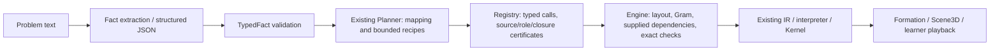

# Goal-directed Planner generalization audit — LOCAL, 2026-10-14

**Decision: NEXT_PLANNER_SLICE_DESIGN_READY**, for ONE proposed slice: source-bound result operands + bounded effect-driven
point–line distance resolution in the existing Planner. Design/preregistration only; no product implementation authorized
or performed. Source baseline main/origin/remote 2a3c0787; candidate 26698338… / 110 files, cache 125 / LLM_ONLY/Hybrid off.
Probe inputs committed before execution at a3907cc3. Run metadata in run.json; receipt hashes in gates.json; no full T3 or browser rerun.

## 1. How much of the lecturer's goal is achieved?

Research route B demonstrably separates fact extraction from deterministic function selection/geometry and composes
existing functions for registered goals across several solids. Exact verification, dependency/causal trace and Scene3D
are implemented. Group A is useful reusable geometry, not a solver for arbitrary new dependency structures or goals.
The default API product still uses LLM_ONLY Semantic Program synthesis; the research route is not enabled there.
No subjective percentage or unbounded generality claim. Gemini extraction of new reference facts remains unmeasured.

## 2. Actual architecture from source

The proposed sequence "grounding then Planner" is not today's execution order. Planner first validates TypedFacts/roles
and proposes calls; Registry grounds them before Engine owns/executes geometry. A planned input is not already verified.

This audit substitutes explicit fixtures for X; no Gemini or product E2E measurement. Source-map.json pins function spans
and file hashes. Relevant authoritative locations:

| Component | Input → output / authority / stop |
|---|---|
| fact_extraction.py:51,107 | Text → TypedFact structured response via run_ai_fact_route; model proposes roles/quotes, no coordinates or function program. Fake adapter tested previously; live reliability not measured here |
| planner.py:42,178 | TypedFact/role validation → KeHoach calls/auxiliary/trace; ambiguity/condition/schema stops. No geometry state, search or Registry effect scan |
| planner.py:380,426,489 | Quantity/operand arity chooses named functions; point-line distance and derived-plane section use fixed depth 1 expansions; fresh labels/memoized planes, finite budgets |
| registry.py:248,392,655,880 | FunctionSpec args and doc_ke_hoach validate IDs/types/dependencies; kiem_nguon/_kiem_phu own source semantics, roles, labels, values and declared auxiliary permissions. No model-supplied postcondition is trusted |
| engine.py:383,620,728,918,1022 | Supplied calls → canonical layout/Gram, point dependency fixed point, exact consistency/construction checks, IR. Geometry Functions reuse interpreter/Kernel. Nonunique/unsupported/missing geometry refuses |
| function_route.py:65,102 | Calls/facts → Engine result → existing simulation_state/formation/scene3d; proof/negation kept separate, observed true-on-one-configuration is not proof. No LLM_ONLY fallback |
| frontend scene3d-model/view | Authoritative snapshots → objectsAt/geometryTimeline, visibility/selection/orbit/playback; geometry arithmetic stays backend, formation steps are presentation |

Goal success requires supported obligations/answer mapping, verified geometry/final memory and a scene. This is not generic
proof-goal completion. Input point producers are scheduled until dependencies resolve; that is not forward chaining over
unregistered functions. Registry contains no machine-readable planning precondition/effect catalog.

## 3. Composition versus hardcoding

| Class | Implemented examples | Interpretation |
|---|---|---|
| A General primitive | midpoint, projection, intersections, translate, plane/section/measure IR | General geometric functions with exact domains; valid rules, not per-question answers |
| B Reusable composition | Shared derived plane reused for construction+area; canonical producer dependency closure | Real reuse/memoization, but not arbitrary function-chain discovery |
| C Goal-specific rule | `_phan_ra` foot→length; `_mat_qua_diem` two translates→plane/section; quantity dispatch | Broadly reusable mathematics, explicitly programmed function sequences |
| D Family-specific mechanisms | Engine base/chart, pyramid apex/height and prism layout cases; regular/cube/tetra definitions | Canonical modeling/support rules. No evidence of Planner recipes keyed to benchmark IDs/vertex names/numbers; do not label every geometric definition as bad hardcoding |
| E Grounding restrictions | Closed phrases/quotes, point/plane anchoring, role/value/negation guards | Independent limitation, demonstrated by wording false refusal; not a search failure |
| F Presentation | solid-first partition, formation faces/height, learner grouping, label placement | Not evidence of geometric inference or planning generality |

The selected-function names/ordered recipes are hardcoded by goal, not by sample labels. Planner does not try alternative
compositions, infer an arbitrary unseen goal, or discover a new Registry function merely because it was added. Adding a
new function still requires implementation/source domain and mapping/rule changes. No current generic backward chaining;
only goal-specific decomposition and Engine's supplied-dependency scheduling/limited geometric normalization.

## 4. Group A value and discriminating probes

Group A reuses translate_point, vector_from_points, construct_plane, section/measure and exact predicates/Gram. Planner
chooses function calls, fresh labels, directions from typed endpoints and shared-plane identity; the two-translate recipe
and source/verification certificate were written for this goal relation. Swapping solids/labels does not create a new
planning algorithm. Changing to an unrepresented goal/ref fails before such a plan can be generated. Group B currently
requires a distinct semantic/source/containment contract; this audit does not implement it or assume that a new search
alone makes its geometry unique.

14 diagnostic cases, labels frozen before running. Details probes.json/baseline.json/probe-summary.json; NOT_HELD_OUT.

| Group | Served correctly | Refused | First stop / meaning |
|---|---:|---:|---|
| Same structure/wording | 2 | 1 | wording-control: SOURCE_PREMISE_UNREAD, valid source conservatively refused; grounding, not planning |
| Same family/new supplied dependency | 2 | 1 | Reordered facts/nested midpoints supported; proposed line_ref schema refused |
| Different family/same primitives | 2 | 2 | Existing prism/cuboid recipes work; two proposed result-reference transports refused |
| Negative controls | 0 | 4 | Dependent directions, missing quote, condition and contradiction all fail closed |

Wrong served: 0 across 6 actual serves. Valid CURRENT-transport corpus: 6 correct served / 4 correct refused / 1 false refusal.
Separate proposed-field diagnostics: 3 SCHEMA_INVALID refusals of mathematically valid goals, intentionally outside current
TypedFact schema. They are transport capability gaps, not evidence of Planner execution on valid facts. Considering the
mathematical requests broadly there are 4 unserved valid requests, but do not mix the three synthetic-transport refusals
into current-contract safety metrics. Extraction reliability NOT_MEASURED. Initial exact-code prediction for condition
was CONDITIONAL_FACT; actual CONDITIONAL_CLAUSE is a correct negative refusal. Neither expectation was rewritten.

Independent analytic squared-distance targets 10/11, 5, 3 were registered before execution. Existing source-grounded
intersection-line/length controls generate real Engine IR, then diagnostic adapters append existing project_onto/measure
statements on that line object. All 3 IR witnesses PASS with canonical Gram. This proves the lower geometric chain exists,
NOT full-source serving of the unsupported distance request. No production resolver/unchecked direct-IR service added.

## 5. Root cause and one next slice

Actionable bottleneck in this audited domain: function results lack first-class source-bound operands and declarative
effects usable for candidate generation. Example: engine.py:941 emits gt_g as line3, ProjectionLineArgs accepts endpoint
Seg, TypedFact question has no line result reference, FunctionSpec lacks planning effects. Schema probes alone cannot
prove search failure; these source facts plus working lower IR witnesses establish the composability obstruction.

One proposed slice: `next-slice-preregistration.md`. Three existing function contracts, a bounded typed-need resolver
inside current Planner, producer bindings and same Registry/Engine authority. Named-line two-step versus derived-line
three-step versus supplied-foot measurement are selected from effects/available producers. No per-family recipe, new
Geometry Function, second state/Planner/DSL or Kernel algorithm. Full generic search is premature while functions cannot
consume their results; one more dedicated recipe would preserve the same coupling. Gap matrix: gap-matrix.md.

Modules to change NEXT turn: existing planner/registry/engine/fact_extraction/function_route; existing IR/Kernel/formation/
frontend reused. Future A/B provider surfaces must be intentionally re-pinned for references; none change in this audit.
New measured product needs candidate/refreeze/T3/review in that implementation turn; current product candidate unchanged.
Six positive and12 concrete negative future fixtures, RED/GREEN sequence, source adversaries, oracle, budgets and browser
criteria are registered; no new held-out claim. Prior wording false refusal remains a separately recorded language limit.

## 6. Frontend reuse and decision boundaries

frontend-reuse.md shows Workspace/Explorer/model, orbit/zoom/reset, labels/highlight/hidden lines/planes/sections/playback/
harness already exist. Product grid toggle exists (Explorer:466→view GridHelper); sparse faint diagonal background is ADAPT,
not absent grid functionality. Vector3 is nondrawable by model contract, so arrows are MISSING display, not missing vector
math. `(P)` metadata exists; canvas caption still missing. No proven duplicate renderer; no consolidation proposed.
All UI changes deferred; this inventory does not replace Planner research or solve orbit instability.

## 7. Git/gates/preservation and next action

New branch from synchronized main2a3c0787. No product/model/cache change, no live Gemini, merge or push, no full T3.
Candidate verify, docs/identity/audit and receipt/preservation hashes: gates.json. Protected assets/ref snapshots and cleanup
in preservation.json. No server/browser/worktree or DB/scratch created for these short probes; the empty task-owned pytest basetemp was removed. Existing pre-protected
cache/ignore warnings stay untouched. Historical benchmark/evidence labels/bytes unchanged; not rescored/pooled.

Canonical next action supersedes Scene3D priority per user's explicit decision: user review/authorization of this ONE
result-binding Planner slice. Backlog Scene3D and Hybrid production blockers remain OPEN. Commit role SELF in run.json.
Design ready does not authorize implementation; next turn must receive that decision. Claude remains primary agent.
