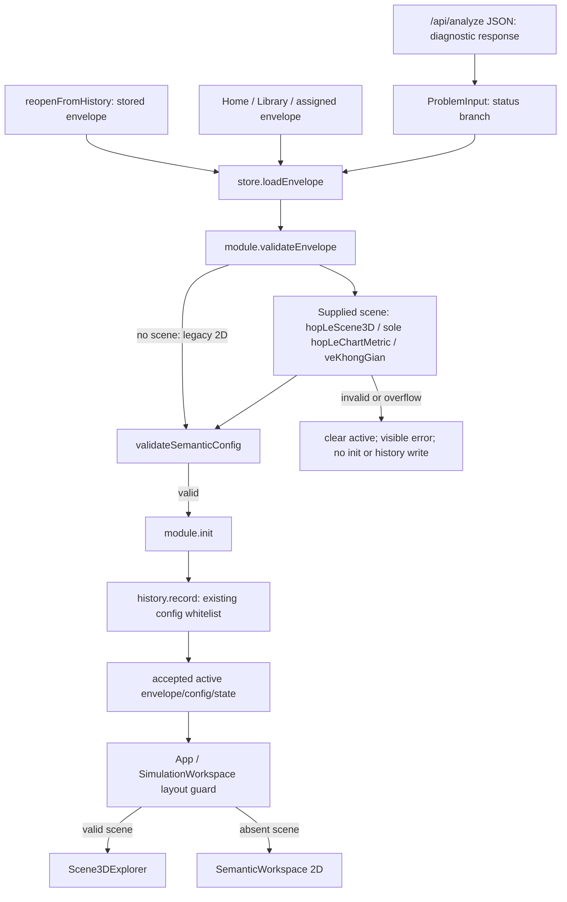

# Scene3D final safety closeout — F2

Owner scope: retain M2 #7, finish the metric acceptance boundary only. No GO MAIN, HUMAN_ACCEPTED or GO LIVE.

## Candidate identity

- Branch: `research/scene3d-plane-grid-camera`; preflight `5f77bfcea4e63aa4bc638d8d9a90eca9d0a74141` clean.
- Main remains `90fe44df9fd600bf0eded87a316b8e6dddc29cc5`.
- Product: `cb1f4954a7243de0561b3e724b7b2e94cb36bffc`; test-only follow-up `216bbf84beb4a2bbd0e6d6c688a4f3e4becf24bc`;
  final refreeze/candidate: `14c26f3f0b95cfae0312e17a6b445ecd51825565`.
- Authoritative candidate runs in fresh detached worktree `.superpowers/worktrees/t3-scene3d-metric-clean`, clean before
  gates. Earlier candidate `2160fbcf` was superseded after its lifecycle spy failed; no product code changed.
- Measured system: 111 files, SHA-256 `045a8a628c7923d68d6eae6446a30d24be08d900f673293b8e74661a21c44ccc`.
- Frontend source tree (includes tests): `2404de2129b4d69ce59289b1d8919ba7e8419bb5`; backend app tree:
  `a7aaf0f99e1d6512d8f715f7879c52577f63516e` (backend unchanged).
- `LLM_ONLY`, cache 125, provider surfaces unchanged, zero live provider requests.

## Correction to the previous F2 conclusion

This corrects `scene3d-plane-grid-camera/pre-main-audit.md` §8 without editing its bytes. At `8e2235e7`, invalid
`chart_metric` could enter active state and history; the shell selected 2D instead of 3D. That was renderer protection,
not rejection of invalid accepted simulation data. The previous claim that the only remaining condition was visual
review was too strong.

Now the registered semantic module owns `validateEnvelope`, returning the existing `ConfigResult`. The store calls
it through the module contract, catches rejection/throws, and only proceeds to init, record and active on success.
The domain uses the existing `hopLeScene3D` and sole `hopLeChartMetric`; `maTranKhung` delegates to that authority.
Actual `veKhongGian` conversion is checked before acceptance. Malformed/non-SPD/nonfinite metrics and nonrepresentable
transformed coordinates reject the entire envelope with a visible home-page error. They never silently fall back to 2D.
`xau` refuses nonfinite scaled numbers and magnitudes >= 1e21, where the existing integer/fraction serializer would
emit exponent notation. This is a display limit, not a claim that the mathematical input is inconsistent.

The API client still returns diagnostic JSON; `status: ok` is not frontend acceptance. Rejected input is not promoted
to `active`, initialized, or recorded. Errors clear stale active/history ID/playing so a rejected history reopen cannot
restore progress into the previously active simulation. No domain/Geometry import or metric-specific branch exists
in `store.ts`: **M2 #7 PASS** (`hybrid-preview-contract.test.tsx`, independent `review.md`).

History schema/storage/records were not migrated, deleted or rewritten. The existing whitelist stores config and
omits Scene3D. Therefore old history can lack the original metric: its 3D provenance is not recoverable from storage.
Such records remain legacy 2D, independently checked by `validateSemanticConfig` and `init`; the UI makes no Scene3D
observation/verification claim. Present but invalid Scene3D is rejected. This preserves old records and valid LLM_ONLY
behavior without treating lost metric data as proof of valid 3D.

The complete acceptance path (including offline samples and history reopening) is:

`llm/client.ts` only transports JSON; it cannot grant acceptance. `state/history.ts` is storage, not a geometry
authority. Its direct record API is not called by another product loader. `SessionCard.progressOf` may read legacy
config to show a step count, but never reads a metric or renders a scene; opening the simulation always re-enters
the module boundary. No accepted bad metric can be restored via cursor/mode or visual-mode toggling.

## Verification

**FINAL_SCENE3D_PRE_MAIN_READY** — technical closeout only; human acceptance remains NOT_GRANTED.

| Final candidate `14c26f3f` | Result |
|---|---|
| Full T3 (`authoritative-t3.json`) | **FULL_PRODUCT_GATE_PASS**, exit 0 |
| Backend | 10828 passed, 1 skipped, 2 deselected, 9 inherited xfailed |
| Frontend | 70 files, 1133 passed |
| Production typecheck/build | PASS |
| Demo / crash boundaries | 5/5 + reduced chain 1/1; 6/6 boundaries, 0 uncaught 500 |
| Freeze | MATCH, 111 files / `045a8a628c7923d6…` |
| Orbit (`orbit-clean/ORBIT_GATE.json`) | p1/p6/p7 DAT, ~449 degrees, stable Z, no snap |
| Fixtures / browser / docs | 41/41 unchanged; 8/8; 42/42 |
| M2 #7 / independent review | PASS / PASS, no must-fix |

Complete raw T3 output is retained outside docs/git; its SHA-256 is in `authoritative-t3.json`. The committed
`t3-summary.log` is explicitly a derived summary. The checkout stayed clean after T3; rebuilt dist SHA-256 values match
the browser receipt exactly. Commits after the candidate contain docs/evidence only; checks are in `final-checks.json`.

Machine status, commands, hashes and final counts: `run.json` (authoritative receipt). Baseline RED is recorded in
`diagnostics.json` / `diagnostics-complete.json` (raw logs retained locally outside docs/git); GREEN in `targeted-tests.log`
(128 tests, 5 files). RED established direct-store,
API, history/stale-active, fallback and finite-SPD overflow failures before the fix. Existing malformed-scene fallback
expectations were changed to whole-envelope rejection. Additional null-scene/config and validator-throw controls pass.
All 41 adapter fixtures retain their response SHA-256 checks in the contract suite. Offline regeneration also verifies
all 41 with no response/input/expectation differences. `same_source_fingerprint = false` is expected: the measured
surface includes the changed frontend semantic module, while the backend and served fixture content remain unchanged.

Real production-build browser receipts: `browser-clean/boundary-browser.json`, 8/8 with no page exceptions. Five
synthetic faults show visible error, no 2D/3D stage and no history; valid 3D and legacy 2D each open and record once;
F4 emits zero observations. Fault payloads are labelled synthetic and are not frozen adapter results.
The initial browser attempt used the wrong legacy CSS selector; its timeout is a harness error, corrected without
product changes. Initial sandbox T3 had a pytest temp-directory permission error, reproduced independently; the final
sandbox retry used a fresh task-owned `PYTEST_DEBUG_TEMPROOT`. The final full run also requires Windows process-tree
permissions for its watchdog tests. Initial orbit CDP startup timed out; rerun status is in `run.json`.
None of these incomplete attempts is counted as PASS.

The first complete T3 at `2160fbcf` failed two Windows watchdog tests because sandbox denied taskkill, plus a lifecycle
test spying the old module method. The watchdog file passed 14/14 with required execution permissions; the test-only
follow-up now spies `validateEnvelope`, asserts restored active and still checks no network. Full frontend passed
70 files / 1133 tests before the final clean T3. Final full T3 runs with watchdog permissions and no gate skipped.

An additional full attempt at `14c26f3f` passed backend 10828 and frontend 1133, demo and crash gates, but failed Vite
cleanup with EPERM: its generated dist had been created by the sandbox identity before the gate ran as the user.
That attempt remains FAIL in local raw diagnostics. The authoritative retry uses a new clean checkout at the SAME
candidate, with one Windows identity for all build/test operations; no source or test changes were made for this retry.

## Deferred Hybrid integration

F3/F4/F5/F6 remain OPEN in `OPEN_ISSUES.md::ISSUE-ARCH-HYBRID-FRONTEND-OFFLINE-INTEGRATION`, blockers before GO HYBRID:
symbolic answers with units, wrapper transport and relation/step anchoring, pre-construction verification-gap labels,
UNKNOWN source wording and missing SOURCE fixture/stage semantics. They do not block this Scene3D closeout while the
feature remains locked. No Product E2E PASS is claimed.

F4 containment: contract keeps `route_d` outside the envelope; the shell reads only `active.envelope.route_d`.
`/api/analyze` uses product policy, not preview identity; browser has no `/api/preview/hybrid` caller; server preview
rejects Origin. The product-path H07 browser control emits no observation. This is containment of current producers,
not verification of arbitrary injected nested `route_d`. No preview endpoint was wired to the browser.

Independent reviewer: `review.md`, PASS F2/M2 #7, no must-fix; test execution by primary agent only. Existing shallow
Scene3D shape checks are not comprehensive schema validation or independent mathematical correctness proof.
Reused modules: registry/module validation, semantic config validator, chart guard/transform, history and fixtures.
Created product modules: none. Duplicate check: one `hopLeChartMetric` definition. No dependency cycle introduced.

Human visual review: **HUMAN_VISUAL_REVIEW_PENDING**. Final readiness requires every automated gate in `run.json` to
pass; human acceptance remains a separate owner decision. No merge/push/Hybrid activation, DB/evidence/worktree cleanup.
