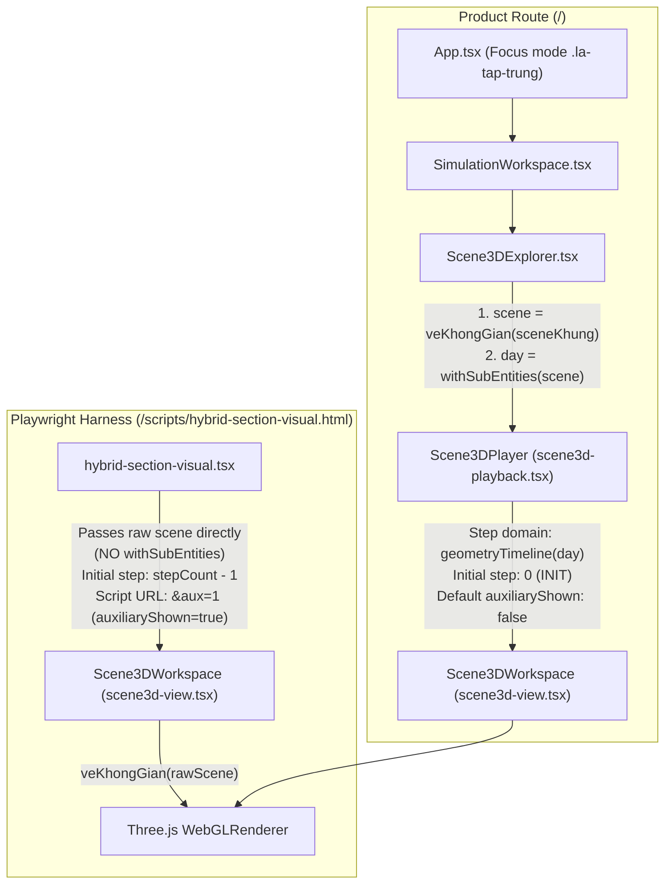

# ALGOSIM — SCENE3D PRODUCT–HARNESS VISUAL PARITY & READABILITY AUDIT (W0)

- **Run ID:** `scene3d-visual-parity-audit` (`scene3d-visual-parity-audit-w00`)
- **Issue Investigated:** `ISSUE-ARCH-SCENE3D-CONSTRUCTION-READABILITY`
- **Status:** `SCENE3D_W0_BASELINE_AUDIT_COMPLETE`
- **Baseline Commit:** `f83b4ed14995c89d6cf00a643cd14c814c78004c` (`research/source-bound-result-planning`)
- **Product Commit:** `55c657b8be715cda0edcc9e6e2ec1b3a204bdb65`
- **Candidate Tree Hash:** `30808cb002b377e4ad68f224363ef58ab6e51e0facba7e2d4c501419f58d91dc` (110 files, `CACHE_VERSION = 125`, `DEFAULT_MODE = LLM_ONLY`)
- **Live Model Calls:** `0` (`ALLOW_LIVE_AI=0`)

---

## 1. Baseline Commit & Candidate Identity Verification

| Check | Value / Result | Status |
|---|---|---|
| Baseline branch HEAD (`research/source-bound-result-planning`) | `f83b4ed14995c89d6cf00a643cd14c814c78004c` | VERIFIED |
| Main branch HEAD (`main`) | `2a3c0787cc35d2e5530d77658225039ab4c5991e` | UNTOUCHED |
| Product commit (`EVALUATION_CANDIDATE.json`) | `55c657b8be715cda0edcc9e6e2ec1b3a204bdb65` | VERIFIED |
| Candidate tree SHA-256 (`freeze_evaluation_candidate.py --verify`) | `30808cb002b377e4ad68f224363ef58ab6e51e0facba7e2d4c501419f58d91dc` | PASS (110 files) |
| Locked scene fixture re-export (`export_result_binding_scenes.py`, `export_hybrid_section_scenes.py`) | `0` byte diff against committed `visual/scenes.json` | PASS (100% deterministic) |
| Untracked user files (`frontend/public/favicon.svg`) | Preserved intact | PASS |

---

## 2. Selected Audit Cases & Rationale

We audited **11 official locked fixtures** (0 live LLM calls) covering all 5 required geometric construction groups (**G1–G5**):

| Case ID | Source Fixture | Group Coverage | Solid Topology & Chart Metric | Key Constructions Audited |
|---|---|---|---|---|
| `section-MAB-trapezoid` | `goal-directed-section-planning/visual/scenes.json[0]` | **G1, G4** (Basic 3D solid + Cutting plane & section) | Pyramid `S.ABCD`, $G = \text{diag}(4,4,9)$ | Base `ABCD`, lateral edges, midpoint `M` on `SC`, plane `(MAB)`, 4-edge trapezoid section `td_f6` |
| `aux-foot-S-to-BD` | `goal-directed-section-planning/visual/scenes.json[5]` | **G2** (Perpendicular foot / distance to named line) | Pyramid `S.ABCD`, $G = \text{diag}(4,4,9)$ | Line `derived_H_line` (`BD`), projection foot `H` from `S` onto `BD`, `perpendicular_witness` |
| `intersection-SAB-SCD` | `goal-directed-section-planning/visual/scenes.json[4]` | **G3** (Plane–plane intersection line) | Pyramid `S.ABCD`, $G = \text{diag}(4,4,9)$ | Planes `plane_SAB`, `plane_SCD`, intersection line `gt_g` through `S` parallel to `AB, CD` |
| `derived-line-pyramid` | `source-bound-result-planning/visual/scenes.json[0]` | **G2, G3, G5** (Distance to derived intersection line in pyramid) | Pyramid `S.ABCD`, $G = \text{diag}(4,4,9)$ | Midpoint `M`, planes `mp1_gt_g=(SAC)`, `mp2_gt_g=(SBD)`, intersection line `gt_g`, foot `H` from `M` to `gt_g` |
| `derived-line-cuboid` | `source-bound-result-planning/visual/scenes.json[1]` | **G2, G3, G5** (Distance to derived intersection line in cuboid, zero-Segment degenerate foot $H=B$) | Cuboid `ABCD.A'B'C'D'`, $G = \text{diag}(4,16,9)$ | Planes `mp1_gt_g=(A'BD)`, `mp2_gt_g=(ABB'A')`, line `gt_g` (`A'B`), foot `H` from `A` to `gt_g` |
| `derived-line-prism` | `source-bound-result-planning/visual/scenes.json[2]` | **G2, G3, G5** (Distance to derived intersection line in triangular prism, non-diagonal metric) | Prism `ABC.A'B'C'`, $G = \begin{pmatrix}4 & 2 & 0\\2 & 4 & 0\\0 & 0 & 9\end{pmatrix}$ | Planes `mp1_gt_g=(A'BC)`, `mp2_gt_g=(ABB'A')`, line `gt_g` (`A'B`), foot `H` from `A` to `gt_g` |
| `two-line-pyramid` | `pedagogical-construction-sequencing/visual/scenes.json[0]` | **G3, G4, G5** (Plane through point parallel to 2 lines + section area in pyramid) | Pyramid `S.ABCD`, $G = \text{diag}(4,4,9)$ | Midpoint `M`, direction vectors `BC, AS`, translated points `H, H1`, plane `(P)`, trapezoid section `td_q` |
| `two-line-prism` | `pedagogical-construction-sequencing/visual/scenes.json[1]` | **G3, G4, G5** (Plane through point parallel to 2 lines + section area in prism) | Prism `ABC.A'B'C'`, $G = \begin{pmatrix}4 & 2 & 0\\2 & 4 & 0\\0 & 0 & 9\end{pmatrix}$ | Midpoint `M`, direction vectors `BC, BB'`, translated points `H, H1`, plane `(P)`, rectangle section `td_q` |
| `two-line-cuboid` | `pedagogical-construction-sequencing/visual/scenes.json[2]` | **G3, G4, G5** (Plane through point parallel to 2 lines + section area in cuboid) | Cuboid `ABCD.A'B'C'D'`, $G = \text{diag}(4,16,9)$ | Midpoint `M`, direction vectors `BD, AA'`, translated points `H, H1`, plane `(P)`, rectangle section `td_q` |
| `rectangular_pyramid_positive` | `w18-binding-focus/inputs/fixtures/rectangular_pyramid_positive.json` | **G1** (Locked Product envelope for basic pyramid volume) | Pyramid `S.ABCD`, $G = \text{diag}(9,16,36)$ | Full Product envelope with quantity readouts (`AB=3, AD=4, SA=6, V=24`) |
| `p1_chop_thiet_dien_khoang_cach` | `product-ui-result-rendering/fixtures/p1_chop_thiet_dien_khoang_cach.json` | **G1, G2, G4, G5** (Locked Product envelope with section & distance in $Oxyz$) | Pyramid `S.ABCD`, $G = I_3$ | Coordinate space $Oxyz$, plane $z=3$, section `(T)`, distance from `S` to `BD` |

---

## 3. Product vs. Harness Architecture Comparison

| Architectural Dimension | Real Product (`/`) | Playwright Harness (`/scripts/hybrid-section-visual.html`) | Parity Verdict |
|---|---|---|---|
| **Chart-to-World Mapping** | `veKhongGian(sceneKhung)` called in `Scene3DExplorer.tsx:207` (and idempotently in `Scene3DWorkspace`) | `veKhongGian(rawScene)` called in `Scene3DWorkspace` (`scene3d-view.tsx:1777`) | **SHARED** (Both suffer from `FINDING-B1`) |
| **Sub-Entity Expansion (`withSubEntities`)** | **ENABLED** (`Scene3DExplorer.tsx:210` adds `solid::face:i`, `solid::edge:a-b`, `td::face:0`, `td::vertex:i`, `td::edge:i`) | **OMITTED** (`hybrid-section-visual.tsx` passes raw scene without `withSubEntities`) | **DIVERGENT (`FINDING-D1`)** |
| **Playback Step Domain** | Learner timeline via `geometryTimeline(day)` (skips `MEASUREMENT` steps, folds `FINAL_RESULT` into preceding construction anchor) | Raw event index `0 .. stepCount - 1` | **DIVERGENT (`FINDING-D2`)** |
| **Initial Step on Load** | `step = 0` (`INIT`, only free points visible) | `step = stepCount - 1` (final raw step) | **DIVERGENT (`FINDING-D2`)** |
| **Auxiliary Geometry Visibility (`auxiliaryShown`)** | Defaults to `false` (`hinhPhu = false` in `Scene3DExplorer.tsx:244`) | Defaults to `false`, **but** `result-binding-visual-check.mjs:31` hardcoded `&aux=1` (`true`) | **DIVERGENT (`FINDING-D3`)** |
| **Camera Pose & Auto-Framing** | `cameraPose(scene)` + `autoFrameCamera` (`FOV=40°`, `pad=1.22`) inside `Scene3DWorkspace` | Identical `cameraPose(scene)` + `autoFrameCamera` inside `Scene3DWorkspace` | **SHARED** (`camera_position` and `camera_target` match to $10^{-16}$) |
| **Canvas Viewport Size (at 1280×900)** | `1231 × 779` px (full-height focus stage `.geo3d-san` with floating buttons `.geo3d-noi`) | `1231 × 520` px (fixed `height: 520px` in harness CSS) | **DIVERGENT (`FINDING-D4`)** |

---

## 4. Visual Parity Findings Table (Product vs. Harness Telemetry)

All measurements below are extracted directly from `results/parity_telemetry.json` (`console_errors: 0`, `page_errors: 0`):

| Case ID | Harness Final (`aux=1`) Base / Sub Objects | Product Init (`step=0, aux=0`) Base / Sub Objects | Product Final (`aux=0`) Base / Sub Objects | Product `auxiliary_hidden_ids` at Final (`aux=0`) | Product `witness_ids` at Final (`aux=0`) | Canvas Diff Ratio: Product Final (`aux=0`) vs Harness Final (`aux=1`) | Canvas Diff Ratio: Product Final (`aux=0`) vs Harness Final (`aux=0`) |
|---|---:|---:|---:|---|---|---:|---:|
| `section-MAB-trapezoid` | `14 / 0` | `5 / 0` | `14 / 18` | `[]` | `[]` | `0.2166` | `0.2166` |
| `aux-foot-S-to-BD` | `13 / 0` | `5 / 0` | `12 / 13` | `["derived_H_line"]` | `["perpendicular:H"]` | `0.1205` | `0.1203` |
| `intersection-SAB-SCD` | `14 / 0` | `5 / 0` | `14 / 13` | `[]` | `[]` | `0.2714` | `0.2714` |
| `derived-line-pyramid` | `16 / 0` | `5 / 0` | `13 / 13` | `["gt_g", "mp1_gt_g", "mp2_gt_g"]` | `["perpendicular:H"]` | `0.4869` | `0.1736` |
| `derived-line-cuboid` | `20 / 0` | `8 / 0` | `17 / 18` | `["gt_g", "mp1_gt_g", "mp2_gt_g"]` | `["perpendicular:H"]` | `0.3677` | `0.3081` |
| `derived-line-prism` | `17 / 0` | `6 / 0` | `14 / 14` | `["gt_g", "mp1_gt_g", "mp2_gt_g"]` | `["perpendicular:H"]` | `0.3245` | `0.2158` |
| `two-line-pyramid` | `16 / 0` | `5 / 0` | `16 / 18` | `[]` | `[]` | `0.2731` | `0.2731` |
| `two-line-prism` | `17 / 0` | `6 / 0` | `17 / 19` | `[]` | `[]` | `0.4753` | `0.4753` |
| `two-line-cuboid` | `20 / 0` | `8 / 0` | `20 / 23` | `[]` | `[]` | `0.3816` | `0.3816` |
| `rectangular_pyramid_positive` | N/A | `5 / 0` | `11 / 13` | `[]` | `[]` | N/A | N/A |
| `p1_chop_thiet_dien_khoang_cach` | N/A | `5 / 0` | `10 / 22` | `[]` | `[]` | N/A | N/A |

### Key Visual Parity Observations Confirmed by Direct Screenshot Inspection

1. **Solid Face Amber Tinting (`FINDING-D1` / `C1`):** In every single Product screenshot (`images/product/*_final_aux0_page.png`), the solid (`S.ABCD`, `ABCD.A'B'C'D'`, `ABC.A'B'C'`) is tinted warm brown-amber because `withSubEntities` adds `solid::face:0..k` (`type: "face", render: "polygon"`), which `buildObject3D` (`scene3d-view.tsx:1138-1154`) renders as translucent amber meshes (`0xd97706`, `opacity: 0.14`) coplanar with the solid's own slate-blue faces (`0x475569`, `opacity: 0.13`). In Harness (`images/harness/*`), `withSubEntities` is not called, so the solid renders in neutral slate-blue.
2. **Disappearance of Target Line `gt_g` and `derived_H_line` in Product (`FINDING-B2` / `D3`):** Compare `images/product/derived-line-pyramid_final_aux0_page.png` with `images/harness/derived-line-pyramid_final_aux1_page.png`: in Product's default state at the final step (`Bước 9/9`), `gt_g`, `mp1_gt_g`, and `mp2_gt_g` are completely hidden (`auxiliary_hidden_ids: ["gt_g", "mp1_gt_g", "mp2_gt_g"]`), leaving point `H` floating in the interior of the pyramid with no line passing through it. The exact same disappearance occurs for `derived_H_line` (`BD`) in `images/product/aux-foot-S-to-BD_final_aux0_page.png` (`Bước 6/6`).
3. **Premature Section Vertex Markers & Step Indexing (`FINDING-D1` / `D2`):** Compare `images/product/two-line-prism_step10_first_section_edge_aux0_page.png` (`Bước 11/14`) with `images/harness/two-line-prism_step10_first_section_edge_aux0_page.png` (`bước 11/17`). In Product, setting the scrubber to index `10` lands on raw step `12` (because `geometryTimeline` skips two `MEASUREMENT` vector steps), and all 4 red vertex spheres of the section (`td_q::vertex:0..3`) are already rendered before the section perimeter is even completed.

---

## 5. Geometry Correctness vs. Learner Readability Findings Table

Using `results/math_and_readability_oracle.json`, we strictly separated **backend mathematical correctness** (in chart/Gram space) from **frontend visual mapping & pedagogical readability**:

| Case ID | Backend Scene IR Math Oracle (Gram Metric $G$) | World-Space `H` (`T · H.xyz`) | Rendered Witness Foot (`H.perpendicular_witness.foot`) | Witness Endpoint Error $\|\text{foot}_{\text{rendered}} - H_{\text{world}}\|_2$ | Target Carrier Visible at Final Step (`aux=0`)? | Coincident / Overlapping Labels or Off-Solid Points |
|---|---|---|---|:---:|:---:|---|
| `section-MAB-trapezoid` | **PASS** (4 vertices coplanar on `(MAB)` & on solid edges) | N/A | N/A | `0.0` | Yes (`td_f6`) | Cutting plane `(MAB)` stays permanently visible over closed section |
| `aux-foot-S-to-BD` | **PASS** ($H=(1/2,1/2,0) \in BD$, $(S-H)^T G (D-B)=0$, $d=\sqrt{11}$) | `[1.0, 1.0, 0.0]` | `[0.5, 0.5, 0.0]` | **`0.707107`** (FAIL `B1`) | **NO** (`derived_H_line` hidden, FAIL `B2`) | Right-angle hook floats near `A`; diagonal `BD` missing at final step |
| `intersection-SAB-SCD` | **PASS** ($S \in gt_g$, $d=(1,0,0) \perp n_{SAB}, n_{SCD}$) | N/A | N/A | `0.0` | Yes (`gt_g`) | 2 full-solid planes `plane_SAB`, `plane_SCD` stay permanently visible |
| `derived-line-pyramid` | **PASS** ($H=(5/11,5/11,3/11) \in gt_g$, $(M-H)^T G d = 0$, $d=\sqrt{77}/11$) | `[0.9091, 0.9091, 0.2727]` | `[0.4545, 0.4545, 0.0909]` | **`0.668153`** (FAIL `B1`) | **NO** (`gt_g` hidden, FAIL `B2`) | Witness segment from `M` ends in empty space; `gt_g` disappears |
| `derived-line-cuboid` | **PASS** ($H=(1,0,0)=B \in gt_g$, $(A-H)^T G d = 0$, $d=2$) | `[2.0, 0.0, 0.0]` | `[1.0, 0.0, 0.0]` | **`1.000000`** (FAIL `B1`) | **NO** (`gt_g` hidden, FAIL `B2`) | `H` coincides with vertex `B` (`[2,0,0]`, label `H` hides `B`); witness goes to midpoint `[1,0,0]` |
| `derived-line-prism` | **PASS** ($H=(1,0,0)=B \in gt_g$, $(A-H)^T G d = 0$, $d=2$) | `[2.0, 0.0, 0.0]` | `[1.0, 0.0, 0.0]` | **`1.000000`** (FAIL `B1`) | **NO** (`gt_g` hidden, FAIL `B2`) | `H` coincides with vertex `B` (`[2,0,0]`, label `H` hides `B`); witness goes to midpoint `[1,0,0]` |
| `two-line-pyramid` | **PASS** (4 section vertices on `(P)`, area $= 9/4$) | N/A | N/A | `0.0` | Yes (`td_q`) | Off-solid point `H1=[1,0,3]` floats in air above/left of `S`; duplicate `td_q::vertex:0..1` on `M, H` |
| `two-line-prism` | **PASS** (4 section vertices on `(P)`, area $= 3$) | N/A | N/A | `0.0` | Yes (`td_q`) | Off-solid point `H=[1.5, 1.732, 0]` floats outside `BC`; duplicate `td_q::vertex:0..1` on `M, H1` |
| `two-line-cuboid` | **PASS** (4 section vertices on `(P)`, area $= 3\sqrt{5}$) | N/A | N/A | `0.0` | Yes (`td_q`) | Duplicate `td_q::vertex:0..2` on `M, H, H1`; cutting plane `(P)` stays visible |
| `rectangular_pyramid_positive` | **PASS** ($V = 24$) | N/A | N/A | `0.0` | Yes | Sub-entity amber face tinting (`khoi_S_ABCD::face:0..4`) |
| `p1_chop_thiet_dien_khoang_cach` | **PASS** ($G = I_3$, $V=72, S=9, d=3\sqrt{6}$) | N/A | N/A | `0.0` | Yes | No `perpendicular_witness` emitted in legacy `Oxyz` fixture |

---

## 6. Root Cause Classification Across Classes A, B, C, D, E

Full machine-readable details are recorded in `results/findings.json`. Below is the consolidated root-cause classification:

### Class A — Scene Data / IR (`backend/app/simulation/geometry_functions/engine.py`)
- **Verdict:** **100% Mathematically Correct (`all_cases_math_pass = true`).** Every point, vector, plane normal, intersection line, projection foot `H`, `perpendicular_witness`, and exact symbolic measurement in `scenes.json` satisfies the Euclidean inner product induced by `chart_metric` $G$.
- **`FINDING-A1` (`NONBLOCKING`):** Carrier lines (`gt_g`, `derived_H_line`) constructed as inputs to `foot_of_perpendicular_to_line` are emitted with `formation_roles: ["CONSTRUCT_AUXILIARY_GEOMETRY"]`, the same role used for intermediate planes (`mp1_gt_g`, `mp2_gt_g`). However, the frontend already has complete information in Scene IR (`o.perpendicular_witness`, `depends_on`, and `PRODUCE_GOAL_RESULT` / `CONSTRUCT_PROJECTED_FOOT`) to distinguish persistent target-witness carriers from disposable scaffolding without modifying Scene IR.

### Class B — Scene Mapping (`scene3d-chart.ts`, `scene3d-auxiliary.ts`, `scene3d-subentities.ts`, `scene3d-timeline.ts`)
- **`FINDING-B1` (`CRITICAL` — `frontend/src/simulations/domains/geometry/scene3d-chart.ts:53-70`):**
  - `veKhongGian(scene)` transforms `o.xyz` and `o.annotation.witness.{foot, marker.{u,v}}` by the upper-triangular Cholesky factor $T$ ($T^T T = G = \text{chart\_metric}$), **but completely omits `o.perpendicular_witness`!**
  - Consequently, `projectionWitnessesAt` (`scene3d-annotations.ts:154-164`) builds `perpendicular:H` from `M.xyz` (world space $T \cdot M$) to `o.perpendicular_witness.foot` (raw chart space $H_{\text{chart}} \ne T \cdot H_{\text{chart}}$), with untransformed marker axes `u, v`.
  - This produces a **0.668 to 1.000 world-unit displacement** between the dashed perpendicular witness endpoint/right-angle symbol and the rendered foot `H` across all 4 projection cases (`aux-foot-S-to-BD`, `derived-line-pyramid`, `derived-line-cuboid`, `derived-line-prism`).
- **`FINDING-B2` (`CRITICAL` — `frontend/src/simulations/domains/geometry/scene3d-auxiliary.ts:36-63` & `scene3d-timeline.ts:110-128`):**
  - `auxiliaryObjects` classifies any `line3`/`plane3` with `formation_roles == ["CONSTRUCT_AUXILIARY_GEOMETRY"]` and a non-quantity dependent (`H`) as disposable (`loai: "dung"`), setting `xongTai` to the raw step where `H` is created (e.g., raw step `8` in `derived-line-pyramid`, raw step `5` in `aux-foot-S-to-BD`).
  - Because the `FINAL_RESULT` measurement step (`q`) is at raw step `xongTai + 1` (`9` or `6`), and `geometryTimeline` folds `FINAL_RESULT` into `H`'s learner step (`anchor = 9 > 8`), at the final step (and even when clicking `H`'s learner step in Product!) `auxiliaryHiddenAt` hides `gt_g` and `derived_H_line` when `auxiliaryShown = false`.
  - Meanwhile, `coMatNhan` (`scene3d-view.tsx:1430`) computes `projectionWitnessesAt(scene, buoc)` from `objectsAt(scene, buoc)` without subtracting `auxiliaryHiddenAt`, leaving `H` and `perpendicular:H` visible while the line `H` lies on is hidden!
  - Conversely, in `two-line-*`, translated auxiliary `point3` objects (`H`, `H1` with `source.binding === "AUXILIARY"`) are ignored by `auxiliaryObjects` (which only checks `line3`/`plane3`), leaving off-solid construction points permanently floating in space.

### Class C — Renderer (`frontend/src/simulations/domains/geometry/scene3d-view.tsx`)
- **`FINDING-C1` (captured under `FINDING-D1` — `scene3d-view.tsx:1138-1154,1920-1929`):**
  - `withSubEntities` adds `solid::face:0..k` (`type: "face", render: "polygon"`) and `td::face:0` (`type: "face"`). `buildObject3D` renders every `type === "face"` object as an amber translucent polygon mesh (`MAU.polygon = 0xd97706`, `opacity: 0.14`) even when unselected, tinting all solid faces brown-amber and rendering `td::face:0` on the very first section edge step (bypassing `vatThietDienTaiBuoc`).
- **`FINDING-C2` (`IMPORTANT` — `scene3d-view.tsx:1256-1305`):**
  - Every `plane3` (`plane_patch`) projects all solid vertices (`diemNen`) onto the plane and expands the bounding rectangle by `padding = 0.22 * span` at `opacity = 0.26` (`0.42` when active). When 1–2 auxiliary/cutting planes (`mp1_gt_g`, `mp2_gt_g`, `mp_td_q`) cut through a solid, these oversized translucent sheets dominate the viewport and reduce contrast of internal lines and right-angle witnesses.

### Class D — Product–Harness Divergence (`Scene3DExplorer.tsx` vs. `hybrid-section-visual.tsx` & `result-binding-visual-check.mjs`)
- **`FINDING-D1` (`IMPORTANT`):** Product applies `withSubEntities(veKhongGian(scene))` (`Scene3DExplorer.tsx:210`), adding 13–23 sub-entities per scene; Harness (`hybrid-section-visual.tsx:32`) omits `withSubEntities`.
- **`FINDING-D2` (`IMPORTANT`):** Product starts at `step = 0` (`INIT`) and steps through `geometryTimeline` learner anchors; Harness starts at `step = stepCount - 1` and steps through raw event indices.
- **`FINDING-D3` (`IMPORTANT`):** Product defaults to `auxiliaryShown = false`; `result-binding-visual-check.mjs:31` passed `&aux=1` (`auxiliaryShown = true`), masking `FINDING-B2` during T3 visual checks.
- **`FINDING-D4` (`NONBLOCKING`):** Harness canvas is `1231×520` vs Product focus stage canvas `1231×779` at `1280×900` viewport.

### Class E — Interaction / UX (`scene3d-subentities.ts`, `scene3d-view.tsx`)
- **`FINDING-E1` (`IMPORTANT`):**
  1. Internal compiler IDs (`gt_g`, `mp1_gt_g`, `mp2_gt_g`, `derived_H_line`) leak into object `label`/`display_label` fields when inspected.
  2. When a projection foot `H` coincides with an existing solid vertex `B` (`derived-line-cuboid`, `derived-line-prism`, where $H = B = [2, 0, 0]$), both `B` and `H` render vertex markers at `[2, 0, 0]` and the priority-2 label `H` occludes the priority-1 vertex label `B` (instead of rendering a combined/offset label such as `B ≡ H` or offsetting `H`).
  3. `deriveSectionSubEntities` (`scene3d-subentities.ts:229`) creates `td::vertex:0..k` (`"Đỉnh 1".."Đỉnh k"`) at coordinates that duplicate existing named points (`M`, `H`).

---

## 7. Evidence Paths & Screenshot Hashes

### JSON Oracles & Telemetry
| Artifact Path | SHA-256 | Description |
|---|---|---|
| `docs/evaluation/geometry/runs/scene3d-visual-parity-audit/results/math_and_readability_oracle.json` | `9cda8f5ad7f30988f5147a2f998a6eddcbd0ec54627765f72449053e007e3cca` | Exact SymPy/Fraction Gram-metric coordinate, projection, plane, and section oracle across 10 fixtures |
| `docs/evaluation/geometry/runs/scene3d-visual-parity-audit/results/parity_telemetry.json` | `2bfc211cb00776a0677f6c9c2fcb1262741e3e3a1b2a5060abc182ac00c65bb0` | Full Playwright Chromium telemetry, pixel stats, canvas diff ratios, and screenshot SHA-256 index across 11 cases |
| `docs/evaluation/geometry/runs/scene3d-visual-parity-audit/results/findings.json` | `eaca19f6e7e35fe96b1826b11e964d4def30e1535f791a6d096ef0558e964b66` | Structured root-cause findings (`FINDING-B1`..`FINDING-D4`) across classes A–E |

### Key Representative Screenshot Hashes (Full 130-file index in `results/parity_telemetry.json`)
| Case & State | Screenshot Path | SHA-256 |
|---|---|---|
| `derived-line-pyramid` — Harness Final (`aux=1`) | `images/harness/derived-line-pyramid_final_aux1_page.png` | `bb60179bc0f71b7cc5cefd95bd537517a5337da7a153a54877c097b629880550` |
| `derived-line-pyramid` — Harness Final (`aux=0`) | `images/harness/derived-line-pyramid_final_aux0_page.png` | `07cb5ef46061b1ca3578eb4635ba2c4f97bb9225951639cb90273668e6e7fd94` |
| `derived-line-pyramid` — Product Init (`step=0, aux=0`) | `images/product/derived-line-pyramid_init_step00_aux0_page.png` | `6cf700b394b539477972327b47bd3051fb53fced87c28e6546ddd2606d49ac47` |
| `derived-line-pyramid` — Product Final (`aux=0`) | `images/product/derived-line-pyramid_final_aux0_page.png` | `a01df35e0a6375ad8c75ffad39fd0349f8775055632ad0fbbf7142a541cc7e17` |
| `derived-line-pyramid` — Product Final (`aux=1`) | `images/product/derived-line-pyramid_final_aux1_page.png` | `e2480366fcde36ce33e595e74f63aa9853b31036675b6a0808bb478642d1782b` |
| `aux-foot-S-to-BD` — Product Final (`aux=0`) | `images/product/aux-foot-S-to-BD_final_aux0_page.png` | `781f94b6dfaa99f2217a1019b7fd7db5f75bf5c8566256d575bf28eb38853bd0` |
| `aux-foot-S-to-BD` — Harness Final (`aux=1`) | `images/harness/aux-foot-S-to-BD_final_aux1_page.png` | `7f43922414833fa97cd3dc3c59272b850945791344df8f1b529047e180828070` |
| `derived-line-cuboid` — Product Final (`aux=0`) | `images/product/derived-line-cuboid_final_aux0_page.png` | `66a65be5075c341d81c1a9f7432a3ab7c6ef1899be02e1539535434157be9025` |
| `two-line-pyramid` — Product Final (`aux=0`) | `images/product/two-line-pyramid_final_aux0_page.png` | `2040a1d06d0ce0f77b392826bc6616c17ef095e5c78e468941e7bc74986d8cb3` |
| `two-line-prism` — Product Step 10 (`aux=0`) | `images/product/two-line-prism_step10_first_section_edge_aux0_page.png` | `4c992c541f57e272521bd2212650679215fa4ab3219fb059b49581a5458da9f9` |
| `p1_chop_thiet_dien_khoang_cach` — Product Final (`aux=0`) | `images/product/p1_chop_thiet_dien_khoang_cach_final_aux0_page.png` | `51c69c9a27974ef0f1aeab8d95484665b6c4a9c61f380e62887d5fd5d8be4087` |

*(All 130 PNG files in `images/harness/` and `images/product/` are indexed with exact byte-level SHA-256 hashes in `results/parity_telemetry.json`.)*

---

## 8. Reuse vs. Extension Matrix (Anti-Duplication Guard)

Per `docs/RULES.md` and `docs/CODE_INDEX.md`, **no new parallel modules, second renderers, or duplicate coordinate mappers may be created.** Every fix in W1–W3 extends an existing authoritative module in place:

| Existing Module | Current Responsibility | W1–W3 Action (`REUSE_AS_IS` vs `EXTEND_IN_PLACE`) | Rationale |
|---|---|---|---|
| `backend/app/simulation/geometry_functions/engine.py` | Emits Scene IR (`objects`, `events`, `formation`, `chart_metric`, `perpendicular_witness`) | **REUSE_AS_IS** in W1–W2 (optional display-label polish in W3 only if needed) | Backend Scene IR coordinates and Gram-metric projections are already 100% exact. |
| `frontend/src/simulations/domains/geometry/scene3d-chart.ts` | Maps chart coordinates to Euclidean world coordinates via Cholesky factor $T$ (`veKhongGian`, `doiDoiTuong`) | **EXTEND_IN_PLACE (W1)** | Add `o.perpendicular_witness` transformation alongside `o.annotation.witness` in `doiDoiTuong(o, T)`. |
| `frontend/src/simulations/domains/geometry/scene3d-auxiliary.ts` | Classifies auxiliary objects (`auxiliaryObjects`, `auxiliaryHiddenAt`) | **EXTEND_IN_PLACE (W1 & W2)** | W1: Keep target carrier lines (`gt_g`, `derived_H_line`) of active projection feet `H` visible (`loai: "co_dinh"` or `xongTai` bound to `H` visibility). W2: Classify temporary off-solid translated `point3` (`source.binding === "AUXILIARY"`) as disposable once their dependent plane is built. |
| `frontend/src/simulations/domains/geometry/scene3d-subentities.ts` | Derives selectable face/edge/vertex sub-entities (`withSubEntities`, `entitiesPresentAt`) | **EXTEND_IN_PLACE (W1 & W2)** | W1: Gate `td::face:0` on section closure and deduplicate `td::vertex:i` against existing named `point3`. |
| `frontend/src/simulations/domains/geometry/scene3d-view.tsx` | Three.js renderer (`buildObject3D`, `Scene3DWorkspace`, label layout) | **EXTEND_IN_PLACE (W1, W2, W3)** | W1: Do not render unselected `solid::face:i` as visible amber tint overlays. W2: Bound auxiliary `plane_patch` to defining vertices/triangle or lower passive opacity. W3: Coincident point label disambiguation (`B ≡ H`). |
| `frontend/scripts/hybrid-section-visual.tsx` | Browser visual harness entry point | **EXTEND_IN_PLACE (W1)** | Call `withSubEntities(scene)` by default (matching `Scene3DExplorer.tsx`) and expose learner timeline anchors + default `aux=0` state in `window.__scene3d_harness`. |
| `frontend/scripts/result-binding-visual-check.mjs` | Browser causal gate for Result Binding scenes | **EXTEND_IN_PLACE (W1)** | Test Product-default `aux=0` state first (asserting carrier line + witness endpoint incidence `||witness.foot - H.xyz|| < 1e-6`), then `aux=1`. |

---

## 9. Proposed W1–W3 Architecture Plan

### Wave 1 (W1): Product–Harness Parity & Chart-Metric Witness Fix (`CRITICAL` Closure)
- **Scope:** Close `FINDING-B1`, `FINDING-B2` (carrier line visibility), `FINDING-D1`, `FINDING-D2`, and `FINDING-D3`.
- **Files to Modify:**
  1. `frontend/src/simulations/domains/geometry/scene3d-chart.ts` (`doiDoiTuong`: transform `o.perpendicular_witness.foot` by `nhan(T, w.foot)` and `o.perpendicular_witness.marker.{u,v}` by `donVi(nhan(T, ...))`).
  2. `frontend/src/simulations/domains/geometry/scene3d-auxiliary.ts` (`auxiliaryObjects`: never hide a `line3`/`plane3` that is the projection carrier of a visible `CONSTRUCT_PROJECTED_FOOT` / `PRODUCE_GOAL_RESULT` point `H` or active `perpendicular_witness`).
  3. `frontend/src/simulations/domains/geometry/scene3d-subentities.ts` & `scene3d-view.tsx` (prevent unselected `solid::face:i` from tinting solid faces amber; gate `td::face:0` on section closure `vatThietDienTaiBuoc`; deduplicate `td::vertex:i` against existing `point3` at identical coordinates).
  4. `frontend/scripts/hybrid-section-visual.tsx` & `frontend/scripts/result-binding-visual-check.mjs` (enable `withSubEntities` in Harness so Product and Harness share the exact same object graph; verify `aux=0` default state and geometric incidence `||witness.foot - H.xyz|| < 1e-6`).
- **Acceptance Criteria & Regression Gates:**
  - RED $\to$ GREEN unit tests in `frontend/src/simulations/domains/geometry/__tests__/` asserting:
    - `||h.perpendicular_witness.foot - h.xyz|| < 1e-9` after `veKhongGian(scene)` across all non-identity `chart_metric` scenes (`aux-foot-S-to-BD`, `derived-line-pyramid`, `derived-line-cuboid`, `derived-line-prism`).
    - Target carrier lines (`gt_g`, `derived_H_line`) are **not** in `auxiliaryHiddenAt(scene, finalStep, false)`.
    - Product and Harness render the exact same `rendered_object_ids` at matched steps.

### Wave 2 (W2): Construction Readability & Auxiliary/Plane Visual Hierarchy (`IMPORTANT` Closure)
- **Scope:** Close `FINDING-C2` and the remaining auxiliary lifecycle items of `FINDING-B2`.
- **Files to Modify:**
  1. `frontend/src/simulations/domains/geometry/scene3d-view.tsx` (`buildObject3D` for `plane_patch`: when a plane is defined by 3 points on the solid, bound/clip its visual patch or render a compact polygon/fan over its defining points with subtle opacity `0.12–0.16` rather than an oversized bounding quad across the entire solid).
  2. `frontend/src/simulations/domains/geometry/scene3d-auxiliary.ts` (include temporary off-solid translated points `point3` with `source.binding === "AUXILIARY"` in `loai: "dung"` once their dependent plane is constructed, and de-emphasize/hide cutting planes `CONSTRUCT_CUTTING_OBJECT` once `CLOSE_SECTION` completes unless `auxiliaryShown = true` or selected).
- **Acceptance Criteria & Regression Gates:**
  - Off-solid translated construction points (`H1` in `two-line-pyramid`, `H` in `two-line-prism`) are hidden after plane `(P)` is constructed when `auxiliaryShown = false`, and re-shown when `auxiliaryShown = true`.
  - Auxiliary planes no longer obscure internal intersection lines or perpendicular witnesses.

### Wave 3 (W3): Coincident Point Labels, Display Notation & Pedagogical Polish (`IMPORTANT` / `NONBLOCKING` Closure)
- **Scope:** Close `FINDING-E1` and `FINDING-D4`.
- **Files to Modify:**
  1. `frontend/src/simulations/domains/geometry/scene3d-view.tsx` (when two visible `point3` objects share identical 3D world coordinates within $10^{-5}$, e.g. `B` and `H` in `derived-line-cuboid`/`prism`, merge or offset their labels as `B (≡ H)` so the primary vertex label `B` is never lost).
  2. `frontend/src/simulations/domains/geometry/scene3d-timeline.ts` / label formatter (present mathematical notation for derived lines/planes instead of raw internal IDs `gt_g`, `mp1_gt_g`).
- **Acceptance Criteria & Regression Gates:**
  - In `derived-line-cuboid` and `derived-line-prism`, both `B` and `H` remain legible at `[2, 0, 0]`.
  - Zero raw compiler IDs (`gt_g`, `mp1_gt_g`, `derived_H_line`) visible on learner-facing badges.
  - Full Vitest + Playwright visual parity suite green.

---

## 10. Explicit List of Unverified Claims & Limits

1. **No Product or Harness Code Modified in W0:** This wave is a baseline diagnostic audit (`SCENE3D_W0_BASELINE_AUDIT_COMPLETE`). The proposed W1–W3 fixes are root-cause-verified against exact source lines and mathematical/browser telemetry, but have not yet been applied to product code.
2. **SwiftShader Software WebGL in Automated Browser Audit:** All automated screenshots in `images/harness/` and `images/product/` were captured under Chromium SwiftShader (`ANGLE (Google, Vulkan 1.3.0 (SwiftShader Device))`) at `1280×900` (`DPR=1`) with `0` live model calls. Hardware GPU rendering shares the exact same Three.js scene graph and coordinate transforms (`veKhongGian`, `withSubEntities`, `auxiliaryHiddenAt`).
3. **Legacy `Oxyz` Fixture (`p1_chop_thiet_dien_khoang_cach`):** That historical fixture predates `perpendicular_witness` emission on `point3` objects and uses an identity chart metric ($G = I_3$), so `FINDING-B1` only manifests on compiler-generated scenes with $G \ne I_3$ and `perpendicular_witness`.

---

## 11. Cleanup & Repository Integrity Summary

- Temporary audit scripts (`D:\tmp\w0_math_oracle.py` and `frontend/scripts/_w0_parity_audit.mjs`) were executed in the isolated worktree and removed prior to finalizing the W0 run package (recorded in `cleanup.json`).
- Main repository checkout `D:\Documents\projects\algo-sim` remains on `research/source-bound-result-planning` at `f83b4ed14995c89d6cf00a643cd14c814c78004c` (`main` at `2a3c0787cc35d2e5530d77658225039ab4c5991e`), with `frontend/public/favicon.svg` preserved untouched and `0` product files modified.
