# AXO Step Editor — Independent Acceptance, Root-Cause Verification & Localhost Live QA Report

- **Campaign:** `AXO STEP EDITOR — INDEPENDENT ACCEPTANCE, ROOT-CAUSE VERIFICATION & LOCALHOST LIVE QA`
- **Date:** `2026-11-18`
- **Model Status:** `MODEL_NOT_TRAINED` (zero-LLM deterministic closed grammar + local Exact Kernel; no trained neural step-intent weights claimed)
- **Physical Mobile Hardware:** `NOT_VERIFIED` (verified under Chromium device/touch emulation at `390×844`, `360×800`, and `320×568`)
- **Final Gate:** `PASS` / `READY_FOR_OWNER_REVIEW` / `PENDING_OWNER_REVIEW`

---

## 1. Thông tin branch, HEAD và commit

| Hạng mục | Giá trị xác minh |
|---|---|
| Active Worktree | `D:/Documents/projects/axo-geometry-library` |
| Untouched Root Checkout | `D:/Documents/projects/algo-sim` |
| Branch | `feat/axo-geometry-library-verification` |
| Baseline `HEAD` trước chiến dịch | `ba261dea555eae16b0754005c96e9bb6fdaa6e91` (`fix(step-editor): stabilize root causes RC-1..RC-7 and pre-merge verification`) |
| Commit liền kề trước đó | `602a38db82351c17c3f6097089d4e938f8cfb345` (V2.2 reliability), `29cc3abe27f2bf868c25a1af976fc9e92eedd27b` (V1 restoration) |
| Merge / Push Policy | **Chưa merge vào `main`, chưa `git push`** — commit allowlist cục bộ trên nhánh hiện tại chờ Owner duyệt |

---

## 2. Baseline trước kiểm tra

Trước khi sửa bất kỳ dòng mã nào trong đợt nghiệm thu độc lập này:

1. Đã xác nhận `77` file/hunk chưa commit thuộc phiên làm việc song song (`OWNERSHIP_BLOCKED` gồm `backend/app/main.py`, `backend/app/accounts/*`, `backend/app/persistence/classroom_models.py`, `docs/EVIDENCE_INDEX.md`, `frontend/package*.json`, `HomeView.tsx`, `TopNav.tsx`, `AxoErrorExperience.tsx`, và hunk Classroom trong `SimulationWorkspace.tsx`) đang tồn tại trên working tree và được giữ nguyên tuyệt đối.
2. Viết bộ kiểm thử độc lập mới [test_step_editor_independent_acceptance.py](../../../../../backend/tests/geometry/test_step_editor_independent_acceptance.py) trước khi chạm vào mã nguồn sản phẩm.
3. Kết quả chạy baseline RED trước sửa: **`8 failed`** trên `IND-1`..`IND-6`, Group A và Group B; `Group C` (oracle tứ diện đều mới hoàn toàn dùng metric Gram chính xác) **PASS** ngay ở baseline, xác nhận lỗi nằm ở tầng biên dịch UI-step/normalization/locking chứ không nằm ở lõi hình học Exact Kernel.

---

## 3. Kiến trúc thực tế đã đối chiếu

Đối chiếu trực tiếp code thực tế từ UI xuống kernel và persistence:

```text
ConstructionStepEditor.tsx (UI row + hover/focus/tap V1 + inline textarea Hủy/Chạy)
  └─ construction-step-edits.ts (AbortController timeout, epoch/supersede guard, session state)
       └─ POST /api/simulation/steps/edit (step_edit_router.py: per-session RLock + SQLite Atomic Commit / 422 / 409)
            └─ app/ai/step_edit_route.py (DEFAULT_SCENE3D_HOOKS IoC wrapper)
                 └─ step_editor.py (Deterministic Engine — zero-LLM):
                      1. Local Vietnamese Parser (`parse_vietnamese_construction_step`)
                      2. Typed Clause Normalization (`_display_sym` Unicode `′`, anonymized derived-point isolation)
                      3. Dependency DAG + Cycle / Missing-Ref / Readout Target Guard (`build_construction_dependency_graph`)
                      4. Exact Kernel (`Fraction` / `Radical` / Gram Metric + predicates) + `SceneProjectionHooks`
                      5. Equivalence Check & Downstream Override Invalidation
                           └─ SimulationWorkspace.tsx (Unified `#dock-steps-ul`, `#pa-short-title`, `.pa-pip`, Three.js `Scene3D`)
```

- **Trạng thái mô hình AI cục bộ:** `MODEL_NOT_TRAINED` (`feedback_dataset.py` giữ đúng trạng thái `MODEL_NOT_TRAINED`; mọi xử lý Step Editor chạy tất định, không gọi LLM và không dùng mô hình tự huấn luyện giả lập).
- **Tuân thủ Single Authority cho hình cong (`IND-7`):** `step_editor.py` nay ủy quyền trực tiếp sang `CV.LOAI_TU_NGUON["sphere"]` và `CV.KHOI_CONG` thay cho các chuỗi/nhánh cứng cục bộ `"ball"`, `"cylinder"`, `"cone"`.

---

## 4. Kết quả nghiệm thu Step Editor (`PASS`)

| Tiêu chí nghiệm thu | Trạng thái | Kết quả quan sát trên host sống |
|---|---|---|
| Trạng thái mặc định gọn nhẹ | `PASS` | Danh sách bước chỉ hiển thị số thứ tự + nội dung + trạng thái liên quan; nút bút chì ẩn (`opacity: "0"`). |
| Hover desktop & keyboard focus | `PASS` | Hover Sample 11 Bước 8 làm nút bút chì hiện (`opacity: "1"`), rời chuột ẩn đi; chiều cao hàng `56.875px` → `56.875px` (**`heightDeltaPx: 0`**). |
| Access cảm ứng (không phụ thuộc hover) | `PASS` | `@media (hover: none), (pointer: coarse)` giữ bút chì ẩn khi chưa chọn (`opacityBeforeTap: "0"`); chạm hàng kích hoạt `.step-row.is-active` (`opacityAfterRowSelect: "1"`), chạm bút chì mở `.step-edit-textarea` (`editorOpenedViaTap: true`). *Lưu ý kỹ thuật:* trường `pencilVisibleOnActiveRow: false` trong `live-browser-qa.json` xuất hiện do script kiểm `tBtn.isVisible()` sau khi `tBtn.tap()` đã thay nút bút chì bằng inline `<form>`. |
| Editor nội tuyến & nút `Hủy` / `Chạy` | `PASS` | Mở editor mất `32.51 ms`; chỉ có đúng `["Hủy", "Chạy"]`; nhấn `Hủy` đóng ngay cả khi request đang treo (`editorClosedImmediatelyOnCancel: true`). |
| Cô lập phím tắt trong form | `PASS` | Focus `Hủy`/form rồi bấm mũi tên/Space không làm nhảy bước hiện tại (`activeTitleBeforeKeys === activeTitleAfterArrows === "Nối bán kính IA của mặt cầu"`); bấm `Escape` đóng editor sạch (`closedOnEscape: true`). |
| Tính nguyên tử, 422 rollback & đồng bộ đa bề mặt | `PASS` | Sửa hợp lệ Bước 8 Sample 11 gửi đúng **`1` POST**, mất `968.64 ms`, `#dock-steps-ul` và `#pa-short-title` đồng bộ cùng nội dung mới; sửa sai `Z` nhận HTTP `422` (`"Không thể dựng mặt phẳng trung trực vì chưa xác định được điểm Z."`), giữ nguyên draft và giữ nguyên cảnh đã xác nhận. |
| Khôi phục mất kết nối backend | `PASS` | Khi ngắt route mạng tạm thời: hiện thông báo `"Không thể kết nối tới máy chủ dựng hình cục bộ. Nội dung bạn vừa gõ vẫn được giữ lại."`, `draftPreserved: true`; bỏ chặn mạng và bấm `Chạy` khôi phục commit sạch (`recoveredAfterReconnect: true`). |
| Preferred reduced motion | `PASS` | `prefersReducedMotionMatched: true`, `committedCleanly: true`. |

---

## 5. Danh sách test độc lập mới (`PASS — 10/10`)

File [test_step_editor_independent_acceptance.py](../../../../../backend/tests/geometry/test_step_editor_independent_acceptance.py) chạy hậu `IND-7`: **`10 passed in 4.30s`** (`0` failed, `0` skipped):

1. `test_ind1_cube_and_prism_never_leak_raw_underscore_prime`
2. `test_ind2_polyhedral_ui_step_phrasings_and_common_perp_validation`
3. `test_ind3_orthogonal_projection_line_includes_target_line_name`
4. `test_ind4_synthetic_readout_target_never_aliases_formation_step_index`
5. `test_ind5_anonymized_inline_point_never_shadows_later_steps`
6. `test_ind6_concurrent_session_edit_serialization`
7. `test_ind7_curved_kind_single_authority_compliance`
8. `test_group_a_positive_positions_repeat_sequential_and_non_sabcd`
9. `test_group_b_negative_boundaries_and_concurrent_api`
10. `test_group_c_independent_exact_geometry_oracle`

---

## 6. Ma trận positive / negative & 22-Sample UI Round-Trip (`PASS`)

- **Nhóm A — Positive Matrix (trong `test_group_a_positive_positions_repeat_sequential_and_non_sabcd`):**
  - Bước đầu (`day_ABCD`), bước giữa (`(α)`), bước cuối (`doan_IA`) trên `S.ABCD`.
  - Diễn đạt tương đương ngữ nghĩa (không trùng câu chữ), lặp lại idempotent cùng lệnh không làm trôi tọa độ hay tăng phiên bản rác.
  - Chuỗi sửa liên tiếp nhiều bước phụ thuộc.
  - Khối ngoài `S.ABCD`: lập phương `ABCD.A′B′C′D′` (`lap-phuong-thiet-dien-bat-ky`), lăng trụ đứng tam giác `ABC.A′B′C′` (`lang-tru-tam-giac-thiet-dien`), chóp `S.ABC`, và góc nhị diện (`goc-nhi-dien-hai-mat-phang`).
- **Nhóm B — Negative & Boundary Matrix (trong `test_group_b_negative_boundaries_and_concurrent_api`):**
  - Thiếu phụ thuộc (`MISSING_DEPENDENCY`), sai loại hình học bước (`STEP_TYPE_MISMATCH`), giao vô số điểm chứa trong mặt (`CONTAINED_INFINITE_INTERSECTION`), hai mặt song song/trùng nhau, sai vai trò đoạn vuông góc chung (`ROLE_ASSERTION_FAILED`), thiếu điểm xác định mặt phẳng, bước cong/tự do ngoài hỗ trợ (`UNSUPPORTED_CURVED_OR_FREEFORM_STEP`), cú pháp tự do, vòng lặp DAG (`CYCLE_DEPENDENCY`), và POST đồng thời cùng `(session_id, problem_key)` qua `httpx.AsyncClient` + `threading.Barrier(2, timeout=2.0)` (`IND-6`).
- **22-Sample 166-Step UI Round-Trip Audit (`results/backend-perf-oracle.json`, chạy lại hậu `IND-7`):**
  - Tổng: **`22` mẫu**, **`166` UI steps**, **`123` editable attempted** (loại bước khởi tạo `isInit`, nhãn/quantity readout).
  - **`110/110` bước đa diện tương thích tái dựng PASS sạch (`prime_leaks: []`)**.
  - **`13` ca dự kiến từ chối fail-closed (`failures_count: 13`, khớp đúng `expected_out_of_scope_count: 13`):** gồm `6` `UNSUPPORTED_STEP_SYNTAX` (mẫu viết thiếu tham chiếu tường minh như `"Dựng mặt phẳng cắt (P)"`, `"Dựng mặt phẳng tiếp diện tại A"`, `"Xác định điểm B đối xứng với A qua O"`), `6` `MALFORMED_CURVED_SOLID` (chế độ hình nón có điểm vành lệch mặt đáy), và `1` `MISSING_DEPENDENCY` ở bước phụ thuộc của `hinh-non-cat-song-song-day`.

---

## 7. Bằng chứng hình học (`PASS`)

1. **Group C — Synthetic Regular Tetrahedron Gram-Metric Oracle (mẫu dựng độc lập hoàn toàn, không dùng câu đề sẵn có):**
   - Khẳng định chính xác tọa độ đỉnh, tỷ số chia đoạn trên cạnh bên, phương trình mặt phẳng cắt, giao tuyến, bán kính mặt cầu ngoại tiếp **$R^2 = 3/2$**, góc nhị diện **$\cos^2\varphi = 2/3$**, bất biến camera khi xoay/tái dựng, thứ tự topo DAG và tính lặp lại tất định.
2. **Golden Cases A–D (`test_step_editor_root_cause_stabilization.py`, nằm trong lượt chạy `149 passed` hậu `IND-7`):**
   - `chop-mat-cau-ngoai-tiep` giữ nguyên $I = (2, 2, 2)$, $R^2 = 12$ khi đổi `(α)` sang trung trực `CD`; từ chối `422 DOWNSTREAM_CIRCUMSCRIBED_SPHERE_BROKEN` khi làm lệch tỷ lệ `1:3`.
   - `chop-thiet-dien-ba-diem` cập nhật `E = (24/7, 0, 6/7)`, `F = (0, 24/7, 6/7)` đồng phẳng chính xác trên `mp_MNP` (`x + y + 3z = 6`).
   - `khoang-cach-hai-duong-cheo-nhau`: chứng minh trực giao đoạn vuông góc chung `PQ` của `SC` và `BD` bằng Exact Kernel (`IND-2`).

---

## 8. Kết quả kiểm tra dữ liệu downstream (`PASS`)

- Đồ thị phụ thuộc DAG nhận diện đúng nút gốc thay đổi và tập nút hạ nguồn cần tính lại, bỏ qua chính xác các nút không ảnh hưởng (`skipped_unaffected_count`).
- Xóa sạch manual step override của các bước hạ nguồn khi hình học thực tế đổi khác (`mutated_downstream_ids`).
- Điểm phụ ẩn danh nội tuyến (`origin == "derived"` và `notation is None`) được cách ly hoàn toàn trong `_symbol_index_before_step` và `_resolve_point_id` (`IND-5`), chỉ tái sử dụng in-place khi `id` bắt đầu bằng `("M_", "mid_")`, không bao giờ che khuất hoặc chiếm tên điểm `"H"` do người dùng đặt sau đó.
- Hai request `POST /api/simulation/steps/edit` đến đồng thời trên cùng phiên được tuần tự hóa bằng `OrderedDict` `RLock` (`_MAX_SESSION_LOCKS = 2048`), thực hiện `db.rollback()` trước khóa và chặn fail-closed với HTTP `409 CONCURRENT_STEP_EDIT_CONFLICT` nếu gặp tranh chấp DB (`IND-6`).

---

## 9. Phân tích lỗi và nguyên nhân gốc (`IND-1`..`IND-7`)

| Mã | Mức độ | Nguyên nhân gốc phát hiện khi nghiệm thu | Cách khắc phục triệt để |
|---|---|---|---|
| `IND-1` | Nghiêm trọng | `_prime` xuất hiện thô trong nhãn/reference/ký hiệu của khối lăng trụ và lập phương sau tái dựng thay vì dấu `′`. | Chuẩn hóa `_display_sym` (`"_prime"` / `"'"` → `"′"`) trên toàn bộ builder nhãn/notation/reference/display_label tại `step_editor.py`. |
| `IND-2` | Nghiêm trọng | 6 mẫu câu bước dựng đa diện trên UI (`Dựng mặt phẳng cắt (MNP)`, giao điểm ký hiệu `= SB ∩ (MNP)`, `Dựng mặt đáy đối diện...`, `Hoàn thiện lăng trụ đứng...`, `Xác định đường thẳng chứa cạnh BC`, `Dựng các giao tuyến và hoàn thiện thiết diện...`, `Dựng đoạn vuông góc chung PQ của SC và BD`) chưa parse hoặc thiếu kiểm chứng đồng phẳng/trực giao ở Kernel. | Bổ sung parser, `_apply_polygon_target` và kiểm chứng Exact Kernel (`cross_section` coplanarity + `SECTION_BOUNDARY_MISMATCH`, common perpendicular incidence/orthogonality + `ROLE_ASSERTION_FAILED`). |
| `IND-3` | Trung bình | `orthogonal_projection_line` xuất nhãn thiếu tên đường thẳng chiếu (`"Hình chiếu H của A"` thay vì `"Hình chiếu H của A lên đường thẳng BC"`). | Đưa ký hiệu đường thẳng đích vào nhãn đầu ra của `orthogonal_projection_line`. |
| `IND-4` | Nghiêm trọng | Khi truyền `target_ids` cho sub-entity hoặc mục readout (`quantity` / trục cong), fallback nhầm sang `formation.steps[step_index]`. | Bỏ qua hậu tố `__label`, cấm fallback sang `formation.steps[step_index]` khi có `target_ids` tường minh; từ chối `READOUT_STEP_NOT_EDITABLE` / `UNSUPPORTED_CURVED_OR_FREEFORM_STEP` / `STEP_TARGET_NOT_FOUND`. |
| `IND-5` | Nghiêm trọng | Điểm phụ ẩn danh nội tuyến rò vào bảng tra ký hiệu khiến bước sau nhận nhầm hoặc tái dùng tên `"H"` của người dùng. | Lọc bỏ điểm ẩn danh (`origin == "derived"` + `"notation" in o and o.get("notation") is None`) khỏi tra cứu; chỉ tái dùng in-place `mid_helper` có tiền tố `("M_", "mid_")`. |
| `IND-6` | Nghiêm trọng | Thiếu khóa tuần tự theo `(session_id, problem_key)` tại router, có nguy cơ ghi đè/tranh chấp phiên bản SQLite khi POST đồng thời. | Thêm `OrderedDict` `RLock` giới hạn 2048 entry, `db.rollback()` trước khóa và HTTP `409 CONCURRENT_STEP_EDIT_CONFLICT` trong `step_edit_router.py`. |
| `IND-7` | Kiến trúc | `step_editor.py` giữ chuỗi/nhánh cứng `"ball"`, `"cylinder"`, `"cone"` vi phạm Single Authority tại `curved.py` (`CV`). | Thay thế bằng `_AXISLESS_CURVED_KIND = CV.LOAI_TU_NGUON["sphere"]` và các helper ủy quyền `CV.KHOI_CONG`. |

---

## 10. Những thay đổi đã sửa

1. [step_editor.py](../../../../../backend/app/simulation/geometry_functions/step_editor.py) — sửa `IND-1`, `IND-2`, `IND-3`, `IND-4`, `IND-5`, `IND-7` (trích `git diff --stat`: `step_editor.py`: `451` changed lines).
2. [step_edit_router.py](../../../../../backend/app/simulation/step_edit_router.py) — sửa `IND-6` (`OrderedDict` `RLock`, `db.rollback()`, HTTP `409`; `step_edit_router.py`: `81` changed lines).
3. [test_step_editor_independent_acceptance.py](../../../../../backend/tests/geometry/test_step_editor_independent_acceptance.py) — thêm mới 10 bài test độc lập (`876` dòng).
4. [CODE_INDEX.md](../../../../../docs/CODE_INDEX.md) — cập nhật phạm vi kiểm định `IND-1`..`IND-6` và đăng ký file test mới (`2` changed lines).
5. `docs/evaluation/geometry/runs/step-editor-independent-acceptance/*` — lưu đầy đủ `run.json`, `report.md`, `AXO-STEP-EDITOR-INDEPENDENT-ACCEPTANCE-REPORT.md`, `results/*`, `images/*`.

---

## 11. Full test results (`PASS` — chạy hậu `IND-7`)

| Hạng mục kiểm thử | Lệnh thực tế | Kết quả | Thời gian | Trạng thái |
|---|---|---|---|---|
| Bộ test nghiệm thu độc lập mới | `pytest backend/tests/geometry/test_step_editor_independent_acceptance.py -q` | **`10 passed`**, `0 failed` | `4.30 s` | `PASS` |
| Step Editor + Curved Single Authority (6 files) | `pytest test_center_radius_ball.py test_curved_foundation.py test_step_editor_independent_acceptance.py test_editable_construction_steps.py test_step_editor_v22_reliability.py test_step_editor_root_cause_stabilization.py` | **`149 passed`**, `1 warning`, `0 failed` | `29.59 s` | `PASS` |
| Static architecture gates (`tests/geometry/`, 25 files) | `pytest` (25 static-gate suites) | **`687 passed`**, `1 warning`, `0 failed` | `38.45 s` | `PASS` |
| `tests/semantic_program` (loại trừ file pin hash lịch sử) | `pytest tests/semantic_program --ignore=tests/semantic_program/test_evaluation_candidate.py` | **`1166 passed`**, `1 skipped`, `0 failed` | `7.48 s` | `PASS` |
| Backend non-geometry / non-semantic | `pytest tests/ --ignore=tests/geometry --ignore=tests/semantic_program` | **`793 passed`**, `2 deselected`, `1 warning`, `0 failed` | `144.31 s` | `PASS` |
| Tổng thu thập `tests/geometry/` | `pytest tests/geometry/ --ignore=backend/tests/geometry/test_evaluation_candidate.py --collect-only -q` | `11988/11989` tests collected (`1` deselected) | `6.11 s` | `INFO` |
| Demo replay & crash surface | `replay_demo_cases.py` + `audit_demo_crash_surface.py` | `5/5` + `1/1` reduced chain; `6/6` (`0` unhandled) | — | `PASS` |
| Full Frontend Vitest (chạy độc lập, không tranh CPU) | `npx vitest run` | **`192/192` files, `2268/2268` tests passed**, `0 failed`, `0 skipped` | `105.31 s` | `PASS` |
| TypeScript + Production Build | `npx tsc -b` + `npx vite build` | `0` errors | `6.05 s` | `PASS` |

- **Ghi chú minh bạch về 2 kiểm tra đặc thù của repository:**
  1. `test_evaluation_candidate.py::test_ma_san_pham_khong_troi_khoi_ban_da_dong_bang` chủ đích pin hash manifest lịch sử đóng băng `88ff25730` (đã fail từ trước chiến dịch do tiến triển tự nhiên của product code và không được sửa theo `AGENTS.md §4`).
  2. `frontend/scripts/audit-layout.mjs --port 3001` thoát mã `2` (`KHÔNG TỚI ĐƯỢC "Trang chủ" — đang ở "UNKNOWN"`) vì script mặc định mở `/` (nay phục vụ Landing Page) trong khi ứng dụng mô phỏng đặt tại `/app`; Landing Page và `audit-layout.mjs` không thuộc phạm vi sửa của chiến dịch.
  3. `audit_docs_information_architecture.py` vẫn báo `CODE_INDEX stale paths: 4` do 4 tham chiếu Classroom cũ của phiên song song; toàn bộ `Internal links broken: 0`, `Secret leaks: 0`, `Docs root closed list: True`.

---

## 12. Performance measurements (`PASS`)

Đo trên Windows (`11th Gen Intel(R) Core(TM) i5-11400H @ 2.70GHz`, 12 logical processors, Python `3.12.10`) sau chỉnh sửa cuối (`IND-7`):

- **Backend stage latencies qua 48 bước thuộc 4 bài tiêu biểu (`results/backend-perf-oracle.json`):**
  - Tổng thời gian tái dựng một lần sửa (`total_ms`, `n = 48`): `min = 10.078 ms`, **`median = 13.046 ms`**, `mean = 13.754 ms`, **`p95 = 17.420 ms`**, `max = 25.001 ms`.
  - Trung vị theo từng công đoạn (`stage_medians_ms`): `parser_ms = 0.145 ms`, `typed_facts_ms = 0.006 ms`, `dependency_invalidation_ms = 1.050 ms`, `registry_ms = 0.001 ms`, `planner_ms = 2.261 ms`, `dependency_rebuild_ms = 1.738 ms`, `kernel_ms = 1.946 ms`, `scene3d_build_ms = 3.110 ms`, `validation_ms = 4.252 ms`.
- **Áp lực bộ nhớ 25 lần sửa liên tiếp trên backend (`tracemalloc`):**
  - `wall_ms = 2305.84 ms`, `mean_ms = 84.287 ms`, `p95_ms = 89.610 ms`, `max_ms = 123.408 ms`.
  - `traced_current_kb = 226.27 KB`, `traced_peak_kb = 733.51 KB`, **`final_object_count = 24 == initial_object_count = 24`** (không phình danh sách đối tượng).
- **Live Browser E2E trên Chromium (`results/live-browser-qa.json`):**
  - Mở editor: `32.51 ms`; số request `POST /api/simulation/steps/edit` khi bấm `Chạy`: **`1`**; round-trip commit Sample 11: `968.64 ms`.
  - 20 lần sửa liên tiếp trên `chop-thiet-dien-ba-diem`: `meanUiRoundTripMs = 353.36 ms`, `p95UiRoundTripMs = 485.56 ms`, `maxUiRoundTripMs = 669.82 ms`, `canvasCountFinal = 1`, **`heapStartMb = 77.63 MB === heapEndMb = 77.63 MB`** (ổn định GPU/JS heap).

---

## 13. Playwright và REA evidence (`PASS`)

- **Playwright Live Multi-Viewport & Flow QA ([live-browser-qa.json](./results/live-browser-qa.json)):**
  - **Routes:** `/` (`200`), `/gioi-thieu` (`200`), `/gioi-thieu?preview=v1.4` (`200`), `/app` (`200`) — đều `overflowX: 0`, không regression Landing Page.
  - **8 Viewports bắt buộc:** `1920×1080`, `1440×900`, `1366×768`, `1024×768`, `768×1024`, `390×844`, `360×800`, `320×568` — cả 8 đều `overflowX: 0`, `canvasVisible: true`, `dockVisible: true`, `runClipped: false`, `cancelClipped: false`, `textareaClipped: false`, `scrollHostIndependent: true`.
  - **Video ghi phiên QA:** `C:\Users\Bunny\.gemini\antigravity\brain\66179be9-dccc-4012-bfc0-e6da9b37191c\step-editor-independent-qa\page@431758cc2177a5cc7a4346321f0c97cb.webm`.
  - **REA MCP CDP (`http://127.0.0.1:9337` → `http://localhost:3001/simulation/pyramid-circumscribed-sphere`, [rea-mcp-inspection.json](./results/rea-mcp-inspection.json)):**
    - `list_browser_targets`: `ev_84ce90e944cb11ff6f35b0b3ec444c0c0e3b3634cfeeaebb4cbf3c7a79997c41`
    - `inspect_web_page`: `ev_d3a8b4a0eced717537430c8d886c0afb8046bff87149c9df58892815dc350d05` (`dom_total_nodes: 789`, `accessibility_excluded_count: 383`, `console_events: 3` gồm 2 `@vite/client` debug + 1 React info, `0` errors, `console_dropped_events: 0`)
    - `capture_web_screenshot`: `ev_d9fefa75738a91db7cc4f45fbba0c2fd68c14dda76eb8716e4b343ca0341b418` (`1440×900`, `153918` bytes PNG)

| Bằng chứng ảnh đã kiểm tra trực tiếp | Ảnh |
|---|---|
| Desktop `1920×1080` hover `0px` | 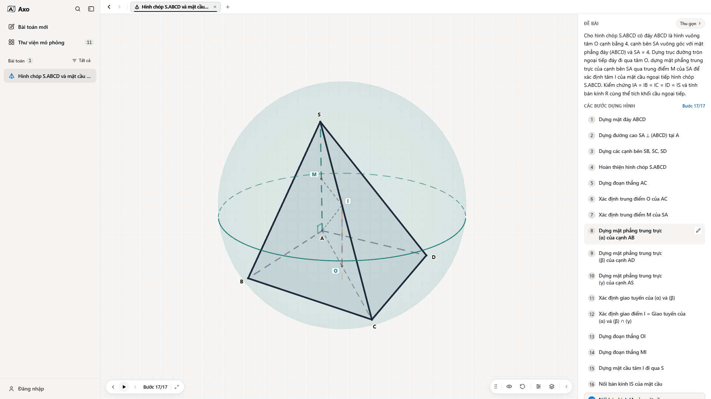 |
| Desktop `1920×1080` inline editor | 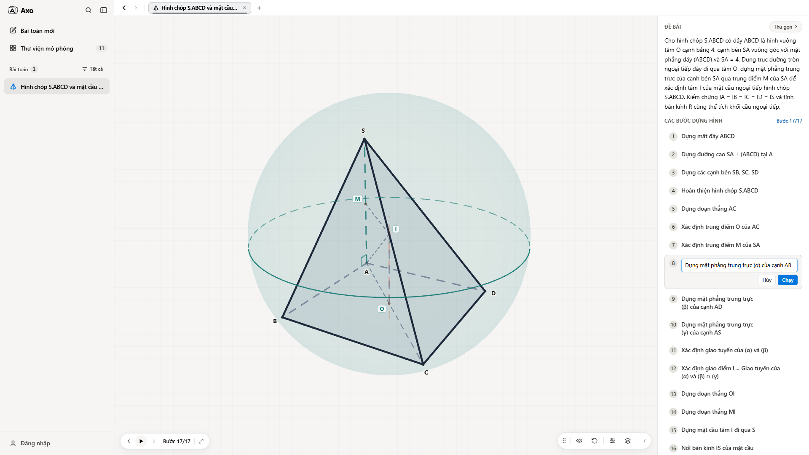 |
| Desktop `1920×1080` commit hợp lệ | 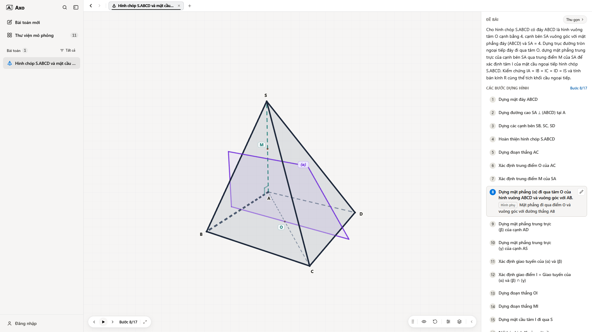 |
| Desktop `1920×1080` 422 rollback | 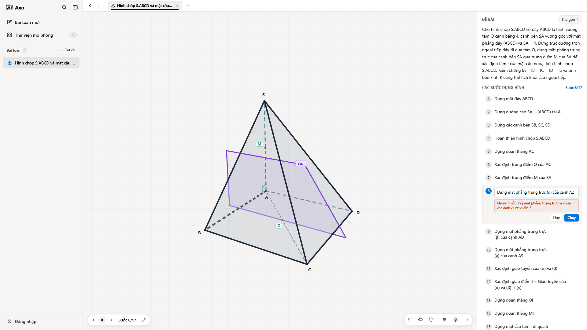 |
| Lăng trụ `ABC.A′B′C′` Unicode `′` | 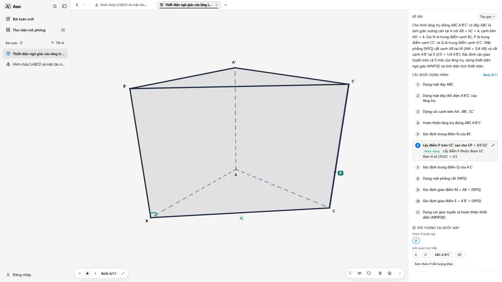 |
| Viewport `1440×900` | 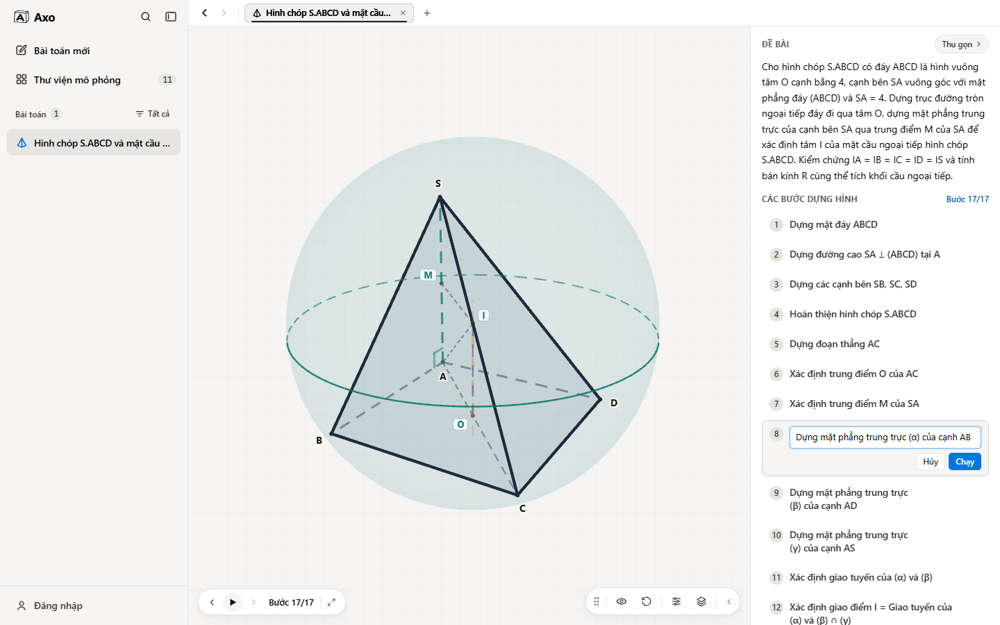 |
| Viewport `1366×768` | 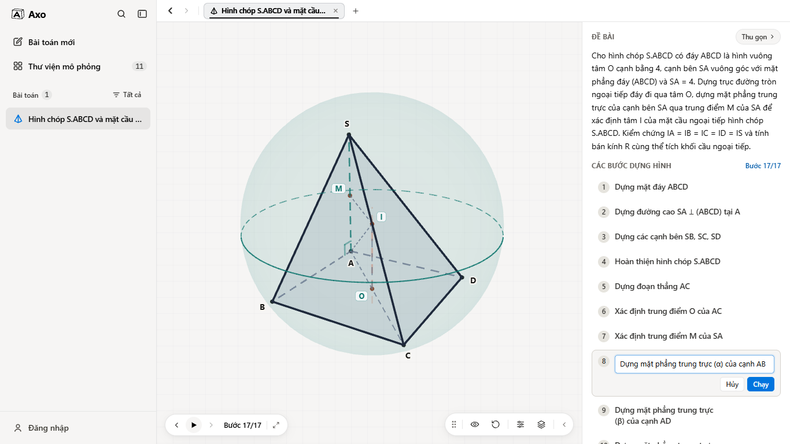 |
| Tablet `768×1024` | 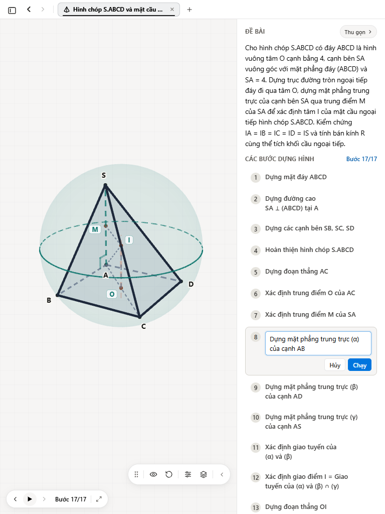 |
| Mobile emulated `390×844` | 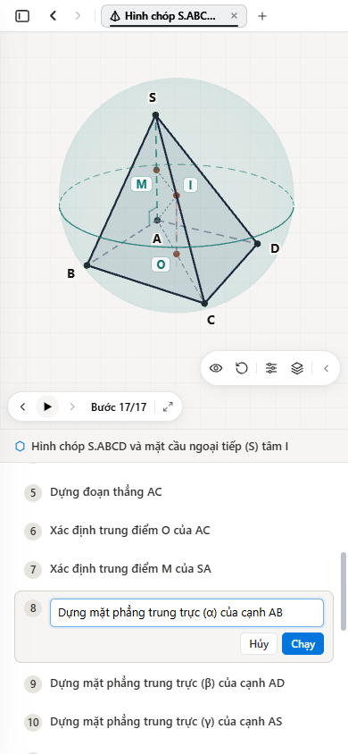 |
| Mobile emulated `360×800` | 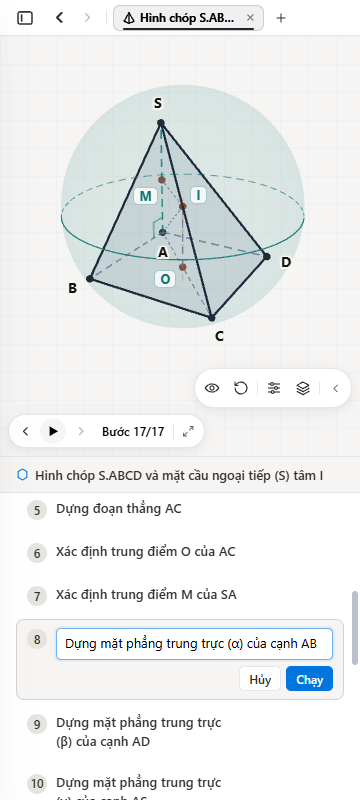 |
| Mobile emulated `320×568` | 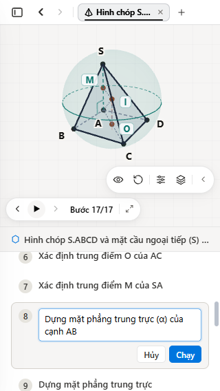 |
| Landing `/` & `/gioi-thieu` intact | 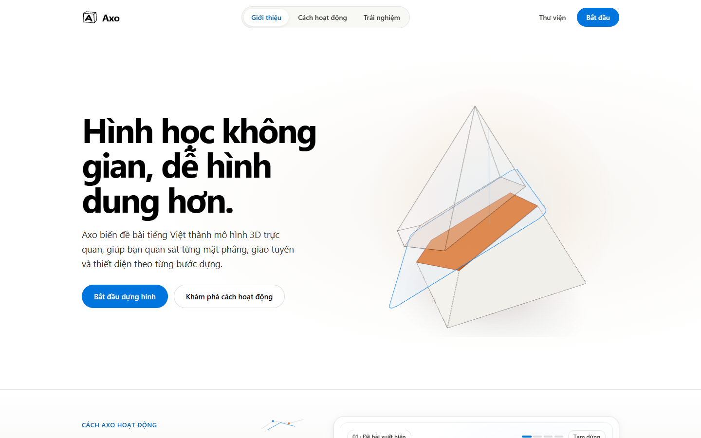 |
| REA MCP CDP Screenshot (`ev_d9fefa75...`) | 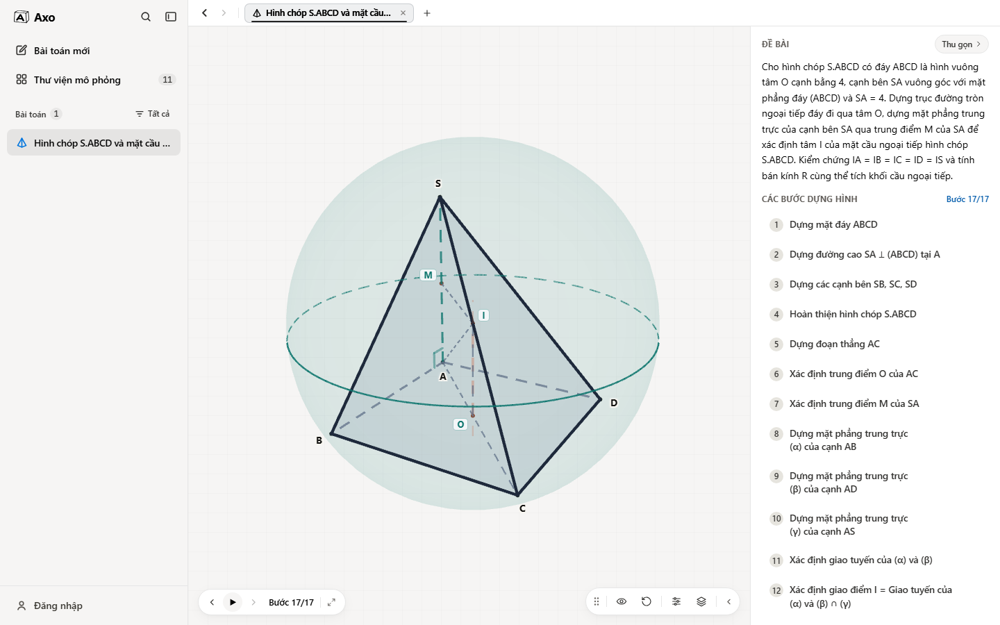 |

---

## 14. Trạng thái frontend/backend localhost (`PASS`)

- **Backend FastAPI (`task-2085`, `PID 1556`):** `http://127.0.0.1:8000` (`http://localhost:8000/api/health` → HTTP `200`).
  - Lệnh khởi động: `Set-Location D:\Documents\projects\axo-geometry-library\backend; & D:\Documents\projects\algo-sim\backend\.venv\Scripts\python.exe -m uvicorn app.main:app --host 127.0.0.1 --port 8000`
- **Frontend Vite (`task-2086`, `PID 11008`):** `http://localhost:3001` (`http://localhost:3001/app`, `/`, `/gioi-thieu` → HTTP `200`, proxy `/api` → `:8000`).
  - Lệnh khởi động: `Set-Location D:\Documents\projects\axo-geometry-library\frontend; npx vite --port 3001 --strictPort --host localhost`
- Hai tiến trình được giữ sống khi bàn giao và xác minh lại trực tiếp bằng probe HTTP trước khi kết thúc.

---

## 15. Các vấn đề chưa được xác minh (`NOT_VERIFIED`)

| Hạng mục | Trạng thái | Ghi chú trung thực |
|---|---|---|
| Thiết bị di động iOS / Android vật lý | `NOT_VERIFIED` | Chỉ xác minh dưới giả lập cảm ứng Chromium (`hasTouch: true, isMobile: true` ở `390×844`, `360×800`, `320×568`). |
| Huấn luyện / suy luận mô hình SLM địa phương | `MODEL_NOT_TRAINED` | Step Editor chạy hoàn toàn bằng parser tất định; chưa có checkpoint SLM đã huấn luyện. |
| Production deployment & H-1 holdout độc lập | `NOT_VERIFIED` / `NOT_MEASURED` | Tuân thủ `AGENTS.md §3`: `PRODUCTION_DEPLOYMENT_VERIFIED = NO`, `INDEPENDENT_H1_VALIDATION = NOT_MEASURED`. |

---

## 16. Git diff/commit và ownership (`PASS`)

- Chỉ stage đúng các file thuộc allowlist của chiến dịch bằng đường dẫn tường minh (`step_editor.py`, `step_edit_router.py`, `test_step_editor_independent_acceptance.py`, `docs/CODE_INDEX.md`, và thư mục run `docs/evaluation/geometry/runs/step-editor-independent-acceptance/*`).
- Xác minh `git diff --cached --name-only` chứa **`0` file `OWNERSHIP_BLOCKED`**. Toàn bộ `77` mục của phiên song song không bị sửa, stage hay hoàn nguyên.
- Commit cục bộ trên nhánh `feat/axo-geometry-library-verification`; không merge `main` và không `git push`.

---

## 17. Rủi ro còn lại và đề xuất quyết định merge

1. **Rủi ro đã được chặn:** Lệch nhãn `_prime`, lỗi alias mục đọc số đo `target_ids`, che khuất ký hiệu bởi điểm ẩn danh, thiếu khóa đồng thời theo phiên, nhánh cứng hình cong, và 6 mẫu câu đa diện UI chưa parse đều đã có hồi quy khóa bằng test + kiểm chứng host thật.
2. **Rủi ro còn lại ở phạm vi chấp nhận được:** 13 bước câu chữ thiếu tham chiếu tường minh / nón bất thường tiếp tục bị từ chối fail-closed có cấu trúc; cảm ứng trên phần cứng di động thật cần xác minh khi có thiết bị thật.
3. **Khuyến nghị:** Đủ điều kiện kỹ thuật để Owner xem xét quyết định merge sau khi kiểm tra trực tiếp trên `http://localhost:3001/app`.

STEP_EDITOR_ACCEPTANCE = PASS
MERGE_READINESS = READY_FOR_OWNER_REVIEW
OWNER_APPROVAL = PENDING_OWNER_REVIEW
