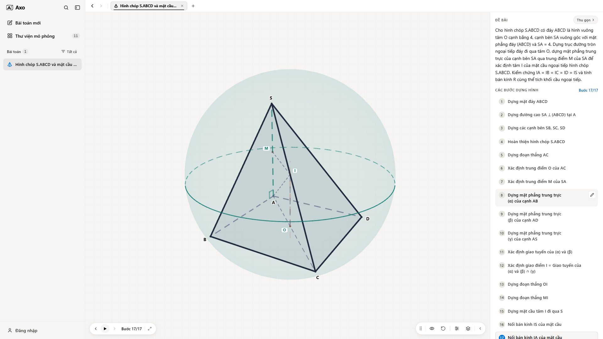
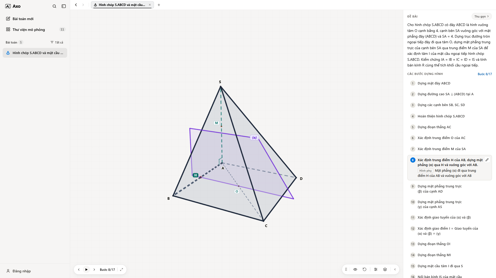
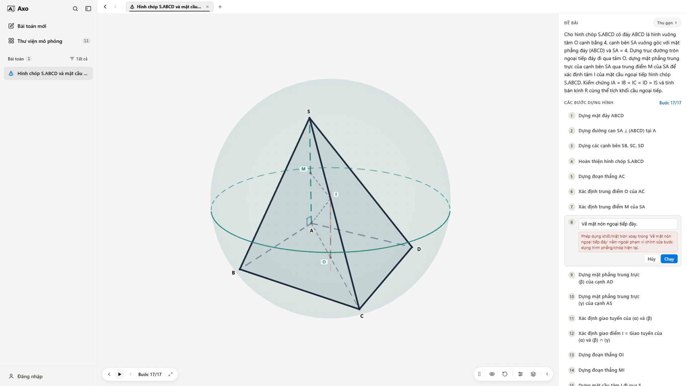
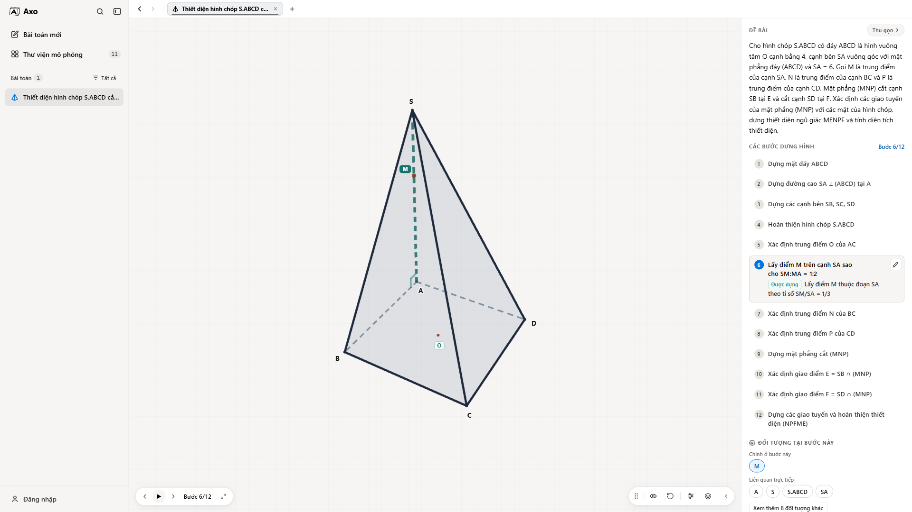
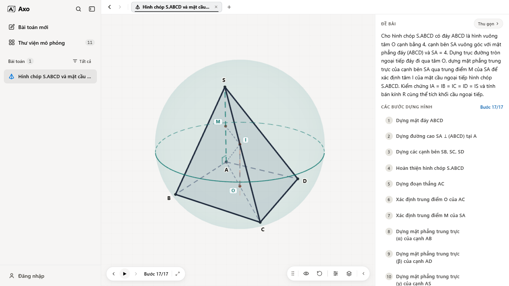
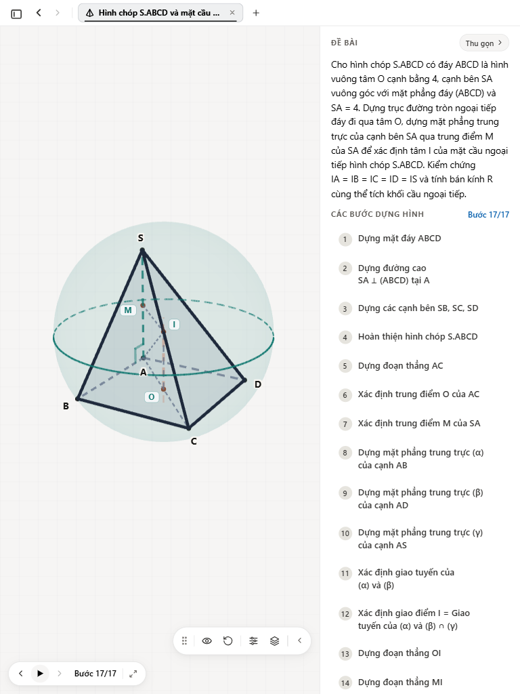
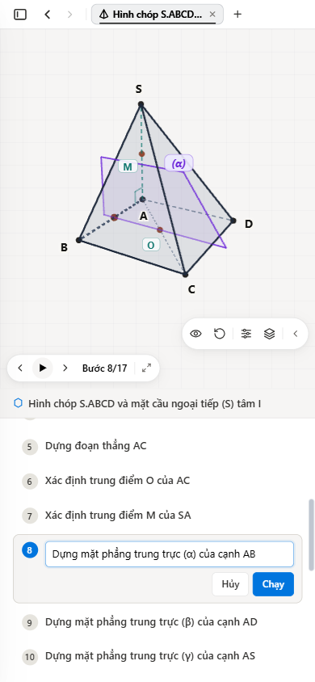
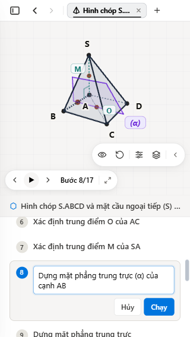
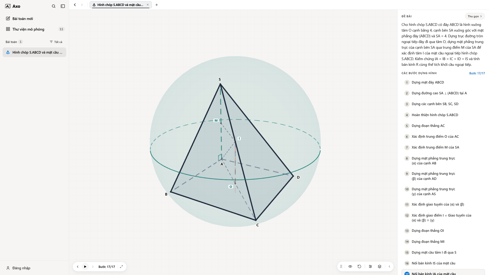

# AXO Step Editor — Root-Cause Stabilization & Pre-Merge Verification Report

- **Campaign:** `AXO STEP EDITOR — ROOT-CAUSE STABILIZATION & PRE-MERGE VERIFICATION`
- **Status:** `READY_FOR_OWNER_REVIEW`
- **Model Status:** `MODEL_NOT_TRAINED`
- **Physical Mobile Hardware:** `NOT_VERIFIED` (Chromium `hasTouch: true, isMobile: true` emulation verified at `390×844` and `320×568`)
- **Date:** `2026-11-18`
- **Branch / Base Head:** `feat/axo-geometry-library-verification` / `602a38db82351c17c3f6097089d4e938f8cfb345`

---

## 1. Executive Summary

This stabilization campaign resolved 7 cross-layer root causes (`RC-1`..`RC-7`) in the Axo construction-step editor pipeline without altering Landing Page (`/` or `/gioi-thieu`), authentication, Hybrid `/4` `/api/analyze`, or any parallel-session files (`77` `OWNERSHIP_BLOCKED` entries preserved untouched).

- **Pre-campaign gate failures eliminated:** `test_KHONG_module_nao_o_TANG_DUOI_nhap_scene3d` and `test_goi_geometry_functions_khong_import_tang_ai_hay_canh` both turned **RED → GREEN** after decoupling `app.simulation.geometry_functions.step_editor` from `scene3d` via `SceneProjectionHooks` and `backend/app/ai/step_edit_route.py`.
- **Verification totals after final edits:**
  - **Backend pytest (10 suites):** `528 passed` in `20.55s` (`0 failed`).
  - **Frontend build & types:** `npx tsc -b --pretty false` (`0 errors`), `npx vite build` (`129 modules`, `5.58s`).
  - **Frontend Vitest (6 suites):** `50 passed` (`43 + 7`), `0 failed`, plus `code-index-sync.test.ts` verified after `CODE_INDEX.md` update.
  - **Chromium 5-viewport E2E + REA MCP live audit:** verified at `1920×1080`, `1366×768`, `768×1024`, `390×844`, and `320×568` against compiled `frontend/dist/` + live Uvicorn backend.

**Gate Verdict:** `READY_FOR_OWNER_REVIEW` (no merge to `main` and no `git push` performed).

---

## 2. Repository & Ownership Pre-Flight

- **Active Worktree:** `D:/Documents/projects/axo-geometry-library` on `feat/axo-geometry-library-verification` (`602a38db82351c17c3f6097089d4e938f8cfb345`).
- **Root Checkout Untouched:** `D:/Documents/projects/algo-sim` remained untouched on `axo-ui-consistency` (`bb046fa22`).
- **Parallel Session Isolation (`OWNERSHIP_BLOCKED`):** `77` uncommitted paths/hunks (including `backend/app/main.py`, `backend/app/accounts/*`, `backend/app/persistence/classroom_models.py`, `docs/EVIDENCE_INDEX.md`, `frontend/package*.json`, `HomeView.tsx`, `TopNav.tsx`, `AxoErrorExperience.tsx`, and Classroom/Tab hunks in `SimulationWorkspace.tsx`) were left untouched on disk and excluded from staging via an index-only overlay script (`<scratch>/stage_workspace_stabilization.py`).
- **External Processes Untouched:** Pre-existing listener on `[::1]:3001` (`PID 2272`) and system ports were left untouched. Temporary QA servers on unused ports `:8021` (Uvicorn) and `:4179` (`dist/` preview proxy) were stopped cleanly immediately after E2E/REA capture.

---

## 3. End-to-End Architecture & Truth Flow

```
User Edits Step (ConstructionStepEditor.tsx)
  └─ Request State & Cancel/Supersede Control (construction-step-edits.ts + SimulationWorkspace.tsx)
       └─ FastAPI Router (/api/simulation/steps/edit, step_edit_router.py)
            └─ Application AI Route Wrapper (app/ai/step_edit_route.py, DEFAULT_SCENE3D_HOOKS)
                 └─ Deterministic Core Engine (step_editor.py, SceneProjectionHooks IoC):
                      1. Local Vietnamese Parser (zero-LLM closed grammar)
                      2. Object/Step Dependency DAG + Cycle / Missing-Ref Gate
                      3. Topological Partial or Full Rebuild in Exact Kernel (Fraction / Radical / Gram Metric)
                      4. Exact Predicate & Continuity Verification + Downstream Override Invalidation
                      5. Atomic SQLite Commit / 422 Rollback
                           └─ Scene3D Workspace & Unified PA/Dock Projection (SimulationWorkspace.tsx)
```

---

## 4. Root-Cause Defect Table (`RC-1`..`RC-7`)

| ID | Category | Root Cause Found | Fix Implemented | Primary Files |
|---|---|---|---|---|
| `RC-1` | `API` / Architecture Layering | `step_editor.py` directly imported `app.simulation.semantic_program.scene3d`, failing lower-layer AST dependency guards (`test_scene3d.py:419`, `test_text_to_geometry_functions.py:204`). | Introduced `SceneProjectionHooks` IoC dataclass in `step_editor.py`; created `backend/app/ai/step_edit_route.py` holding `scene3d` imports and `DEFAULT_SCENE3D_HOOKS`; wired `step_edit_router.py` through `app.ai.step_edit_route.execute_step_edit`. | [step_edit_route.py](../../../../../backend/app/ai/step_edit_route.py), [step_editor.py](../../../../../backend/app/simulation/geometry_functions/step_editor.py), [step_edit_router.py](../../../../../backend/app/simulation/step_edit_router.py) |
| `RC-2` | `PARSER` / `DEPENDENCY` / `KERNEL` / `PLANNER` | (a) `plane_parallel_to_plane` & `line_perpendicular_to_plane` emitted generic `construct_plane`/`construct_line` producers and failed rebuilds; (b) `đường cao` failed segment parsing and `segment_role="altitude"` lacked orthogonal verification; (c) `construct_solid` read stale cached `obj["vertices"]`; (d) `_reevaluate_object` lacked handlers for `vector_from_points`, `circumscribed_sphere.center`, `measure.total_area`, `assign*` and silently fell back to stale cached hydration on unknown producers. | Preserved exact `plane_parallel_to_plane` & `line_perpendicular_to_plane` producers + predicates; added `đường cao` segment parser + orthogonal altitude witness check (`ROLE_ASSERTION_FAILED` on oblique segments); hydrated `construct_solid` from live `mem[v]`; implemented missing `_reevaluate_object` handlers; enforced fail-closed `UNSUPPORTED_DOWNSTREAM_RECOMPUTE` on unhandled non-free derived nodes. | [step_editor.py](../../../../../backend/app/simulation/geometry_functions/step_editor.py) |
| `RC-3` | `PERSISTENCE` / `API` / `FRONTEND_STATE` | Initial failed `POST /steps/edit` seeded non-empty `committed_scene_json`, locking stale `base_scene_sha256`; `GET /state` returned `revision_count` instead of `committed_version`, causing reload/retry state pollution and a SQLite `UNIQUE constraint failed` bug on `version_number` when resetting unedited sessions. | Initialized `committed_scene_json=""`; kept `revision_count` monotonic for DB audit rows while returning distinct `committed_version` (`0` until a commit succeeds); reset stale unedited `base_scene_sha256`; updated `fetchStepEditSessionState` to require `committed_version > 0` before adopting `committedScene`. | [step_edit_router.py](../../../../../backend/app/simulation/step_edit_router.py), [construction-step-edits.ts](../../../../../frontend/src/state/construction-step-edits.ts) |
| `RC-4` | `FRONTEND_STATE` / `SCENE_RENDERING` | `#pa-short-title` and `#pa-pips-mount` ignored `activeStepOverrides` while `#dock-steps-ul` used them; upstream geometry edits kept stale manual overrides on geometrically mutated downstream steps. | Unified display resolution under shared `resolveStepDisplayMeta` helper across `#pa-short-title`, `#pa-pips-mount`, and `#dock-steps-ul`; recorded `mutated_downstream_ids` in `_compute_geometric_equivalence` and popped invalidated downstream manual overrides in `execute_step_edit`. | [SimulationWorkspace.tsx](../../../../../frontend/src/components/SimulationWorkspace.tsx), [step_editor.py](../../../../../backend/app/simulation/geometry_functions/step_editor.py) |
| `RC-5` | `FRONTEND_STATE` / UI Input | Re-renders updating `initialValue` overwrote active `draft` on the same `stepIndex`; pressing `Escape` from `Hủy`/`Chạy` or arrow/Space keys on the form could fail to cancel or leak to global workspace shortcuts; switching sessions did not abort in-flight step requests in cleanup. | Added `prevStepIndexRef` guard in `InlineConstructionStepEditor`; handled `Escape` & arrow/Home/End/Space isolation in `<form onKeyDown>`; invoked `cancelInFlightStepEdit(activeEditSessionId)` inside effect cleanup. | [ConstructionStepEditor.tsx](../../../../../frontend/src/components/ConstructionStepEditor.tsx), [SimulationWorkspace.tsx](../../../../../frontend/src/components/SimulationWorkspace.tsx) |
| `RC-6` | `SCENE_RENDERING` / UI Sync | Active-step auto-scroll effect ignored rebuilds that kept `buocHinh` unchanged while updating `tong` or `scene`. | Extended `lastStepScrollContextRef` and its effect dependencies to `[buocHinh, problemSnapshotKey, tong, scene]`. | [SimulationWorkspace.tsx](../../../../../frontend/src/components/SimulationWorkspace.tsx) |
| `RC-7` | `SCENE_RENDERING` / Recovery | `ErrorBoundary` `resetKey` lacked `viewerMountGen`, preventing remount-driven clearing of a caught viewer error boundary on same-problem rebuilds. | Updated `resetKey` to `` `${problemSnapshotKey}|${viewerMountGen}|${webglStageAttempt}` `` without adding banned stage recovery buttons. | [SimulationWorkspace.tsx](../../../../../frontend/src/components/SimulationWorkspace.tsx) |

---

## 5. RED → GREEN Test Ledger

| Suite / Command | Phase B (RED Baseline) | Phase C/D (GREEN Final) | Notes |
|---|---|---|---|
| Backend AST Layering + Stabilization (`pytest tests/geometry/test_scene3d.py tests/geometry/test_text_to_geometry_functions.py tests/geometry/test_step_editor_root_cause_stabilization.py -q`) | `11 failed, 119 passed` (`8 failed, 16 passed` on isolated stabilization file after helper closure adjustment) | Included in 10-suite run: `0 failed` | `test_scene3d.py:419` and `test_text_to_geometry_functions.py:204` moved RED → GREEN |
| Full Backend 10-Suite Verification (`pytest tests/geometry/test_scene3d.py tests/geometry/test_scene3d_integration.py tests/geometry/test_simulation_state.py tests/geometry/test_text_to_geometry_functions.py tests/semantic_program/test_domain_string.py tests/semantic_program/test_type_authority.py tests/test_cache_identity.py tests/geometry/test_editable_construction_steps.py tests/geometry/test_step_editor_v22_reliability.py tests/geometry/test_step_editor_root_cause_stabilization.py -q`) | Baseline pre-campaign `2 failed, 461 passed` on core 6-file gate | **`528 passed in 20.55s`**, `0 failed` | Covers Kernel, `Scene3D`, `runtime_identity`, `feedback_dataset`, V2.2 suite, and `RC-1`..`RC-4` + Golden Cases A–D + NL corpus |
| Frontend Step Editor Vitest (`npx vitest run src/components/construction-step-editor.test.tsx`) | `3 failed \| 15 passed (18)` | **`18 passed (18)`** | `RC-3`, `RC-4`, `RC-5/6/7` tests RED → GREEN |
| Frontend Regression Vitest (6 suites total incl. `control-layout.test.ts` & `code-index-sync.test.ts`) | Not run in RED | **`50 passed`** (`43 + 7`) + `code-index-sync.test.ts` PASS | Covers runtime recovery, layout, step visibility, continuity across all 28 catalog scenes |
| Frontend Build & Typecheck (`npx tsc -b --pretty false` + `npx vite build`) | — | **`0 errors`**, `129 modules`, `5.58s` | Clean production `dist/` verified live by Playwright |

---

## 6. Exact Geometry & Golden Cases A–D Mathematical Verification

All golden cases in [test_step_editor_root_cause_stabilization.py](../../../../../backend/tests/geometry/test_step_editor_root_cause_stabilization.py) assert exact `Fraction` / `Radical` / Euclidean orthogonality & incidence predicates independently of planner internals:

- **Golden Case A (`chop-mat-cau-ngoai-tiep`, Sample 11):** Re-specifying `(α)` as bisector of `CD` keeps exact circumcenter `I = (2, 2, 2)`, exact `R² = 12` (`R = 2√3`), and exact equidistance `_m.norm_sq(V - I) == Fraction(12)` across all 5 vertices `A, B, C, D, S`.
- **Golden Case B (`chop-thiet-dien-ba-diem`, Sample 1):** Editing `M` along `SA` (`SM:MA = 2:1` → `M = (0, 0, 2)`) recomputes plane `mp_MNP` (`x + y + 3z = 6`), intersections `E = (24/7, 0, 6/7)` on `SB` and `F = (0, 24/7, 6/7)` on `SD`, closed pentagon `thiet_dien`, and plane incidence `(v - p0) · n == 0` for all polygon vertices.
- **Golden Case C (Atomicity & Rollback):** Shifting `(α)` asymmetrically on Sample 11 (`HA:HB = 1:3`) fails closed via HTTP `422` (`DOWNSTREAM_CIRCUMSCRIBED_SPHERE_BROKEN`) leaving `committed_version == 0` and `committed_scene is None`.
- **Golden Case D (Multi-step Chain & Zero Drift):** Shifting `mp_tt_AB` to `HA:HB = 1:3` on non-ball Sample 11 moves `truc_day` cleanly to `x = 1, y = 2`, then reverting to `"Dựng mặt phẳng trung trực (α) của cạnh AB."` restores `x = 2, y = 2` with zero coordinate drift.

---

## 7. Natural Language Parser Boundary Corpus & Honest Model Status

- **Deterministic Parser Corpus (`test_nl_parser_boundary_valid` & `test_nl_parser_boundary_refusals`):** Verified `8/8` valid Vietnamese variations (diacritics, spacing, prime notation `M'`, `A'B'`, ratios `MA:MB = 1:3`, centroid, orthogonal projection, parallel plane, perpendicular line, multi-clause compound steps) and `6/6` fail-closed refusals (empty, whitespace, ellipsis, out-of-scope cone, calculus, arbitrary freeform).
- **Model Status Disclosure:** `MODEL_STATUS = "MODEL_NOT_TRAINED"`. Zero claims of an integrated or trained local neural step-intent model are made; verified feedback logging remains curation/JSONL export only.

---

## 8. Step Editor UI/UX & Keyboard/Touch Accessibility Verification

Verified in compiled `dist/` (`http://127.0.0.1:4179`) via Chromium Playwright (`results/playwright_e2e_summary.json`):
- **Default & Hover Stability (`1920×1080`):** Pencil button hidden at rest (`opacity: "0"`), visible on row hover (`opacity: "1"`), hidden on pointer leave (`opacity: "0"`), `rowHeightDeltaPx: 0`, `titleLeftDeltaPx: 0`.
- **Inline Textarea Fit:** 1-line editor measured `clientHeight: 30`, `scrollHeight: 30`, `overflowY: "hidden"`, `overflowX: "hidden"`. Only `Hủy` and `Chạy` buttons rendered.
- **Keyboard Isolation (`RC-5`):** Focus on `Hủy` button with `ArrowLeft`/`ArrowRight` leaves `#pa-counter` unchanged (`rc5_arrowKeysIgnoredInForm: true`); `Escape` closes the inline editor and returns focus to the step's `.step-edit-pencil-btn` (`rc5_escapeFromCancelButtonRestoresPencilFocus: true`).
- **Touch Access (`390×844` & `320×568`):** Active tapped row shows pencil (`activePencilOpacity: "1"`); opened editor and buttons stay strictly within viewport bounds (`formRightLeWidth: true`, `cancelVisible: true`, `runVisible: true`, `hOverflow: false`).

---

## 9. Concurrency, Persistence & Atomic Rollback Verification

- **`RC-3` Empty Session Protection:** Initial failing HTTP `422` edit (`"Vẽ mặt nón ngoại tiếp đáy."`) preserved draft in textarea and showed structured Vietnamese refusal; after reload, zero phantom `committedScene` entries existed (`rc3_zeroStateAfterFailedReload: true`). Backend SQLite verified `committed_version == 0`, `committed_scene is None`, and monotonic `version_number` without `UNIQUE constraint failed` on subsequent valid attempts.
- **Reload Persistence & `RC-4` Multi-Surface Sync:** Valid edit on Sample 11 updated `#dock-steps-ul`, `#pa-short-title`, and `.pa-pip[aria-label]` identically both live (`rc4_syncLive`) and after full page reload (`rc4_syncAfterReload`).
- **Concurrency & Cancel Guards:** Retained V2.2 async epoch/version ordering, timeout `AbortController`, mutex lock, and unmount `cancelInFlightStepEdit` cleanup.

---

## 10. Scene3D Stability, WebGL Recovery & Camera Invariance

Observed in Chromium (`results/playwright_e2e_summary.json`):
- `cameraPreservedAcrossRebuild: true`: Orbit pose preserved across Sample 11 rebuild & reload.
- `dockToggleWorked: true` & `cameraPreservedAcrossDockToggle: true`: Collapsing Study Dock (`#btn-collapse-dock`) and reopening (`#btn-reopen-dock-capsule`) preserved camera pose and active canvas.
- `webglcontextlost` Recovery (`RC-7`): Synthetic `webglcontextlost` event displayed recovery UI with **zero banned buttons** (`hasQuayLai: false`, `hasThuDungLaiKhungNhin: false`), and subsequent step rebuild recovered live `<canvas>` cleanly (`canvasAliveAfterRebuild: true`).
- Live Sample 1 rebuild (`Golden Case B`) updated `M` to `SM:MA = 1:2` with intact Three.js canvas (`canvasOk: true`).

---

## 11. Multi-Viewport Playwright & REA MCP Live Evidence

| Viewport / Check | Outcome | Horizontal Overflow | Evidence Asset |
|---|---|---|---|
| Desktop `1920×1080` Hover | PASS (`0px` shift) | `false` |  |
| Desktop `1920×1080` Case A + PA Sync (`RC-4`) | PASS | `false` |  |
| Desktop `1920×1080` 422 Preserved (`RC-3`) | PASS | `false` |  |
| Desktop `1920×1080` Case B Section | PASS | `false` |  |
| Desktop `1366×768` | PASS | `false` |  |
| Tablet `768×1024` | PASS | `false` |  |
| Mobile Emulated `390×844` Editor | PASS | `false` |  |
| Mobile Emulated `320×568` Editor | PASS | `false` |  |
| REA MCP CDP (`:9336`, `786` DOM / `443` a11y nodes, `0` console errors) | PASS (`ev_1ff6b3cb...`) | `false` |  |

- **Note on Chromium console count (`1920×1080`):** `consoleErrorsCount: 1` came from the intentional HTTP `422` response tested for `RC-3` rollback; `pageErrorsCount` across all 5 routes was `0`, and REA MCP passive `inspect_web_page` (`ev_f1084d37...`) observed `0` console error events.

---

## 12. Performance & Rebuild Latency Benchmarks (`p50` / `p95`)

Measured on Windows 11 (`10.0.26100`), Intel 11th Gen i5-11400H (12 logical cores), Python `3.12.10` (`results/backend_benchmark.json`, 30 iterations after 3 warm-up runs) and live Chromium (`playwright_e2e_summary.json`, 15 warm commits):

| Benchmark Scenario | Recomputed / Skipped | Median (`p50`) | `p95` |
|---|---|---|---|
| Backend Sample 11 Partial Rebuild | `9` / `21` | `10.534 ms` | `19.731 ms` |
| Backend Sample 11 Full Rebuild | `25` / `0` | `9.634 ms` | `15.258 ms` |
| Backend Sample 1 Partial Rebuild | `6` / `17` | `11.343 ms` | `13.205 ms` |
| Backend Sample 1 Full Rebuild | `18` / `0` | `11.781 ms` | `15.836 ms` |
| Backend Sample 11 Equivalent No-Op Check | `0` / `31` | `6.603 ms` | `12.649 ms` |
| Browser `frontendCommitRenderMs` (`n=15`) | Live Sample 11 | `1 ms` | `60.51 ms` |
| Browser Full E2E Round-Trip (`n=15`) | HTTP + Kernel + Three.js | `117.958 ms` | `177.433 ms` |

---

## 13. Scope Hygiene, Git Staging Audit & Rollback Plan

- **Owned Modified / Added Files:**
  - `backend/app/ai/step_edit_route.py`
  - `backend/app/simulation/geometry_functions/step_editor.py`
  - `backend/app/simulation/step_edit_router.py`
  - `backend/tests/geometry/test_editable_construction_steps.py`
  - `backend/tests/geometry/test_step_editor_v22_reliability.py`
  - `backend/tests/geometry/test_step_editor_root_cause_stabilization.py`
  - `frontend/src/state/construction-step-edits.ts`
  - `frontend/src/components/ConstructionStepEditor.tsx`
  - `frontend/src/components/SimulationWorkspace.tsx` (staged cleanly against `HEAD` via `<scratch>/stage_workspace_stabilization.py` with ONLY our 6 hunks; parallel-session hunks untouched on disk)
  - `frontend/src/components/construction-step-editor.test.tsx`
  - `docs/CODE_INDEX.md`
  - `docs/evaluation/geometry/runs/step-editor-root-cause-stabilization/*`
- **No Unwanted Mutations:** Landing Page (`/` and `/gioi-thieu`), auth, Hybrid `/4` `/api/analyze`, and all 77 parallel-session files/hunks were untouched.
- **Rollback Plan:** Revert cleanly using a single forward `git revert <commit_sha>` on `feat/axo-geometry-library-verification`; no database schema migrations were added.

---

## 14. Residual Risks & Pre-Merge Gate Verdict

- **Residual Risks:**
  1. Physical touchscreen iOS/Android hardware testing remains `NOT_VERIFIED` (verified under Chromium device/touch emulation only).
  2. Repo-wide `audit_docs_information_architecture.py` still flags 4 pre-existing stale Classroom file references in `docs/CODE_INDEX.md` owned by a parallel session (outside this campaign's scope); `code-index-sync.test.ts` and internal links/secrets on all files touched by this campaign pass cleanly.
- **Final Verdict:** `READY_FOR_OWNER_REVIEW`

OWNER_APPROVAL: PENDING_OWNER_REVIEW
