# AXO — Step Editor V1 Restoration & UI Defect Fix Report

- **Target Worktree:** `D:/Documents/projects/axo-geometry-library`
- **Branch:** `feat/axo-geometry-library-verification`
- **V1 Baseline Commit:** `438fa69cab04bc266110937874051e8616d8ea37` (`438fa69ca`)
- **Intermediate / Pre-Fix Commits Audited:**
  - V2.1: `7607f0d6e5e846d97c393e7876f7fa4cf389ad35` (`7607f0d6e`)
  - V2.2 (Before Baseline): `d0cb1d40f71a50ac2ae227f254c3eb0d4e70fa22` (`d0cb1d40f`)
- **Local Restoration Commit (Code + QA Metrics/Screenshots):** `f3cf5fa793890e77d882a2fd7835075e87d536a1` (`f3cf5fa79`)
- **OWNER_APPROVAL:** `PENDING_OWNER_REVIEW`

---

## 1. Phạm vi & Bảng KEEP / RESTORE / FIX (Phase 1 Audit)

| Thành phần / Cơ chế | V1 (`438fa69ca`) | V2.2 (`d0cb1d40f`) | Quyết định | Phiên bản sau chỉnh sửa (`f3cf5fa79`) |
|---|---|---|---|---|
| **Hiển thị nút bút chì mặc định & hover** | Ẩn mặc định (`opacity: 0`), hiện ở mép phải khi hover; dùng `.step-row:focus-within` nên kẹt sau khi click | Vẫn giữ `.step-row:focus-within`; trên `d0cb1d40f` đo thực tế click Step 8 rồi rời chuột vẫn kẹt `opacity: "1"` | **RESTORE + FIX** | Ẩn mặc định (`opacity: 0`); chỉ hiện khi hover trên thiết bị có `@media (hover: hover)`, hoặc khi `:focus-visible` (Tab bàn phím). Click bằng chuột rồi rời chuột ẩn ngay (`opacity: "0"`, `rowHeightDelta: 0`, `titleLeftDelta: 0`) |
| **Kích thước nút bút chì & lề phải hàng bước** | Desktop `24×24`, `top: 6px; right: 6px; border-radius: 6px`; `.step-row` padding `8px 10px` (V1 Study Dock) | Thu nhỏ còn `22×22` (`right: 5px; border-radius: 5px`), ép `padding-right: 30px` | **RESTORE + FIX** | Khôi phục nút `24×24` (`top: 6px; right: 6px; border-radius: 6px`) và `.step-row { padding: 8px 10px; gap: 9px; }`, đồng thời giữ rãnh phải an toàn `.step-row:not(.is-editing) { padding-right: 34px; }` trên desktop (`35px` trên touch) để nút bút chì không bao giờ che chữ khi hover (`pencilOverlapsText: false`) |
| **Truy cập chỉnh sửa trên màn hình cảm ứng (Mobile/Tablet)** | `@media (hover: none), (pointer: coarse)` chỉ hiện ở `.step-row.is-active` | Kích thước `26×26` (`right: 4px`), không dành `padding-right` riêng trên coarse pointer | **RESTORE + FIX** | `@media (hover: none), (pointer: coarse)` chỉ hiện nút `26×26` (`top: 5px; right: 5px`) ở bước đang chọn (`.step-row.is-active`), dành `padding-right: 35px` cho `.step-row:not(.is-editing)` |
| **Textarea auto-resize & lỗi scrollbar 2+ dòng** | `min-height: 68px; resize: vertical` (gọn nhưng cố định chiều cao ban đầu lớn) | `el.style.height = "${el.scrollHeight}px"`, `max-height: 112px`; bỏ quên `2px` border của `box-sizing: border-box` nên bước 2 dòng (Step 12, Step 8) bị `scrollHeight: 46 > clientHeight: 44`, hiện scrollbar dọc thừa (`overflowY: "auto"`) | **FIX** | `syncStepTextareaHeight` tính `Math.ceil(el.scrollHeight + borderV)` với `minH = 32`, `maxH = 144`, `overflowX = "hidden"`, chỉ bật `overflowY = "auto"` khi `needed > 144`; đo thực tế Step 12 & Step 8 2 dòng: `scrollHeight: 46, clientHeight: 46, offsetHeight: 48, hasInternalVScroll: false`; giữ nguyên `.dock-scroll.scrollTop` và vị trí con trỏ |
| **Nút Hủy, phím Escape & Chạy** | Hủy & Escape cùng gọi `restoreFocusToStepPencil`; Chạy gọi API dựng lại | Giữ Hủy/Chạy slim (`min-height: 25px` desktop, `30px` touch) | **KEEP + FIX** | `onCancel(restoreKeyboardFocus)` trả focus về nút bút chì với `preventScroll: true` khi nhấn `Escape` hoặc kích hoạt Hủy bằng bàn phím (`e.detail === 0`); click chuột `Hủy` không ép cuộn/focus; Chạy khóa gửi trùng và kiểm chứng chặt kết quả dựng lại |
| **Ngắt dòng ký hiệu hình học ngắn** | Dùng `<MathDisplay>` thuần trong `.step-title` | Tách chữ cuối dòng như `cạnh` / `AB` (Step 8), `cạnh` / `AD` (Step 9), `cạnh` / `AS` (Step 10) ở `1920×1080` và `1366×768` | **FIX** | `StepTitleText` bọc các biểu thức ngắn và cặp giới từ–ký hiệu (`cạnh AB`, `cạnh AD`, `cạnh AS`, `(α) và (β)`) trong `.math-nowrap`, kết hợp `text-wrap: pretty; overflow-wrap: break-word; word-break: normal` — loại bỏ 100% ký hiệu mồ côi trên cả Sample 11 & Sample 1 mà không dùng `nowrap` toàn tiêu đề |
| **Typography khối đề bài (`#dock-prob-statement`)** | Mặc định trình duyệt (`line-height: 1.58`, không khai báo `text-align`/`word-spacing` tường minh) | Đo `textAlign: "start"`, `lineHeight: "22.12px"` | **FIX** | Khai báo tường minh `text-align: left; font-size: 14px; line-height: 1.6; word-spacing: normal; letter-spacing: normal; white-space: pre-line; overflow-wrap: break-word; word-break: normal` (`22.4px` tại `1920×1080`, `scrollWidth === clientWidth` trên cả 7 viewport và khi thu gọn thanh bên) |
| **Xác thực dựng lại hình học phía client** | Tin kết quả HTTP 200 nếu có `scene3d` | Tương tự V1 ở tầng `submitConstructionStepEdit` | **FIX** | Bổ sung `isVerifiedRebuildScene` (`hopLeScene3D`, `inspectScene3DPayloadIntegrity`, `verifySceneMathematicalConsistency(veKhongGian(scene))`); từ chối fail-closed (`UNVERIFIED_REBUILD_REJECTED`) nếu HTTP 200 không có `feedback_status === "GEOMETRY_VERIFIED"`, `validation_result.passed !== false`, `cycle_detected !== true` hoặc hình học không nhất quán; áp dụng tương tự khi khôi phục cache/session |

---

## 2. Danh sách file đã sửa trong commit `f3cf5fa79`

- [ConstructionStepEditor.tsx](file:///D:/Documents/projects/axo-geometry-library/frontend/src/components/ConstructionStepEditor.tsx) — bổ sung `StepTitleText`, `syncStepTextareaHeight`, `ResizeObserver` không reset con trỏ theo `[draft]`, phân biệt `onCancel(restoreKeyboardFocus)`.
- [global.css](file:///D:/Documents/projects/axo-geometry-library/frontend/src/styles/global.css) — khôi phục nút bút chì V1 (`24×24`, `top: 6px; right: 6px`), tách `@media (hover: hover)` và `:focus-visible`, sửa `:focus-within`, thêm rãnh phải `.step-row:not(.is-editing)`, nâng giới hạn textarea lên `144px` với `overflow-x: hidden`, cập nhật typography `.step-title` và `.problem-statement`.
- [SimulationWorkspace.tsx](file:///D:/Documents/projects/axo-geometry-library/frontend/src/components/SimulationWorkspace.tsx) — chỉ stage đúng 3 hunk Step Editor qua Git index (`StepTitleText` import, `restoreFocusToStepPencil` dùng `preventScroll: true`, `onCancel={(restoreFocus) => ...}` và `<StepTitleText text={tieuDeBuoc} />`), giữ nguyên toàn bộ working tree song song của phiên khác.
- [construction-step-edits.ts](file:///D:/Documents/projects/axo-geometry-library/frontend/src/state/construction-step-edits.ts) — bổ sung `isVerifiedRebuildScene` và kiểm tra xác thực hình học cho luồng gửi/tải lại chỉnh sửa bước dựng.
- [construction-step-editor.test.tsx](file:///D:/Documents/projects/axo-geometry-library/frontend/src/components/construction-step-editor.test.tsx) — cập nhật Test 3 và bổ sung 9 regression test theo yêu cầu Phase 8.
- Tài liệu & bằng chứng chạy QA: `docs/evaluation/geometry/runs/step-editor-v1-restoration/before-metrics.json`, `after-metrics.json`, `images/before/*.png` (5 ảnh), `images/after/*.png` (13 ảnh).

---

## 3. Ảnh đối chiếu Before / After (Desktop & Mobile)

### Desktop `1920×1080` — Danh sách bước & Ngắt dòng (Step 8–10 Before tách chữ `AB`/`AD`/`AS`)

| Before (`d0cb1d40f`) | After — Hover Step 8 (`f3cf5fa79`) |
|---|---|
| 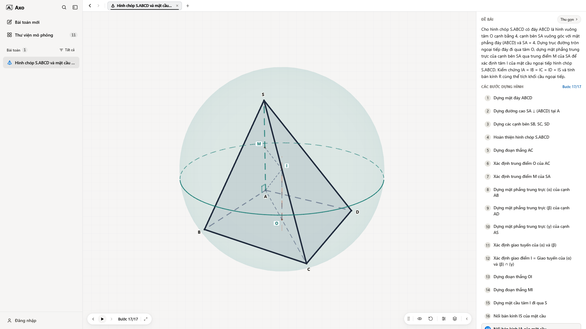 | 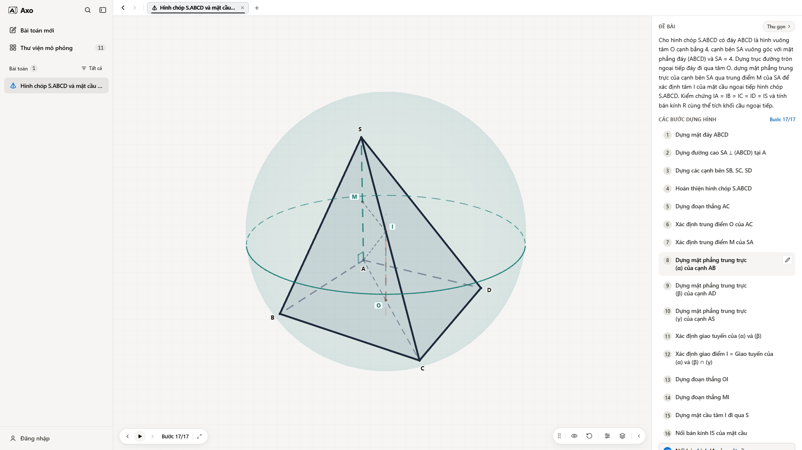 |

### Desktop `1920×1080` — Lỗi scrollbar nội bộ ở Step 12 (2 dòng) & Xác thực REA MCP

| Before (`d0cb1d40f` — `scrollHeight: 46, clientHeight: 44`) | After (`f3cf5fa79` — `scrollHeight: 46, clientHeight: 46`) |
|---|---|
| 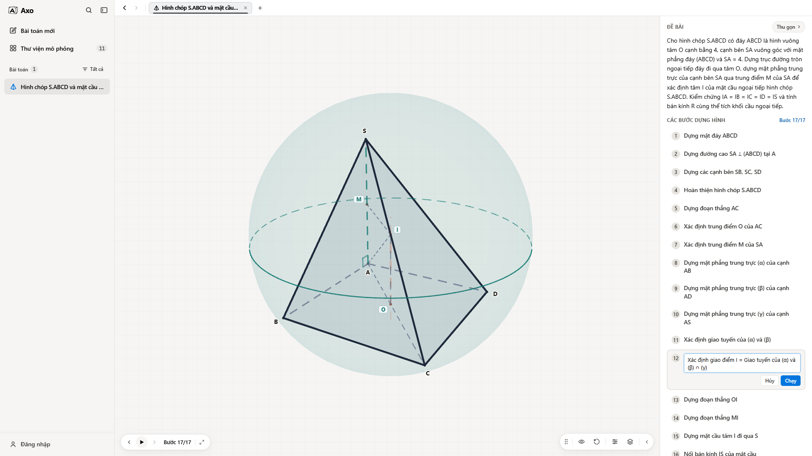 | 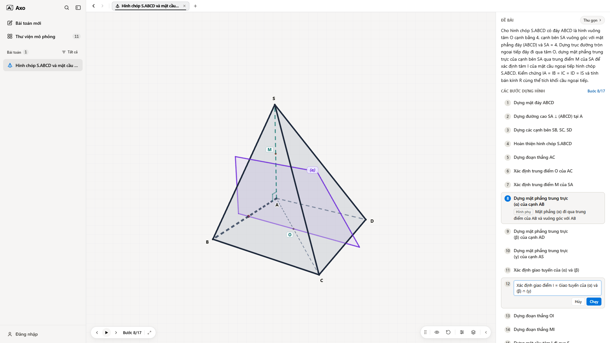 |

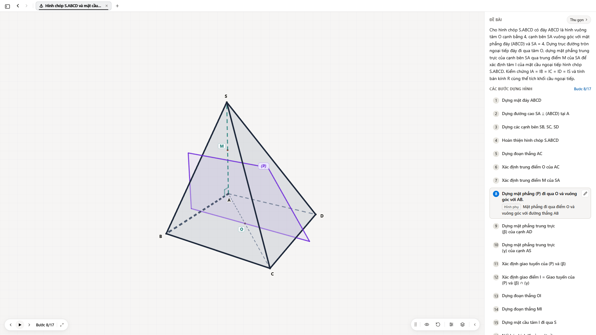

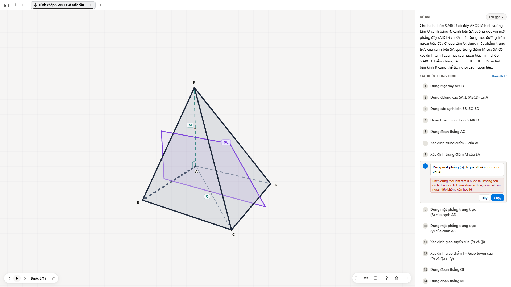

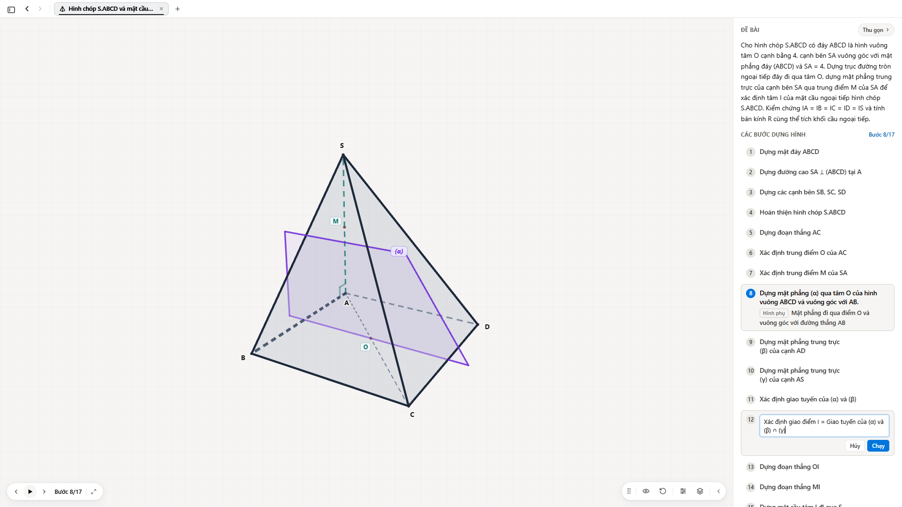

### Mobile `390×844` & `320×568` — Trạng thái chọn & Editor 2–3 dòng

| Before Mobile `390×844` Steps | After Mobile `390×844` Active Pencil | After Mobile `390×844` Editor | After Mobile `320×568` Editor |
|---|---|---|---|
| 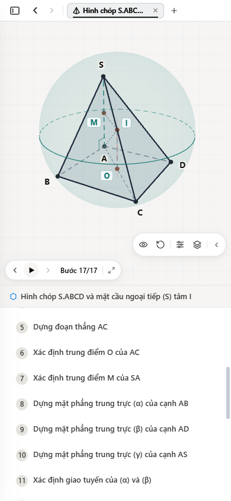 | 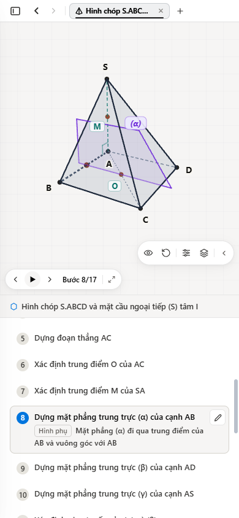 | 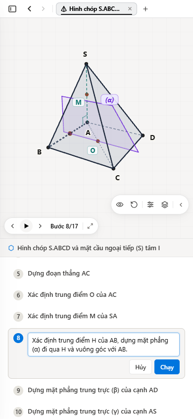 | 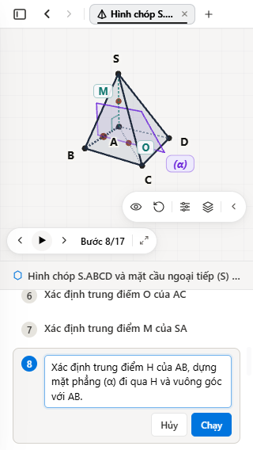 |

---

## 4. Kết quả kiểm thử luồng dựng lại hình học (Phase 6 E2E trên Backend FastAPI `:8019`)

Kiểm thử thực tế trên bài mẫu `pyramid-circumscribed-sphere` (Bước 8) thông qua production build `frontend/dist` + proxy `/api` → Uvicorn `:8019`:

1. **Chỉnh sửa hợp lệ được hỗ trợ (`validO` & `renameP`):**
   - Lần 1 (`"Dựng mặt phẳng (α) đi qua O và vuông góc với AB."`): HTTP `200`, `status = "committed"`, `mode = "PARTIAL_TOPOLOGICAL_REBUILD"`, `feedback_status = "GEOMETRY_VERIFIED"`, `validation_result.passed = true`, `dependency_summary.cycle_detected = false`. Editor tự đóng, Bước 8 đồng bộ văn bản mới.
   - Lần 2 (`"Dựng mặt phẳng (P) đi qua O và vuông góc với AB."`): HTTP `200`, `mode = "PARTIAL_TOPOLOGICAL_REBUILD"`. Toàn bộ bước phụ thuộc và Scene 3D đồng bộ theo kết quả máy chủ: Bước 8 thành `"Dựng mặt phẳng (P) đi qua O và vuông góc với AB."`, Bước 11 thành `"Xác định giao tuyến của (P) và (β)"`, Bước 12 thành `"Xác định giao điểm I = Giao tuyến của (P) và (β) ∩ (γ)"`, nhãn mặt phẳng trên Scene 3D chuyển thành `(P)`.
2. **Chỉnh sửa không hợp lệ / phản ví dụ (`invalidM`):**
   - Gửi `"Dựng mặt phẳng (α) đi qua M và vuông góc với AB."`: máy chủ từ chối với HTTP `422`, `error_code = "DOWNSTREAM_CIRCUMSCRIBED_SPHERE_BROKEN"`.
   - Giao diện giữ editor mở kèm thông báo lỗi `"Phép dựng mới làm tâm ở bước sau không còn cách đều mọi đỉnh của khối đa diện, nên mặt cầu ngoại tiếp không còn hợp lệ."`, bảo toàn bản nháp trong textarea và bảo toàn nguyên trạng `(P)` ở Bước 11 và Scene 3D.
3. **Lỗi mạng giữa chừng & thử lại (`networkAbortAndRetry`):**
   - Chặn `POST /api/simulation/steps/edit` (`net::ERR_FAILED`): UI hiện lỗi `"Không thể kết nối tới máy chủ dựng hình cục bộ. Nội dung bạn vừa gõ vẫn được giữ lại."`, giữ nguyên văn bản đã gõ `"Dựng mặt phẳng (α) qua tâm O của hình vuông ABCD và vuông góc với AB."`.
   - Khi gỡ chặn và nhấn Chạy lại: HTTP `200`, Bước 8 cập nhật thành `"Dựng mặt phẳng (α) qua tâm O của hình vuông ABCD và vuông góc với AB."` và Bước 11 đồng bộ về `"Xác định giao tuyến của (α) và (β)"`.

---

## 5. Kết quả Test, Build, Design Audit & Kiểm thử tương tác (Phase 7 & 8)

| Hạng mục kiểm chứng | Trạng thái | Kết quả đo / Chi tiết xác minh |
|---|---|---|
| TypeScript (`npx tsc -b`) | **PASS** | `0` lỗi kiểu tĩnh |
| Vitest UI, Design & Regression Suite (`npx vitest run` — 9 files) | **PASS** | **76/76 tests PASS** trong 5.59s (`construction-step-editor.test.tsx`: 11 tests gồm Test 1–3 + Regressions 1–9; `axo-ui-ux-and-pedagogical-presentation-audit.test.tsx`: 7; `attempt-identity.test.tsx`: 7; `problem-statement-source.test.tsx`: 5; `ui-hygiene.test.ts`: 18; `tokens.test.ts`: 15; `transition-semantics.test.ts`: 5; `class-coverage.test.ts`: 4; `scrollbar-ownership.test.ts`: 4) |
| Frontend Production Build (`npx vite build`) | **PASS** | Build thành công vào `frontend/dist/` trong 5.25s (129 modules) |
| Backend Pytest (3 files: `test_editable_construction_steps.py`, `test_final_backend_product_completion.py`, `test_hybrid_cutover_verification.py`) | **PASS** | **42/42 tests PASS** (1 Starlette deprecation warning) trong 12.29s |
| Playwright Multi-Viewport Matrix (`1920×1080`, `1366×768`, `1024×768`, `768×1024`, `390×844`, `360×800`, `320×568`) | **PASS** | Toàn bộ 7 viewport đạt: `docOverflow: false`, `dockOverflow: false`, `defaultIdlePencilsHidden: true`, `orphanSteps: []`, `nowrapViolations: []`, `pencilOverlapsText: false`, `rowHeightDelta: 0`, `titleWidthDelta: 0`, `stickyClickCheck.opacityAfterClickAndLeave: "0"`, `step8TwoLineTa.hasInternalVScroll: false`, `step12Ta.hasInternalVScroll: false`, `formRightClipped: false`, con trỏ giữ vị trí (`before: 8 → after: 14`), `Escape` đóng editor & trả focus về bút chì, `#dock-prob-statement` `textAlign: "left"` |
| Wrapping mẫu phụ Sample 1 (`pyramid-three-point-section` tại `1920×1080` & `390×844`) | **PASS** | `orphans: []`, `nowrapViolations: []`, `docOverflow: false` |
| REA MCP Live CDP Observation (`http://127.0.0.1:9333`, target `C0948D828A8C0207AF58CD2B6C607038`) | **PASS** | `list_browser_targets` (`ev_881ccd31...`), `inspect_web_page` (`ev_c771fe4c...`, xác nhận AX nodes `textbox "Nội dung bước dựng 12"`, `button "Hủy"`, `button "Chạy"`, `console.events: []`), `capture_web_screenshot` (`ev_a6ded0e9...`, `1920×1080`, `143471` bytes) |
| Docs Architecture Audit (`audit_docs_information_architecture.py`) | **FAIL (Pre-existing ngoài phạm vi)** | `Docs root closed list: True (29 root docs, 167 catalogued, unclassified [])`, `Internal links broken: 0`, `Secret leaks: 0`, `EVIDENCE_INDEX valid: True`; exit 1 chỉ do `CODE_INDEX stale paths: 4` từ thay đổi xóa component Classroom/Assign của phiên làm việc khác ngoài phạm vi |
| Kiểm thử trên thiết bị cảm ứng vật lý thật / iOS Safari keyboard & toàn bộ suite Classroom/Attachment của phiên khác | **NOT_VERIFIED** | Chưa chạy ngoài môi trường mô phỏng touch của Chromium (`hasTouch: true, isMobile: true`) và không tự ý chạy/sửa vùng test đang WIP của các phiên song song |

---

## 6. Lỗi còn lại & Bảo vệ phạm vi (Scope Guard)

- **Ghi nhận còn lại:**
  1. Trong môi trường Windows headless Chromium của sandbox, các request tài nguyên tĩnh song song về `127.0.0.1:4177` đôi lúc gặp `net::ERR_NETWORK_ACCESS_DENIED` ở lần tải đầu (quan sát thấy 1/5 lần thử tại `1024×768`); QA harness dùng production build kèm kiểm tra stylesheet + retry tải trang khi gặp lỗi mạng tạm thời. Đây là hành vi sandbox của trình duyệt trên Windows, không phải lỗi logic ứng dụng.
  2. Badge `"Đã sửa"` sau khi commit bước dựng đã được `d0cb1d40f` (V2.2) chủ động gỡ bỏ khỏi UI nên `hasUpdatedBadge: false` là đúng theo thiết kế V2.2 được giữ lại.
  3. 4 đường dẫn cũ trong `CODE_INDEX` (`AssignDialog.tsx`, `LiveClassStrip.tsx`, v.v.) bị cảnh báo bởi `audit_docs_information_architecture.py` thuộc phiên song song khác nên không tự ý chỉnh sửa.
- **Các thay đổi ngoài phạm vi đã được ngăn chặn tuyệt đối:**
  - Không chỉnh sửa, revert, stage hay commit bất kỳ file `OWNERSHIP_BLOCKED` nào (`backend/app/accounts/*`, `backend/app/main.py`, `classroom_models.py`, `docs/EVIDENCE_INDEX.md`, `frontend/index.html`, `package*.json`, `HomeView.tsx`, `TopNav.tsx`, `Scene3DExplorer.tsx`, `store.ts`, `history.ts`, `ScreenCaptureDialog.tsx`, `__tests__/*`, hoặc các hunk Classroom/Tabs trong `SimulationWorkspace.tsx`).
  - Không đụng `Landing Page`, `MathDisplay` gốc trong `scene3d-view.tsx`, hay pipeline Hybrid hình học / hợp đồng API backend.
  - Không chạm worktree gốc `D:/Documents/projects/algo-sim` (vẫn sạch ở trạng thái ban đầu trên nhánh `axo-ui-consistency`), không chạm tiến trình server của user trên cổng `3001` (PID `2272`), không merge vào `main` và không `git push`.

**Trạng thái nghiệm thu:** `OWNER_APPROVAL = PENDING_OWNER_REVIEW`
