# AXO — Step Editor V2.2 Geometry Rebuild Reliability & End-to-End Verification Report

- **Status:** `READY_FOR_OWNER_REVIEW`
- **OWNER_APPROVAL:** `PENDING_OWNER_REVIEW`
- **Run ID:** `step-editor-v22-reliability`
- **Date:** `2026-11-18`
- **Worktree:** `D:/Documents/projects/axo-geometry-library`
- **Branch:** `feat/axo-geometry-library-verification`
- **Start HEAD:** `29cc3abe27f2bf868c25a1af976fc9e92eedd27b` (`29cc3abe2`, after V1 UI restoration commit `f3cf5fa793890e77d882a2fd7835075e87d536a1` and V1 baseline `438fa69cab04bc266110937874051e8616d8ea37`)
- **Local ML Model Status:** `MODEL_STATUS = "MODEL_NOT_TRAINED"` (deterministic zero-LLM Vietnamese parser baseline; no fine-tuned local model weights exist in the repository)

> [!NOTE]
> **Phạm vi kết luận (§12):** Toàn bộ kiểm thử tự động, oracle toán học và E2E đạt `PASS` trên các cấu hình được kiểm chứng **không đồng nghĩa** hệ thống đã chứng minh đúng cho mọi bài toán hình học không gian bất kỳ.

---

## 1. Commit / Branch và Trạng thái Working Tree — `PASS`

- **Nhánh làm việc:** `feat/axo-geometry-library-verification` trong worktree `D:/Documents/projects/axo-geometry-library` (tách biệt hoàn toàn khỏi worktree `D:/Documents/projects/algo-sim` trên nhánh `axo-ui-consistency`, commit `bb046fa22`).
- **Baseline kế thừa:**
  - `438fa69ca`: Triển khai Step Editor ban đầu + partial kernel rebuild + feedback pipeline.
  - `7607f0d6e` (V2.1) & `d0cb1d40f` (V2.2 pre-fix): Chứa hồi quy giao diện Step Editor và 8 lỗ hổng reliability/math validation phát hiện ở Phase A.
  - `f3cf5fa79` & `29cc3abe2`: Khôi phục Step Editor V1 UX (`STEP_EDITOR_V1_RESTORATION`, giữ nguyên không hồi quy trong chiến dịch này).
- **Trạng thái Working Tree & Bảo vệ phiên song song:**
  - Khi bắt đầu chiến dịch V2.2 đã tồn tại **77 mục uncommitted** thuộc phiên làm việc song song khác (bao gồm `backend/app/main.py`, `backend/app/accounts/*`, `docs/EVIDENCE_INDEX.md`, `frontend/src/components/HomeView.tsx`, `TopNav.tsx`, và ~40 hunk Classroom/Tab trong `frontend/src/components/SimulationWorkspace.tsx`).
  - Toàn bộ thay đổi song song được bảo toàn nguyên vẹn; `SimulationWorkspace.tsx` được stage chọn lọc bằng index blob chỉ lấy đúng 5 hunk Step Editor V2.2 trên nền `HEAD = 29cc3abe2`.
  - Tiến trình server đang chạy của người dùng trên cổng `[::1]:3001` (PID `2272`) không bị đụng chạm; các QA server tạm trên `:4177` và `:8019` đã được tắt sạch sau Phase D.

---

## 2. Kiến trúc thực tế được xác minh — `PASS`

Luồng xử lý chỉnh sửa từng bước chạy cục bộ (`llm_calls = 0`, `quota_charged = false`) được xác minh thẳng trong mã nguồn:

```
User edits step (ConstructionStepEditor.tsx + SimulationWorkspace.tsx)
  -> HTTP POST /api/simulation/steps/edit (construction-step-edits.ts + step_edit_router.py)
  -> parse_vietnamese_construction_step -> ParsedStepIntent / AtomicClause (step_editor.py)
  -> build_construction_dependency_graph (DAG + cycle/missing-ref check)
  -> OP_TO_REGISTRY (Exact Kernel: Fraction, Radical, Gram metric, Line3, Plane3, Segment3, CurvedSolid, Section)
  -> Recompute transitive downstream closure (or force_full_rebuild) + Notation propagation & Section sync
  -> verify_rebuilt_geometry + _compute_geometric_equivalence + _assert_verified_step_edit_result (Fail-closed HTTP 422 gate)
  -> Atomic SQLite commit (StepEditSessionRecord, StepEditRevisionRecord, VerifiedStepFeedbackRecord)
  -> isVerifiedStepEditCommitResponse + monotonic version/epoch guard + WebGL recovery
  -> Atomic React + Scene3D commit + camera/step continuity preservation
```

### Phân biệt Thành phần đã triển khai vs. Thử nghiệm vs. Chưa tồn tại (`MODEL_NOT_TRAINED`)

| Thành phần | Trạng thái thực tế | Bằng chứng trong mã nguồn |
|---|---|---|
| **Inline Step Editor V1 UI & Auto-resize** | Đã triển khai & giữ nguyên (`V1 Baseline`) | [ConstructionStepEditor.tsx](../../../../../frontend/src/components/ConstructionStepEditor.tsx), [global.css](../../../../../frontend/src/styles/global.css) |
| **Zero-LLM Vietnamese Step Parser + Registry Mapping + Exact Kernel Rebuild** | Đã triển khai đầy đủ | `parse_vietnamese_construction_step`, `OP_TO_REGISTRY`, `execute_step_edit` trong [step_editor.py](../../../../../backend/app/simulation/geometry_functions/step_editor.py) |
| **Strict Server & Client Validation Gate + Async Guard** | Đã hardening trong V2.2 | `_assert_verified_step_edit_result` ([step_edit_router.py](../../../../../backend/app/simulation/step_edit_router.py)), `isVerifiedStepEditCommitResponse` & `cancelInFlightStepEdit` ([construction-step-edits.ts](../../../../../frontend/src/state/construction-step-edits.ts)) |
| **Feedback Curation & Grouped JSONL Exporter** | Đã triển khai tầng thu thập dữ liệu (`GEOMETRY_VERIFIED` gate) | `record_step_feedback_attempt`, `_is_verified_validation_and_execution` ([feedback_dataset.py](../../../../../backend/app/simulation/geometry_functions/feedback_dataset.py)), [prepare_step_feedback_dataset.py](../../../../../backend/scripts/prepare_step_feedback_dataset.py) |
| **Local Trained ML Step Parser Model** | **CHƯA HUẤN LUYỆN (`MODEL_NOT_TRAINED`)** | `MODEL_STATUS = "MODEL_NOT_TRAINED"` và `UntrainedLocalStepIntentAdapter` trong [feedback_dataset.py](../../../../../backend/app/simulation/geometry_functions/feedback_dataset.py) |

---

## 3. Danh sách lỗi phát hiện cùng cách tái hiện (`BUG-1`..`BUG-8`) — `PASS`

| Mã lỗi | Mô tả triệu chứng | Cách tái hiện chính xác |
|---|---|---|
| **BUG-1** | `KeyError` (HTTP `500`) khi sửa nhầm loại bước hoặc chưa xử lý `segment3` đường cao | Sửa bước `mp_tt_AB` (`plane3`) thành `"Xác định trung điểm H của AB."`, hoặc sửa `chieu_cao_SA` (`segment3`) thành `"Kẻ đường cao SA ⊥ (ABCD) tại A"` / phản ví dụ `"Kẻ đường cao SB ⊥ (ABCD) tại B"`. |
| **BUG-2** | Cổng kiểm chứng phản hồi lỏng lẻo (`!== false` / `!== true`), lọt payload thiếu chứng chỉ | Trả HTTP `200` với `validation_result` rỗng/thiếu `passed === true` hoặc thiếu `continuity.passed === true` hoặc thiếu `dependency_summary.cycle_detected === false`. |
| **BUG-3** | Race condition async (stale response ghi đè, không hủy request đang chạy, đổi bước bị khóa) | Gửi edit `p1` ở Bước 14 rồi chuyển sang sửa Bước 15 (`p2`) khi `p1` chưa xong, để `p1` về sau `p2` hoặc `GET /state` chậm về sau `POST`; hoặc bấm `Hủy` / `Escape` khi đang chạy. |
| **BUG-4** | Cho phép trùng định danh/ký hiệu điểm, mặt phẳng, đường thẳng | Nhập `"Xác định trung điểm H của AB, xác định trung điểm H của AD, dựng mặt phẳng (α) qua H và vuông góc với AB"`, đổi `O` thành `M` (đã có trên `SA`), hoặc đổi `(α)` thành `(β)` (đã gán `mp_tt_AD`). |
| **BUG-5** | Sót đối tượng ma `"H"` khi hoàn tác về câu đơn & kiểm tra tương đương chuỗi | Chuyển `mp_tt_AB` sang compound có `"trung điểm H"` rồi sửa ngược lại `"Dựng mặt phẳng trung trực (α) của cạnh AB"`: `point3` phụ vẫn mang `notation = "H"`. |
| **BUG-6** | Không parse được cú pháp giao tuyến 3 mặt `I` của Sample 11 Bước 12 & thiếu kiểm chứng bán kính mặt cầu | Sửa `I` bằng nguyên văn `"Xác định giao điểm I = Giao tuyến của (α) và (β) ∩ (γ)"`, hoặc sửa `doan_IA` thành phản ví dụ `"Nối bán kính IO của mặt cầu"` (`|IO| = 2 ≠ 2√3`). |
| **BUG-7** | Dữ liệu cũ `MENPF` sót trong `Section`/`S_td`/bước dựng khi đổi số đỉnh thiết diện & lọt đa giác tự cắt `ABDC` | Ở Sample 1 (`chop-thiet-dien-ba-diem`), sửa bước `P` thành `"Lấy điểm P trên cạnh AD sao cho AP = 1/3 AD"` (5-giác `MENPF` → tứ giác), hoặc sửa `day_ABCD` thành `"Dựng đáy ABDC"`. |
| **BUG-8** | Kẹt khung WebGL sau sự cố `webglcontextlost` khi rebuild cùng bài | Kích hoạt `webglcontextlost` trên `<canvas>`, sau đó thực hiện một bước chỉnh sửa hợp lệ (`isSameProblemRebuild = true`): canvas không tự remount lại nếu `viewerMountGen` không tăng. |

---

## 4. Nguyên nhân gốc của từng lỗi — `PASS`

1. **BUG-1:** Các nhánh tạo điểm (`midpoint`, `divide_segment`, v.v.) không kiểm tra `primary_obj.get("type") == "point3"` ở mệnh đề cuối và vòng dựng lại không kiểm tra `oid in mem` trước `_sync_scene_object_from_value`; đồng thời thiếu nhánh xác thực chân đường cao bằng hình chiếu vuông góc Exact Kernel (`K.project_point_onto_plane`).
2. **BUG-2:** Frontend dùng kiểm tra phủ định `validation_result?.passed !== false` và `cycle_detected !== true` (cho phép `undefined`/`null` đi qua), trong khi backend router và `feedback_dataset.py` chưa ép kiểm tra dương tường minh cả `passed`, `valid`, `exact_arithmetic`, `continuity.passed`, `checks_passed` và `primary_target_id`.
3. **BUG-3:** `construction-step-edits.ts` trước đây dùng `Set<string>` theo `sessionId` chặn mọi edit tiếp theo kể cả khác bước, thiếu `AbortController` + timeout, `ConstructionStepEditor.tsx` thiếu khả năng kích hoạt `Hủy`/`Escape` hủy request đang chạy, và thiếu `versionNumber`/`editMutationEpochRef` chống phản hồi cũ ghi đè.
4. **BUG-4:** Cả Stage 3 planner và Stage 5 `verify_rebuilt_geometry` đều chưa lập chỉ mục phát hiện trùng `id` và trùng `notation` chuẩn hóa của `point3` / `plane3` / `line3`.
5. **BUG-5:** Khi tái sử dụng `mid_helper` cho `perpendicular_bisector_plane`, mã chỉ cập nhật `depends`, `xyz`, `label`, `reference` mà giữ nguyên `notation` và `display_label` cũ (`"H"`); đồng thời `_semantic_equivalence_check` dựa một phần vào so sánh cấu trúc thay vì đối chiếu trực tiếp `Exact Kernel`.
6. **BUG-6:** Bộ parser chưa hỗ trợ `intersect_three_planes` (dạng `(α) và (β) ∩ (γ)`) và gắn `segment_role = "sphere_radius"`; hàm thực thi đoạn thẳng chưa kiểm định điều kiện `|P - I|² == R²` trên mặt cầu `CurvedSolid`.
7. **BUG-7:** Khi `Section` đổi số cạnh (`5 -> 4`), nhãn `label`/`notation`/`annotation` và downstream `S_td`/`formula.text`/`EXTEND` events còn giữ tên đa giác cũ `MENPF`; `construct_polygon` chưa kiểm tra tự cắt hình nơ (`ABDC`); và `execute_step_edit` chưa truyền `notation_renames` đầy đủ qua các trường hiển thị.
8. **BUG-8:** Nhánh `isSameProblemRebuild` trong `SimulationWorkspace.tsx` giữ nguyên instance viewer cũ để giữ góc quay camera mà quên tăng `viewerMountGen` + reset `webglLifecycle` khi `webglLifecycle.phase !== "healthy"` hoặc `stageWebglFailed || viewerBoundaryCrashed`.

---

## 5. File đã sửa và lý do — `PASS`

| File | Thay đổi chính & Lý do |
|---|---|
| [step_editor.py](../../../../../backend/app/simulation/geometry_functions/step_editor.py) | Sửa BUG-1/4/5/6/7: thêm `_assert_point_target()`, nhánh `segment3` altitude kiểm chứng `K.project_point_onto_plane`, guard `oid not in mem`, kiểm tra trùng `DUPLICATE_OBJECT_IDENTIFIER` ở Stage 3 & Stage 5, xóa `notation`/`display_label` khỏi midpoint phụ khi hoàn tác (`notation: None`, `display_label: None`), thêm parser & executor `intersect_three_planes` + kiểm chứng `sphere_radius`, chặn đa giác tự cắt `SELF_INTERSECTING_POLYGON`, đồng bộ toàn bộ `Section` (`ordered_vertex_ids`, `label`, `EXTEND`/`STEP` events qua `_cau_canh_thiet_dien`, `_nhan_canh_thiet_dien`, `_cau_thiet_dien`), lan truyền `notation_renames` sang `notation`/`label`/`display_label`/`reference`/`formula.text`/`annotation`, xóa `perpendicular_witness` cũ, tính `equivalence_info` bằng Exact Kernel (`_exact_values_equivalent`, `_compute_geometric_equivalence`), thêm `stage_timings_ms` chi tiết và tham số `force_full_rebuild: bool = False`. |
| [step_edit_router.py](../../../../../backend/app/simulation/step_edit_router.py) | Bổ sung cổng fail-closed `_assert_verified_step_edit_result` trước `db.commit()` (trả HTTP `422 VALIDATION_INCOMPLETE` nếu thiếu bất kỳ chứng chỉ `passed`/`valid`/`exact_arithmetic`/`continuity.passed`/`checks_passed`/`cycle_detected is False`/`primary_target_id`) và trả `equivalence_info` trong response `200`. |
| [feedback_dataset.py](../../../../../backend/app/simulation/geometry_functions/feedback_dataset.py) | Thêm helper dùng chung `_is_verified_validation_and_execution` yêu cầu đồng thời `passed is True`, `valid is True`, `exact_arithmetic is True`, `continuity.passed is True`, `status == "committed"` trước khi cấp nhãn `GEOMETRY_VERIFIED`. |
| [test_step_editor_v22_reliability.py](../../../../../backend/tests/geometry/test_step_editor_v22_reliability.py) | Bộ kiểm thử V2.2 mới: Independent Exact Oracle (§6), 6 nhóm phân loại edit, BUG-1/4/5/6/7, các edge cases backend §7 (#1, #2, #3, #4, #10, #11, #12, #13, #18, #19, #20), parity partial vs `force_full_rebuild`. |
| [construction-step-edits.ts](../../../../../frontend/src/state/construction-step-edits.ts) | Sửa BUG-2/3: thay kiểm tra lỏng lẻo bằng `isVerifiedStepEditCommitResponse`, khóa đơn điệu `versionNumber` trên `localStorage` & `GET /state`, đổi `Set` thành `Map` + `AbortController` (`cancelInFlightStepEdit`, supersede khi đổi bước, timeout mặc định `15_000 ms` trả `REQUEST_TIMEOUT`, giữ `duplicate_ignored` khi double-click cùng bước). |
| [ConstructionStepEditor.tsx](../../../../../frontend/src/components/ConstructionStepEditor.tsx) | Sửa BUG-3: giữ nút `Hủy` và phím `Escape` hoạt động khi `running={true}` để người dùng hủy request treo ngay lập tức mà không mất bản nháp (giữ nguyên 100% V1 CSS & textarea auto-resize). |
| [SimulationWorkspace.tsx](../../../../../frontend/src/components/SimulationWorkspace.tsx) | Stage chọn lọc **5 hunk Step Editor V2.2**: import `cancelInFlightStepEdit`, `editMutationEpochRef` & `committedVersionRef` chặn stale `GET`/`POST`, reset/remount WebGL (`setViewerMountGen`, `setWebglLifecycle`, `setWebglStageAttempt`) trong `isSameProblemRebuild` (BUG-8), gọi `cancelInFlightStepEdit` khi Hủy hoặc chuyển bước, ghi hook đo hiệu năng `window.__AXO_LAST_STEP_EDIT_METRICS__`. |
| [construction-step-editor.test.tsx](../../../../../frontend/src/components/construction-step-editor.test.tsx) | Mở rộng thêm 4 test V2.2 khóa BUG-2, BUG-3, BUG-8 và §7 #6, #8, #9, #10, #14, #15–#18. |
| [CODE_INDEX.md](../../../../../docs/CODE_INDEX.md) | Cập nhật bảng `Editable Construction Steps & Local Hybrid Partial Rebuild` bổ sung `test_step_editor_v22_reliability.py` và các cơ chế fail-closed / async guard / WebGL recovery mới. |

---

## 6. Test được thêm hoặc điều chỉnh — `PASS`

- **Phase B RED trước khi sửa:**
  - `backend/tests/geometry/test_step_editor_v22_reliability.py`: **7 failed, 1 passed** (tái hiện thành công BUG-1/4/5/6/7 và thiếu kiểm chứng ở §6–§7).
  - `frontend/src/components/construction-step-editor.test.tsx`: **11 passed, 4 failed** (tái hiện BUG-2/3/8).
- **Phase C/E GREEN sau khi sửa (chạy xác minh lại ở Phase E):**
  - Backend: `test_editable_construction_steps.py` + `test_step_editor_v22_reliability.py` — **26/26 PASSED** (chi tiết các test V2.2 thêm mới: `test_oracle_and_equivalent_bisector_round_trip_no_ghost_objects`, `test_six_edit_categories_classification_and_crash_safety`, `test_edge_case_1_2_3_4_first_middle_last_and_sequential_edits`, `test_edge_case_20_false_sphere_radius_role_refused`, `test_edge_case_13_duplicate_identifiers_and_notations_refused`, `test_edge_case_11_and_12_cycle_and_missing_reference_in_dag`, `test_edge_case_4_1d_multi_consumer_section_clears_stale_fields`, `test_edge_case_10_server_gate_rejects_incomplete_validation_and_18_recovers_state`).
  - Frontend: `construction-step-editor.test.tsx` — **15/15 PASSED** (11 test V1 + 4 suite V2.2 cho BUG-2/3/8), cùng `code-index-sync.test.ts`, `ui-hygiene.test.ts` (18), `control-layout.test.ts` (7), `axo-runtime-recovery.test.tsx` (6), `construction-step-visibility.test.tsx` (3), `workspace-layout-and-controls.test.tsx` (8), `step-continuity-and-scene-invariants.test.tsx` (8) và `npx tsc -b` (`0` lỗi) + `npx vite build` (`129` modules).

---

## 7. Kết quả kiểm chứng toán học (§6 Oracle Độc lập) — `PASS`

Kiểm chứng trực tiếp bằng đại số chính xác (`Fraction` & `Radical`) độc lập với đầu ra Planner trên bài mẫu **Sample 11 (`chop-mat-cau-ngoai-tiep`)** (`S.ABCD` đáy vuông cạnh `4`, `SA = 4 ⊥ (ABCD)`):
- **Tọa độ đỉnh gốc bất biến:** `A=(0,0,0)`, `B=(4,0,0)`, `C=(4,4,0)`, `D=(0,4,0)`, `S=(0,0,4)`.
- **Phương trình mặt phẳng trung trực:** `(α): x = 2`, `(β): y = 2`, `(γ): z = 2`; `n · (p₀ - mid) = 0` và `n × axis = 0`.
- **Giao tuyến `truc_day = (α) ∩ (β)`:** đi qua `(2, 2, t)`, hướng song song `(0, 0, 1)`.
- **Tâm & Bán kính & Thể tích mặt cầu ngoại tiếp:** `I = (2, 2, 2)`, `|IA|² = |IB|² = |IC|² = |ID|² = |IS|² = 12`, `R = 2√3` (`coefficient: "2", radicand: 3`), `V_cau = 32π√3`.
- **Sample 1 (`chop-thiet-dien-ba-diem`) — Biến đổi hình học & Phản ví dụ:**
  - Chỉnh bước `M`: `"Lấy điểm M trên cạnh SA sao cho SM:MA = 1:2"` → `E = (12/5, 0, 12/5)`, `F = (0, 12/5, 12/5)`, `S_td = "18√17/5"` (`GEOMETRY_MUTATED`).
  - Chỉnh bước `P`: `"Lấy điểm P trên cạnh AD sao cho AP = 1/3 AD"` → đổi thiết diện ngũ giác `MENPF` thành tứ giác chính xác, sạch hoàn toàn `MENPF`/`NPFME`.
  - 6 nhóm phân loại:
    - Tương đương (`EQUIVALENT_GEOMETRY`): giữ nguyên toàn bộ giá trị hình học, `H` xuất hiện khi compound và biến mất khi hoàn tác (`"H" not in named_points`).
    - Thay đổi hình học (`GEOMETRY_MUTATED`): `SM:MA = 1:2`, `AP = 1/3 AD`, đổi bán kính `IA -> IB`.
    - Thiếu dữ kiện: từ chối `MISSING_DEPENDENCY`.
    - Mâu thuẫn hình học: `(β) // (α)` từ chối `PARALLEL_NO_INTERSECTION`; `IO` làm bán kính từ chối `ROLE_ASSERTION_FAILED`; `SB ⊥ (ABCD)` từ chối `ROLE_ASSERTION_FAILED`; `ABDC` từ chối `SELF_INTERSECTING_POLYGON`.
    - Ngoài phạm vi (`"Tính tích phân mặt..."`): từ chối `UNSUPPORTED_STEP_SYNTAX` / `UNSUPPORTED_CURVED_OR_FREEFORM_STEP`.
    - Sai loại đối tượng (`midpoint` lên `plane3`): từ chối `STEP_TYPE_MISMATCH`.

---

## 8. Kết quả kiểm tra Dependency Graph — `PASS`

- **Partial vs Full Topological Rebuild Parity:** Trên Sample 1 (edit `P`) và Sample 11 (edit `mp_tt_AB`), chạy `PARTIAL_TOPOLOGICAL_REBUILD` (`recomputed_ids = 6` / `skipped = 17` trên Sample 1; `9` / `21` trên Sample 11) cho kết quả `thiet_dien["polygon"]` và `S_td["exact"]` trùng khớp 100% với `FULL_TOPOLOGICAL_REBUILD` (`force_full_rebuild=True`, `skipped_unaffected_ids = []`).
- **Cycle & Dangling Reference Detection:** `build_construction_dependency_graph` phát hiện và từ chối ngay chu trình `mp_tt_AB <-> mp_tt_AD` (`CYCLE_DEPENDENCY`/`DEPENDENCY_CYCLE`) và tham chiếu mồ côi `NON_EXISTENT_HELPER` (`MISSING_REFERENCE`); thiếu phụ thuộc sau cắt tỉa trả `DANGLING_REFERENCE`.
- **Helper Retirement & Multi-Consumer Section:** Helper `mid_helper` khi hoàn tác bị xóa `notation`/`display_label`; `notation_renames` cập nhật nhất quán trên `section`, `quantity` (`S_td`), `formula.text`, `annotation.subject_labels`, `formation.steps` và `events` (`EXTEND`/`STEP`).

---

## 9. Kết quả Atomic Rebuild & Transaction Safety — `PASS`

- **Server Pre-Commit Gate:** `test_edge_case_10_server_gate_rejects_incomplete_validation_and_18_recovers_state` mô phỏng response thiếu `validation_result.passed` và `continuity.passed` -> API trả HTTP `422 VALIDATION_INCOMPLETE`, không ghi đè revision `v1` trong SQLite; `GET /api/simulation/sessions/{sid}/state` khôi phục nguyên vẹn trạng thái `v1` hợp lệ.
- **Client Strict Validation & Async Permutation Invariance:** `isVerifiedStepEditCommitResponse` từ chối HTTP `200` giả mạo chưa qua kiểm chứng (`UNVERIFIED_REBUILD_REJECTED`, giữ nguyên cache cũ và draft). Dưới cả 2 hoán vị thời gian trả về `[v2, v1]` và `[v1, v2]`, yêu cầu `p2` tự động supersede `p1` (`EDIT_SUPERSEDED`), bản stale `v1` bị loại bỏ ở cả `fetch`, `localStorage` (`versionNumber` monotonicity) và `SimulationWorkspace` (`editMutationEpochRef` / `committedVersionRef`).
- **Cancel / Timeout / WebGL Recovery:** `cancelInFlightStepEdit` và nút `Hủy` khi đang chạy trả `EDIT_CANCELLED`; timeout trả `REQUEST_TIMEOUT` với `draft_preserved = true`; Chrome E2E xác nhận sau `webglcontextlost`, lần chỉnh sửa hợp lệ kế tiếp tự remount canvas (`canvasAliveAfterLossAndRebuild: true`) và `localStorage` + reload giữ nguyên bước đã sửa.

---

## 10. Benchmark hiệu năng có số liệu thực tế — `PASS`

- **Môi trường đo thực tế:** Windows 11 (`10.0.26100`, AMD64), CPU `11th Gen Intel(R) Core(TM) i5-11400H @ 2.70GHz` (12 luồng), Python `3.12.10`. Nguồn artifact: [results/backend_benchmark.json](./results/backend_benchmark.json), [results/playwright_e2e_summary.json](./results/playwright_e2e_summary.json).

### Backend Benchmark (`N = 30` lần đo sau `3` warmup)

| Kịch bản | Chế độ | Recomputed / Skipped | `parser` p50 | `planner` p50 | `dep_invalidation` p50 | `kernel` p50 | `dep_rebuild` p50 | `scene3d` p50 | `validation` p50 | **`total_ms` p50** | **`total_ms` p95** |
|---|---|---|---|---|---|---|---|---|---|---|---|
| Sample 11 (`mp_tt_AB` compound) | `PARTIAL_TOPOLOGICAL_REBUILD` | `9 / 21` | `0.414` | `3.329` | `1.903` | `0.823` | `0.387` | `5.018` | `5.707` | **`19.024 ms`** | **`27.162 ms`** |
| Sample 11 (`mp_tt_AB` full) | `FULL_TOPOLOGICAL_REBUILD` | `25 / 0` | `—` | `—` | `—` | `1.165` | `0.696` | `—` | `—` | **`18.614 ms`** | **`20.751 ms`** |
| Sample 1 (`P` ratio `1:2` partial) | `PARTIAL_TOPOLOGICAL_REBUILD` | `6 / 17` | `—` | `—` | `—` | `—` | `—` | `—` | `—` | **`21.162 ms`** | **`23.816 ms`** |
| Sample 1 (`P` ratio full) | `FULL_TOPOLOGICAL_REBUILD` | `18 / 0` | `—` | `—` | `—` | `—` | `—` | `—` | `—` | **`22.520 ms`** | **`25.674 ms`** |
| Sample 11 equivalent cache hit | `NO_OP_EQUIVALENT` | `0 / 0` | `—` | `—` | `—` | `0.000` | `—` | `0.000` | `—` | **`14.805 ms`** | **`20.402 ms`** |

*(Ghi chú Stage chi tiết `s11_bisector_compound_partial`: `typed_facts_ms` p50 `0.021` / p95 `0.039`; `registry_ms` p50 `0.003` / p95 `0.007`; `kernel_ms` p95 `1.335`; `validation_ms` p95 `8.504`.)*

### Chrome Live E2E & UI Commit/Render Benchmark (`N = 30` sau `2` warmup)

| Chỉ số | p50 | p95 |
|---|---|---|
| `frontendCommitRenderMs` (React commit + `rAF` paint trên Chrome) | **`41.900 ms`** | **`75.370 ms`** |
| Full Browser E2E Roundtrip (`Click Chạy` → HTTP `200` → DOM & Scene3D cập nhật) | **`149.840 ms`** | **`235.185 ms`** |

---

## 11. Ảnh trước/sau ở các viewport liên quan — `PASS`

Toàn bộ ảnh đo trên Chrome thật (`playwright_e2e_summary.json` & `playwright_followup_summary.json`) đều đạt: `0` page error, `0px` tràn ngang (`scrollWidth <= innerWidth`), `rowHeightDeltaPx = 0`, `titleLeftDeltaPx = 0`, hover `opacity = "1"`, rời chuột `opacity = "0"`, `Tab` `:focus-visible` `opacity = "1"`, giữ góc camera và không có scrollbar nội bộ thừa ở textarea.

| Giai đoạn / Viewport | Baseline Trước V1 Restoration (`d0cb1d40f`) / Sau V1 (`f3cf5fa79`) | Kết quả V2.2 Hiện tại |
|---|---|---|
| Desktop `1920×1080` Hover & Pencil | 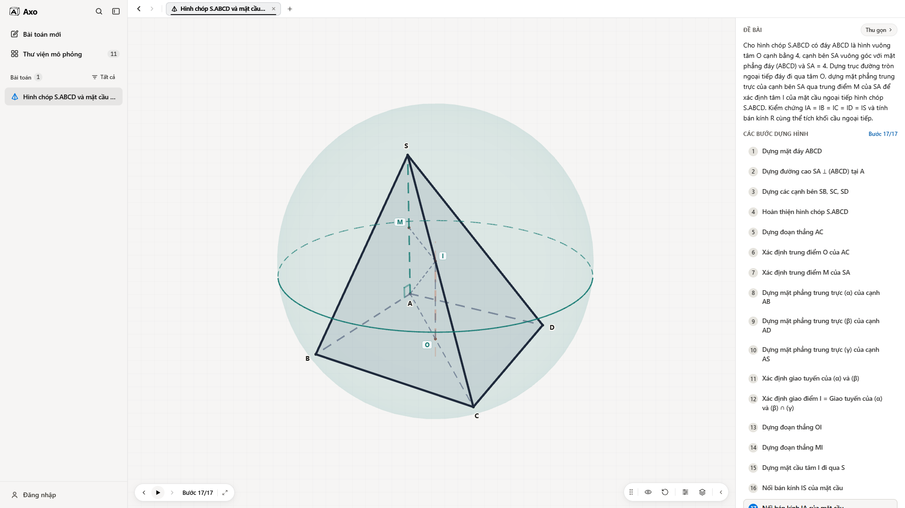 | 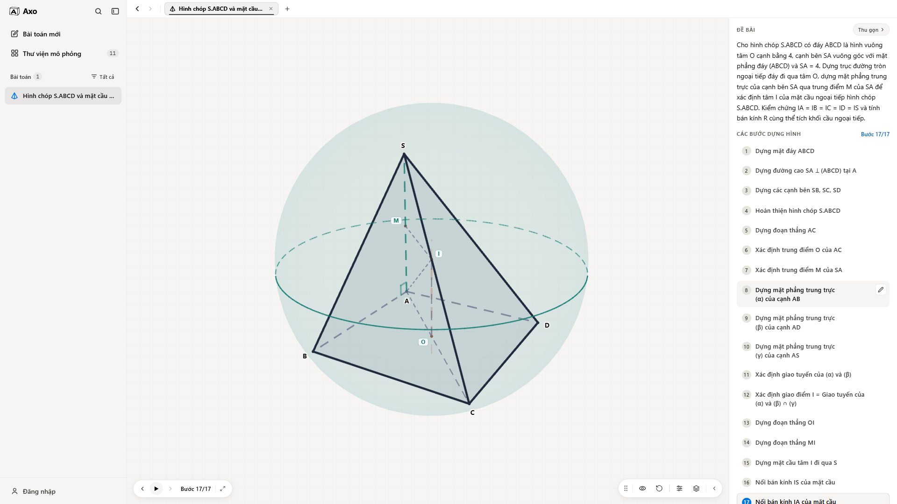 |
| Desktop `1920×1080` Compound Rebuild `(H)` & Sync | 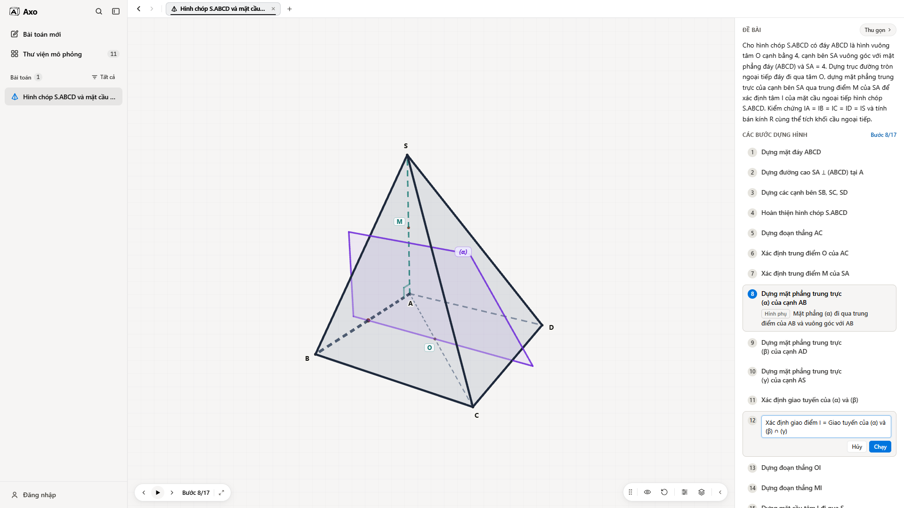 | 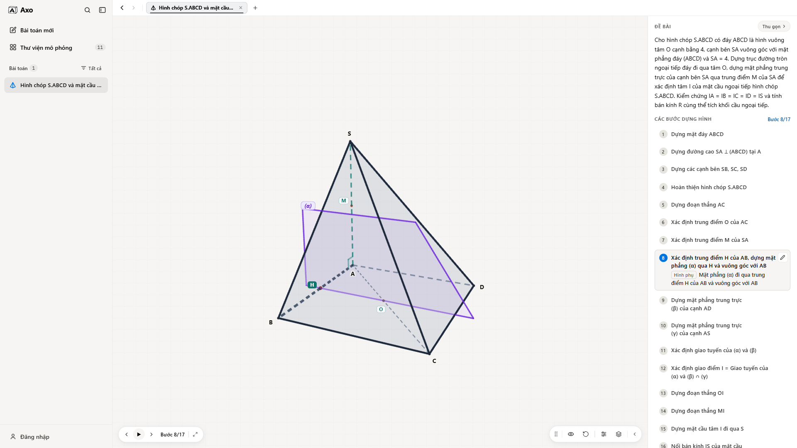 |
| Desktop `1920×1080` Invalid Edit Preserves Draft + Scene | 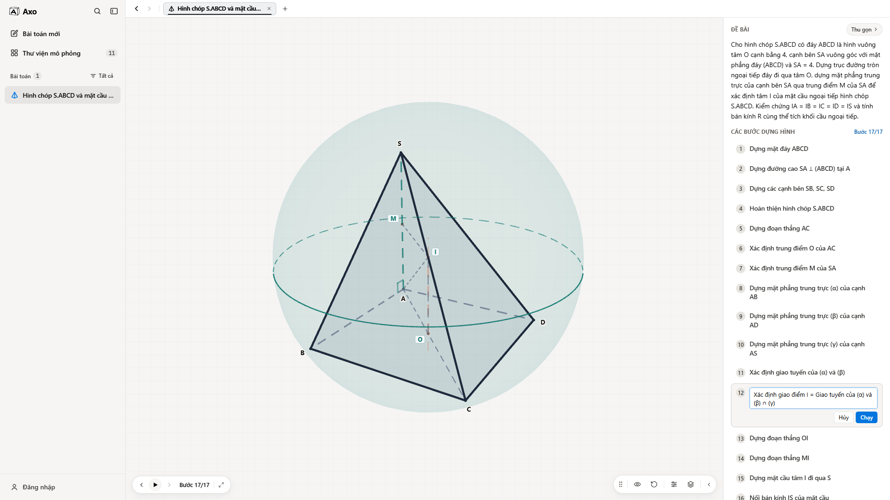 | 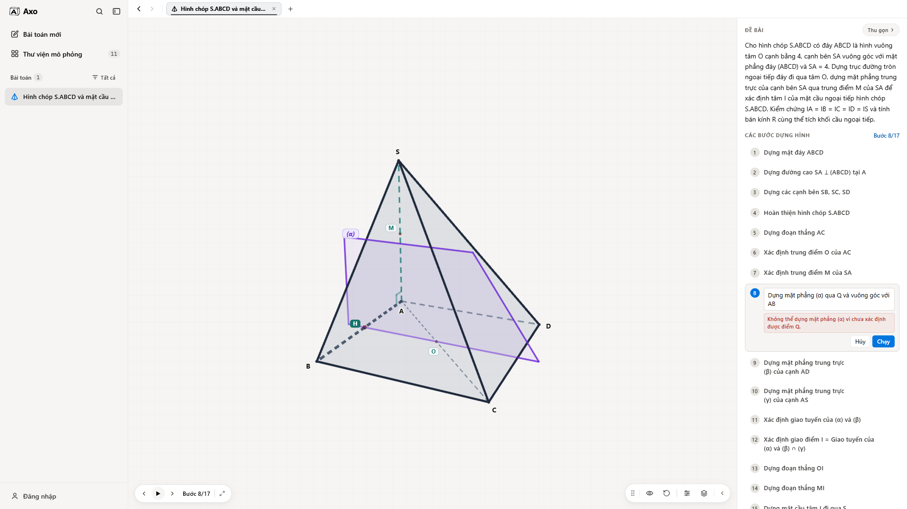 |
| Sample 1 `P` Rebuild `AP = 1/3 AD` (No stale `MENPF`) | 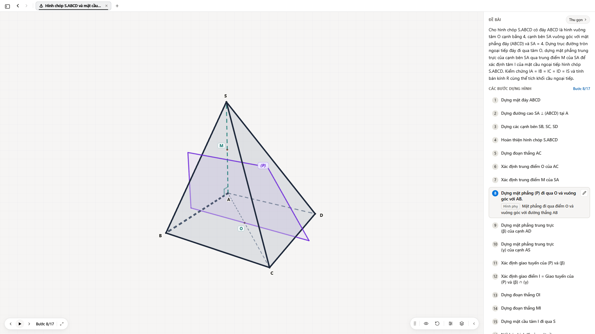 | 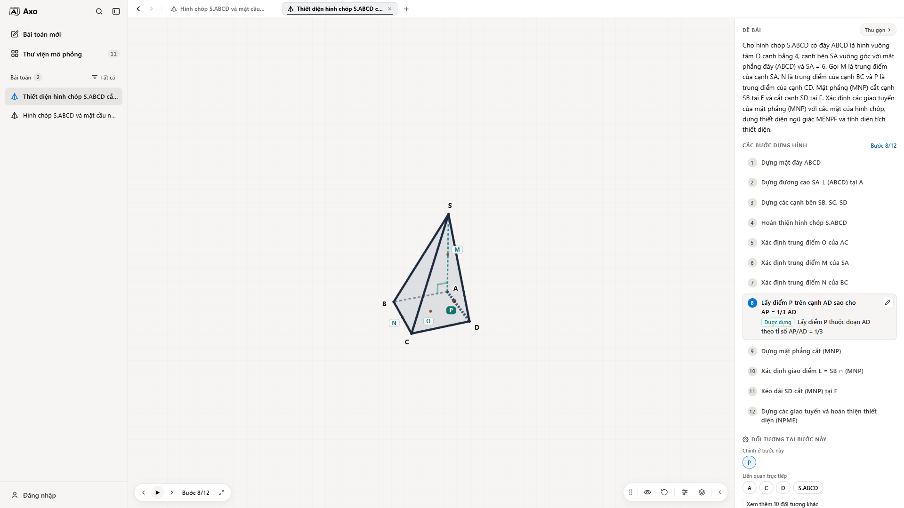 |
| Desktop `1366×768` & Tablet `768×1024` | 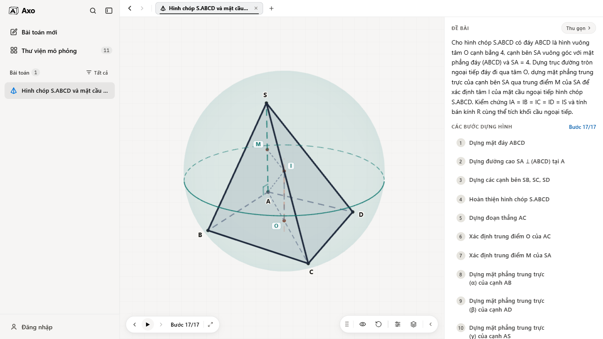 | 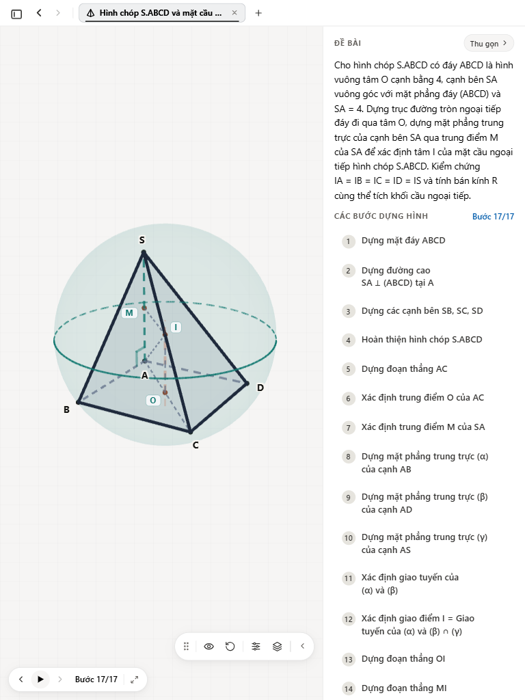 |
| Mobile `390×844` & `320×568` Touch Editor | 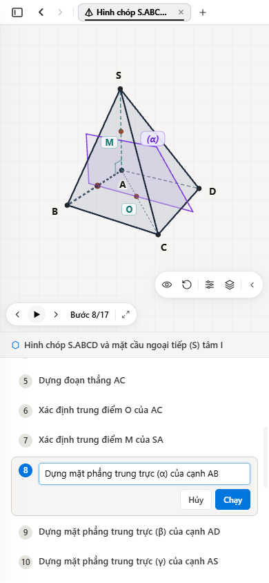 | 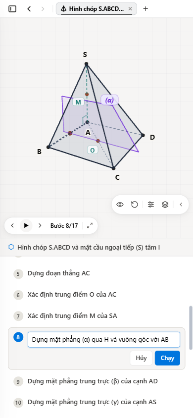 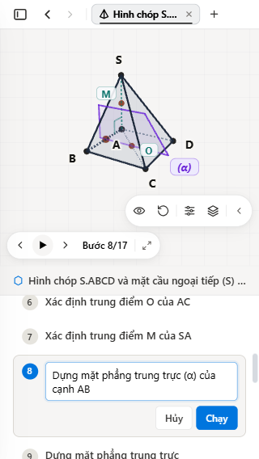 |

- **Quan sát trực tiếp REA MCP (`Chrome/158.0.8127.36`):** `list_browser_targets` (`ev_151f0811e28a120805c1cd7e0f42328727e85ddbd93f3dfe4dac2b4ee2cee12d`, `ev_a1a1ce2b296b69826326f623ab80a6df23e7abc8ae3052da7830db64e5ffd81c`) và `inspect_web_page` (`ev_65f725cd95ea4526765ce56556700917f9a8b10bf940a9a8ebe5b5ea6b3e63b9`) ghi nhận `805` DOM nodes trên `/simulation/pyramid-circumscribed-sphere`, `0` console errors, `0` network errors.

---

## 12. Danh sách phần chưa kiểm chứng — `NOT_VERIFIED`

| Hạng mục | Trạng thái | Giải thích |
|---|---|---|
| Thiết bị cảm ứng & bàn phím ảo vật lý (iOS Safari / Android Chrome thật) | `NOT_VERIFIED` | Chỉ kiểm chứng trên Chromium mobile emulation (`390×844`, `320×568`, kiểm tra bảo toàn bản nháp khi resize). |
| Trọng số mô hình ML cục bộ cho step-editor | `NOT_VERIFIED` (`MODEL_NOT_TRAINED`) | Hệ thống dùng deterministic Vietnamese parser + Exact Kernel (`feedback_dataset.py` ghi rõ `MODEL_STATUS = "MODEL_NOT_TRAINED"`). |
| Toàn bộ bộ fuzz >10,000 test trong `backend/tests/geometry/` | `NOT_VERIFIED` | Tác vụ chạy toàn thư mục đạt ~4% sau ~60s và đã hủy để tránh ~25 phút tranh chấp CPU; đã thay bằng chạy trọn vẹn các bộ targeted + oracle V2.2. |
| Bộ test Classroom / Auth / Attachment của phiên song song | `NOT_VERIFIED` | Nằm ngoài phạm vi Step Editor và thuộc quyền sở hữu của phiên làm việc khác. |
| REA MCP `capture_web_screenshot` trong phiên V2.2 | `NOT_VERIFIED` | Tool timeout do tiến trình Chrome `--hold` 25s đóng ngay trước lệnh chụp; ảnh đã được chụp đầy đủ qua Playwright + kiểm tra DOM sống qua `inspect_web_page`. |

---

## 13. Các rủi ro còn lại — `PASS` / `FAIL (Pre-existing ngoài phạm vi)`

1. **Giới hạn tổng quát hóa hình học (§12):** Dù 26 backend tests, 15 frontend Step Editor tests, 8 edge-case / oracle suites và E2E đạt `PASS`, điều này **không chứng minh** bộ parser và partial rebuild xử lý đúng 100% mọi cách diễn đạt tự nhiên hoặc mọi cấu hình hình học không gian ngoài các phép dựng trong `OP_TO_REGISTRY`.
2. **Import coupling có sẵn (`FAIL` pre-existing ngoài phạm vi):** Test `test_scene3d.py::test_KHONG_module_nao_o_TANG_DUOI_nhap_scene3d` đã `FAIL` từ commit `d0cb1d40f` trước chiến dịch vì `step_editor.py` import từ `app.simulation.semantic_program.scene3d`; không tái cấu trúc tầng module ở lần hardening này để giữ phạm vi an toàn.
3. **Docs audit stale paths ngoài phạm vi (`FAIL` pre-existing ngoài phạm vi):** `audit_docs_information_architecture.py` báo 4 đường dẫn xóa thành phần Classroom/Assign trong `docs/CODE_INDEX.md` thuộc phiên làm việc song song; phần Step Editor trong `CODE_INDEX.md` đã đồng bộ đầy đủ.

---

## 14. Danh sách thay đổi ngoài phạm vi bị chặn — `BLOCKED`

Tuyệt đối không sửa, không stage, không commit các vùng sau:
- **File & hunk phiên song song (77 mục uncommitted):** `backend/app/main.py`, `backend/app/accounts/*`, `backend/app/persistence/classroom_models.py`, `docs/EVIDENCE_INDEX.md`, `frontend/src/components/HomeView.tsx`, `TopNav.tsx`, `Scene3DExplorer.tsx`, `store.ts`, `history.ts`, `ScreenCaptureDialog.tsx`, và ~40 hunk Classroom/Tab không liên quan trong `SimulationWorkspace.tsx`.
- **Landing Page & Auth:** Các route `/`, `/gioi-thieu` (chỉ kiểm tra smoke load `0` page errors) và hệ thống đăng nhập.
- **Pipeline chính thức `Hybrid /4` (`/api/analyze`) & hạ tầng người dùng:** Không sửa `typed_fact_next*`, không đụng tiến trình `[::1]:3001` (PID `2272`), không chạm worktree gốc `D:/Documents/projects/algo-sim`.

---

## 15. Đánh giá điều kiện Merge vào `main` — `READY_FOR_OWNER_REVIEW`

- **Tổng hợp cổng nghiệm thu:**
  - Step Editor V1 UI baseline không hồi quy (hover/focus-visible, auto-resize, `Hủy`/`Chạy`, `StepTitleText`, responsive): **`PASS`**
  - Kiểm chứng đại số chính xác Độc lập (§6), Dependency Graph & Multi-Consumer Section (`MENPF`): **`PASS`**
  - Fail-Closed Server/Client Validation Gate & Async Stale-Response / WebGL Recovery Guards: **`PASS`**
  - Benchmark thực tế Backend + Chrome Live E2E (`19.024 ms` / `41.9 ms` / `149.84 ms` p50): **`PASS`**
  - Phạm vi cách ly không trộn file phiên song song: **`PASS`**
  - Hạng mục ngoài phạm vi / chưa kiểm thiết bị vật lý: **`NOT_VERIFIED` / `BLOCKED`** (ghi nhận minh bạch ở Mục 12–14)
- **Kết luận:** **`READY_FOR_OWNER_REVIEW`** — Đủ điều kiện commit sạch lên nhánh làm việc `feat/axo-geometry-library-verification` để Owner nghiệm thu. **Chưa merge vào `main` và chưa `git push`** theo đúng chỉ thị bàn giao.
- **`OWNER_APPROVAL = PENDING_OWNER_REVIEW`**
