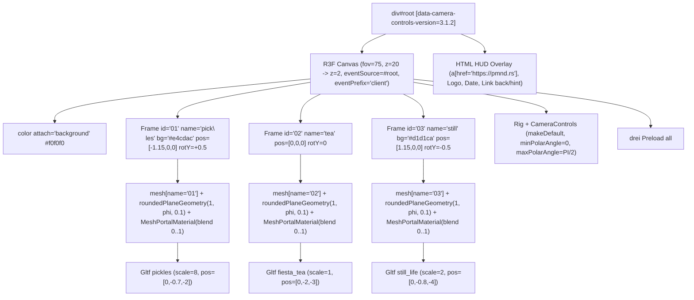

# Báo cáo Reverse-Engineering `pmndrs/examples/enter-portals` (Giai đoạn 1 — REA MCP & Mã nguồn gốc)

> **Phạm vi:** Tài liệu phân tích kỹ thuật phục vụ Gate 1 trên nhánh cô lập `feat/axo-hero-enter-portals` (baseline `bc6ff5e33`). Không chỉnh sửa `main`, `LandingView.tsx`, hoặc nhánh thử nghiệm Hero cũ.

---

## 1. Sơ đồ cấu trúc demo & bằng chứng REA MCP

### 1.1. Bằng chứng REA MCP thu thập từ `https://pmndrs.github.io/examples/enter-portals/`

| Phép đo / Công cụ REA | Evidence ID | Dữ liệu quan sát trực tiếp |
| :--- | :--- | :--- |
| `capture_browser_scenario` | `ev_b4ea01ca22dd74f61f0b61dd24558fffede5e048c2abbf265b42399994330996` | 158 events, 39 HTTP 200 responses, 1 unfinished blob request; xác nhận tải 3 GLB (`pickles...glb`, `still_life...glb`, `fiesta_tea...glb`), Draco 1.5.5 (`draco_wasm_wrapper.js`, `draco_decoder.wasm` từ `www.gstatic.com`), font Inter từ `rsms.me` & `@pmndrs/assets` WOFF chunks. |
| `list_browser_targets` | `ev_7e0aa9cc7af9dbab88a76971f204b7f42810dfa2d82847162d0c0a2b68c1059c` | Chrome `158.0.8127.36` (`target_id: 4C3CA426C0FB2DDB9B8B9C4F444DA4F2`), tiêu đề `Enter Portals — pmndrs examples`. |
| `inspect_web_page` | `ev_f497c13ea690de4c9c1261a1ae086ae4e735a4ce6fb28adf04d91f3b6b4d2a81` | 47 DOM nodes; `#root[data-camera-controls-version="3.1.2"]`; `canvas[data-engine="three.js r186"]`; 21 accessibility nodes (`pmnd.rs dev collective`, `15/06/2023`, `double click to enter portal`). |
| `inspect_web_event_listeners` (`#root`) | `ev_827b3e3b82d197d55fada40209780485bba50b0eaffbea686b2175a761397487` | 153 event listeners gắn trên `#root` (R3F `eventSource={document.getElementById("root")}` gồm `dblclick`, `pointermove`, `pointerdown`, `pointerup`, `pointercancel`, `pointerleave`, `wheel` + listener non-passive `pointerdown`/`pointercancel`/`wheel` từ `CameraControls`). |
| `capture_web_screenshot` | `ev_53f20b7e2c69d5eb16849eb16326224eb3cb9a930137d70347dfb33b583a93d7` | PNG 1440×900 (`sha256: 599841ce6853674ef18c44dfef215f6c8ad687a0e34e8b0c707356eb827ea8b1`, `273,513 B`). |
| `analyze_web_bundle` + `inspect_analysis_view` | `ev_118710a450264b138dab5299ff15cf23edd2780fd5c35f914b89740d39fa31f4` / `ev_dcaa248904caf99f6dcbef4c0c75754eac46d94c7eefa09746d34515fe657254` | Lập chỉ mục 3 script với SHA-256 (`inter_regular`, `inter_medium` hoàn tất; chunk gộp chính `index-tepvWJEw.js` vượt timeout AST mặc định 30s — đối chiếu bù qua mã nguồn gốc chính thức). |

### 1.2. Sơ đồ kiến trúc Scene & DOM



---

## 2. Danh sách Component & Vai trò kỹ thuật

Mã nguồn gốc xác minh tại `https://github.com/pmndrs/examples/tree/main/examples/enter-portals` (`src/index.tsx`, `src/App.tsx`, `src/styles.css`, `src/react-three-fiber-jsx.d.ts`):

1. **`Root` (`src/index.tsx`):** Đọc route `/item/:id` qua `useRoute` và `setLocation` của `wouter`, bọc `<App />` cùng lớp overlay DOM góc màn hình (`pmnd.rs dev collective`, `@pmndrs/branding` `<Logo />`, ngày `15/06/2023`, và liên kết `< back` khi ở `/item/:id` hoặc `"double click to enter portal"` ở trang gốc).
2. **`App` (`src/App.tsx`):** Khởi tạo `<Canvas camera={{ fov: 75, position: [0, 0, 20] }} eventSource={document.getElementById("root")!} eventPrefix="client">`, nền `#f0f0f0`, đặt 3 `<Frame>` theo cung mở đối xứng `[-1.15, 0, 0]` (`rotY = 0.5`), `[0, 0, 0]`, `[1.15, 0, 0]` (`rotY = -0.5`), gắn `<Rig />` và `<Preload all />`.
3. **`Frame`:**
   - Gồm 3 `<Text>` troika-three-text đặt nổi phía trước mặt phẳng Portal (`z = 0.01`): tên (`fontSize = 0.3`, Inter Medium, `[-0.375, 0.715, 0.01]`, `lineHeight = 0.8`), chỉ số `/{id}` (`fontSize = 0.1`, Inter Regular, `[0.4, -0.659, 0.01]`, `anchorX="right"`), và tác giả (`fontSize = 0.04`, `[0.0, -0.677, 0.01]`), tất cả dùng `material-toneMapped={false}`.
   - Hình học khung: `<roundedPlaneGeometry args={[width, height, 0.1]} />` từ `maath/geometry` với tỷ lệ vàng mặc định `width = 1`, `height = 1.61803398875`, bo góc `0.1`.
   - Cổng không gian: `<MeshPortalMaterial ref={portal} events={params?.id === id} side={THREE.DoubleSide} blur={0} resolution={512}>`.
4. **`Gltf`:** Nạp 3 asset GLB nén Draco (`KHR_draco_mesh_compression` + `EXT_texture_webp`) dùng vật liệu `KHR_materials_unlit` — do đó scene gốc **không cần đèn** (`directionalLight`/`ambientLight` không xuất hiện trong `App.tsx`), vẫn lên sắc độ tranh sơn dầu đúng như bản thiết kế GLB.
5. **`Rig`:** Kết hợp `useThree()` (`controls`, `scene`) + `useRoute("/item/:id")` + `<CameraControls makeDefault minPolarAngle={0} maxPolarAngle={Math.PI / 2} />`.

---

## 3. Cơ chế hoạt động của `MeshPortalMaterial`

- `MeshPortalMaterial` (từ `@react-three/drei`) dựng các con (`children`) vào một `WebGLRenderTarget` riêng biệt (FBO) sử dụng thông số camera của scene chính để giữ nguyên **hiệu ứng thị sai phối cảnh (parallax)** khi xoay camera ngoài, tạo ảo giác khung thẻ như một "cánh cửa sổ" mở sang thế giới sâu phía sau (`-z`).
- Tham số **`blend`** điều khiển chuyển tiếp giữa trạng thái cửa sổ (`blend = 0`: nhìn qua lỗ khung) và trạng thái toàn màn hình (`blend = 1`: cảnh bên trong chiếm trọn khung nhìn không còn viền khung):
  ```ts
  useFrame((state, dt) =>
    easing.damp(portal.current, "blend", params?.id === id ? 1 : 0, 0.2, dt),
  );
  ```
- Thuộc tính **`events={params?.id === id}`** bảo đảm các sự kiện chuột bên trong thế giới con của một Portal chỉ được kích hoạt khi người dùng thực sự đã đi vào đúng Portal đó (`/item/:id`), tránh xung đột raycast khi đang ở gallery ngoài.

---

## 4. Tương tác & Responsive quan sát trực tiếp

### 4.1. Quan sát tương tác thực nghiệm (Desktop `1440x900`)

| Thao tác kiểm thử | Kết quả quan sát thực tế | Cơ chế kỹ thuật tương ứng |
| :--- | :--- | :--- |
| Khởi tải trang | Canvas mờ hiện lên mượt (`opacity: 0 -> 1`, CSS `@keyframes fade-in 5s ease 1s forwards`), camera bay từ `z = 20` về `[0, 0, 2]` nhìn `[0, 0, 0]`. | `styles.css` animation + `Rig` `useEffect` gọi `controls.setLookAt(0,0,2, 0,0,0, true)`. |
| Hover ngoài / trên từng Portal (`01`, `02`, `03`) | Ngoài vùng thẻ: `cursor = auto`. Đưa chuột vào từng khung Portal: `cursor = pointer`. | `onPointerOver={() => hover(true)}` / `onPointerOut={() => hover(false)}` + `useCursor(hovered)`. |
| Click đơn lên Portal `02` | Không điều hướng, URL vẫn giữ gốc, chữ góc trên giữ nguyên `double click to enter portal`. | Chỉ đăng ký `onDoubleClick`, không gắn `onClick`. |
| Double-click Portal `02` (`/01`, `/03`) | URL chuyển `/item/02` (`/item/01`, `/item/03`), chữ góc trên trái đổi thành `< back`, `blend` mở ra toàn cảnh (`0 -> 1`), camera trượt vào trước cảnh `tea`. | `e.stopPropagation(); setLocation("/item/" + e.object.name)` kích hoạt `Rig` chuyển mục tiêu camera theo không gian cục bộ của Portal. |
| Kéo chuột (orbit drag) sau khi vào Portal | Góc nhìn xoay tự do quanh vật thể bên trong (`CameraControls`) với trục dọc khóa ở bán cầu trên (`0 .. PI/2`). | `CameraControls` gắn non-passive pointer/wheel listeners trên `#root`. |
| Click `< back` | URL quay về `/`, `blend` thu về `0`, camera trượt ngược ra gallery 3 khung Portal. | `setLocation("/")` -> `params` về `null`. |

### 4.2. Kiểm tra Responsive (Giới hạn của bản gốc)

- **Tablet `768x1024`** (`ref-tablet-768x1024.png`) và **Mobile `390x844`** (`ref-mobile-390x844.png`): `overflowX = 0`, canvas co giãn theo 100% viewport. Tuy nhiên vì camera gốc cố định `fov = 75`, vị trí `[0, 0, 2]` và vị trí Portal cố định ở `x = ±1.15`, nên ở màn hình dọc hẹp **hai Portal trái (`/01`) và phải (`/03`) bị cắt xén ở hai mép màn hình** (đặc biệt trên `390x844` chỉ còn thấy dải màu rìa của `01` và `03`).
- Ghi nhận rõ: **Bản gốc không có logic responsive 3D framing**; Gate 1 tái tạo trung thực điểm này, và chỉ điều chỉnh khi bước sang Gate 2 (Axo Hero) nếu Owner duyệt.

---

## 5. Cấu hình Camera & Animation chi tiết

- **Canvas Camera khởi tạo:** `fov = 75`, `position = [0, 0, 20]`.
- **Rig trạng thái Gallery (`!params?.id`):**
  - Camera: `(0, 0, 2)`, Focus target: `(0, 0, 0)`, `enableTransition = true`.
- **Rig trạng thái Entered Portal (`params?.id`):**
  - Tìm node `<mesh name={id}>` qua `scene.getObjectByName(params.id)`.
  - Biến đổi điểm local trên parent `<group>` sang tọa độ thế giới:
    - Camera position: `active.parent.localToWorld(position.set(0, 0.5, 0.25))`
    - Focus target: `active.parent.localToWorld(focus.set(0, 0, -2))`
- **Portal dissolve:** `easing.damp(portal.current, "blend", params?.id === id ? 1 : 0, 0.2, dt)` (half-life `0.2s` từ `maath/easing`).

---

## 6. Thành phần có thể tái sử dụng vs Chỉ dùng ở Gate 1

- **Tái sử dụng cho Gate 2 (Axo Hero):** Mô hình kiến trúc `<Frame>` + `<MeshPortalMaterial>` + `easing.damp` `blend` + `Rig` chuyển góc nhìn bằng `localToWorld` + `CameraControls` + tách biệt DOM/3D events (`eventSource`).
- **Chỉ giữ ở Prototype Gate 1 (bỏ ở Gate 2):** 3 file GLB đồ dùng bếp (`pickles`, `tea`, `still_life` kèm text tiếng Anh `"double click to enter portal"` / `"pmnd.rs dev collective"`), `@pmndrs/branding` `<Logo />`, toàn màn hình `100vw x 100vh`, và định tuyến URL `/item/:id` toàn trang gây xung đột với Router hiện hữu của Axo (ở Gate 2 nên dùng local React state hoặc callback được kiểm soát trong vùng phải Hero).

---

## 7. Ánh xạ Dependency tương thích Axo (`react@18.3.1`, `three@^0.185.1`)

| Thư viện | Bản gốc (`package.json`) | Nhánh Gate 1 (tương thích React 18) | Ghi chú tương thích |
| :--- | :--- | :--- | :--- |
| `react` / `react-dom` | `19.2.9` | `^18.3.1` (giữ nguyên của Axo) | Không nâng cấp React để bảo toàn toàn bộ hệ thống Axo. |
| `three` | `0.186.1` | `^0.185.1` (giữ nguyên của Axo) | Peer dependency `@react-three/fiber@8` yêu cầu `>=0.133`, `drei@9` yêu cầu `>=0.137`. |
| `@react-three/fiber` | `9.8.2` (React 19 only) | `8.18.0` (`>=18 <19`) | Hỗ trợ React 18 với API `Canvas`, `extend`, `useFrame`, `useThree` tương đương. |
| `@react-three/drei` | `10.7.9` (R3F v9 only) | `9.122.0` (`@react-three/fiber ^8`) | Cung cấp `MeshPortalMaterial`, `CameraControls`, `Gltf`, `Text`, `Preload`, `useCursor`. |
| `maath` | `^0.10.x` (ngầm qua example) | `0.10.8` | Cung cấp `easing.damp` và `geometry.RoundedPlaneGeometry`. |
| `wouter` | `^2.12.1` | `2.12.1` | Tái tạo đúng hành vi URL `/item/:id` trên HTML entry riêng ở Gate 1. |
| `suspend-react` | `0.1.3` | `0.1.3` | Nạp bất đồng bộ module font từ `@pmndrs/assets`. |
| `@pmndrs/assets` / `@pmndrs/branding` | `^1.6.0` / `^0.0.8` | `1.6.0` / `0.0.8` | Inter WOFF và logo pmndrs cho bản dựng đối chiếu Gate 1. |

---

## 8. Rủi ro kỹ thuật & Giấy phép tài nguyên

- **Mã nguồn mẫu (`pmndrs/examples`):** Giấy phép **MIT License** (`Copyright (c) 2024 Poimandres`) — cho phép tái sử dụng, chỉnh sửa, giữ nguyên thông báo bản quyền.
- **3D Models (`.glb`):**
  - `pickles_3d_version_of_hyuna_lees_illustration-transformed.glb` (`153,628 B`):Header GLB ghi `Omar Faruq Tawsif`, giấy phép `CC-BY-4.0`.
  - `still_life_based_on_heathers_artwork-transformed.glb` (`363,456 B`): Header GLB ghi `Omar Faruq Tawsif`, giấy phép `CC-BY-4.0`.
  - `fiesta_tea-transformed.glb` (`2,284,160 B`): **Lưu ý kiểm toán:** Header JSON GLB đã biến đổi không còn trường `asset.extras` (author/license), dù `src/index.tsx` gốc ghi nhận chung cho Omar Faruq Tawsif (`CC-BY-4.0`). Chỉ sử dụng tạm để đối chiếu Gate 1, **không** đưa vào bản tích hợp Hero Axo ở Gate 2.
- **Font Inter (`@pmndrs/assets`):** Giấy phép SIL Open Font License 1.1.
- **Draco WASM Decoder:** Mẫu gốc tải từ CDN `https://www.gstatic.com/draco/versioned/decoders/1.5.5/`. Trong prototype Gate 1 sử dụng bộ giải mã Draco glTF nội bộ sao chép từ `three/examples/jsm/libs/draco/gltf/` tại `/draco/` để chạy offline tin cậy và tránh phụ thuộc mạng ngoài.
- **Rủi ro API Drei v9 vs v10 / Three r185 vs r186:** Cần kiểm chứng thực tế `MeshPortalMaterial`, `CameraControls`, `THREE.Clock` deprecation warning và thuộc tính JSX `roundedPlaneGeometry` khi chạy Vite + Chrome thực tế.

---

## 9. Những điểm chưa thể xác minh tại bước phân tích tĩnh

1. Chunk `index-tepvWJEw.js` (minified bundle đầy đủ của live demo) chạm giới hạn thời gian `analysis_timeout_ms = 30000 ms` của REA `analyze_web_bundle` nên chỉ lập chỉ mục SHA-256 ở mức `source` (`status: "unavailable", reason: "deadline"`); logic chi tiết đã được xác minh trực tiếp qua mã nguồn gốc tại `pmndrs/examples/examples/enter-portals`.
2. Số liệu FPS trên GPU phần cứng thật và độ mượt cảm ứng trên thiết bị di động thật **chưa được đo** (phiên REA/Playwright chạy trên Headless Chromium Desktop).
